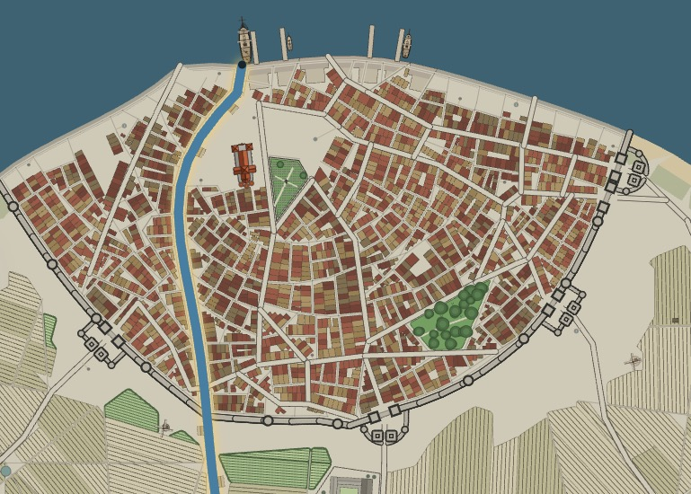
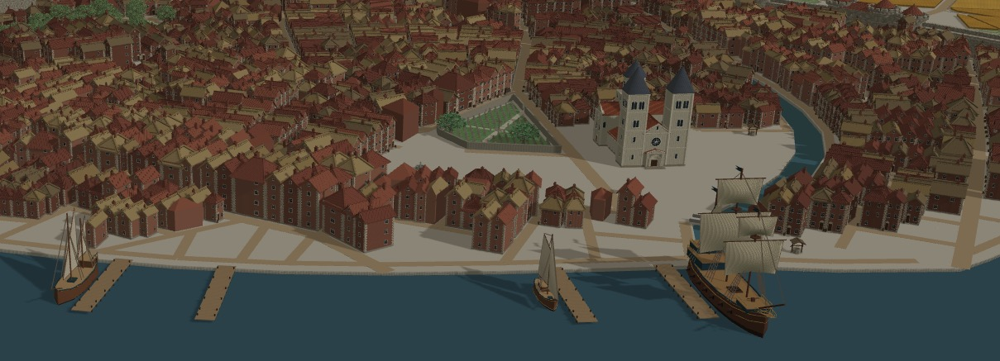
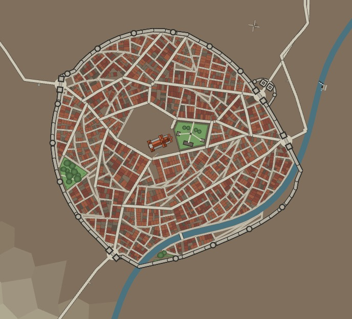
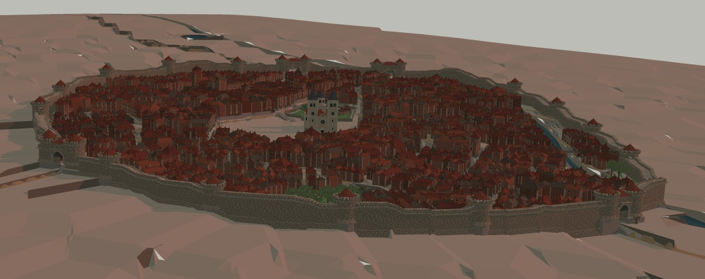
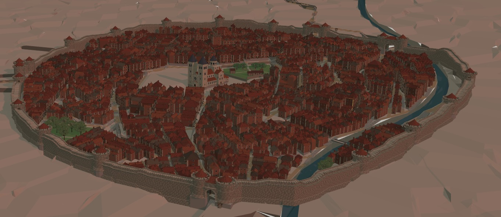
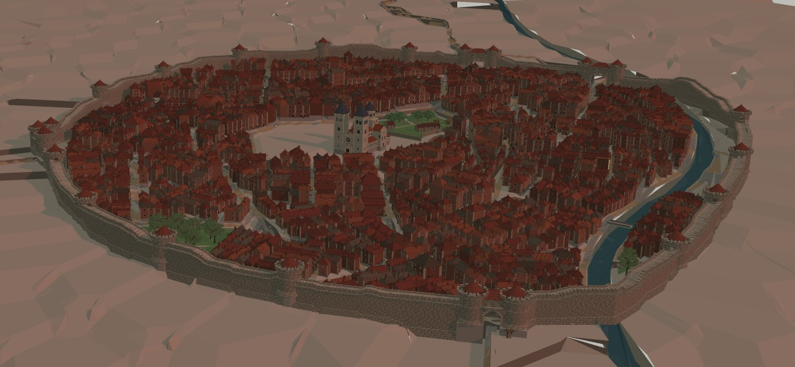
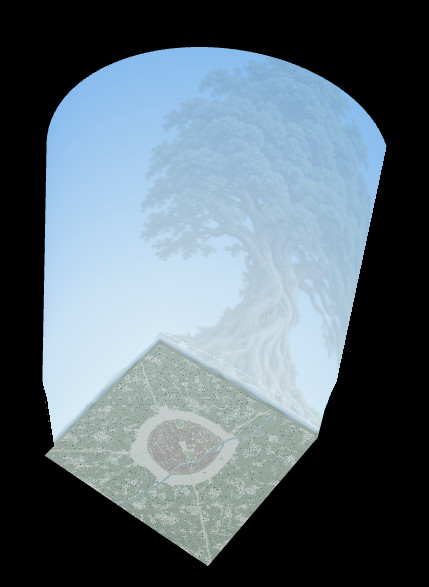
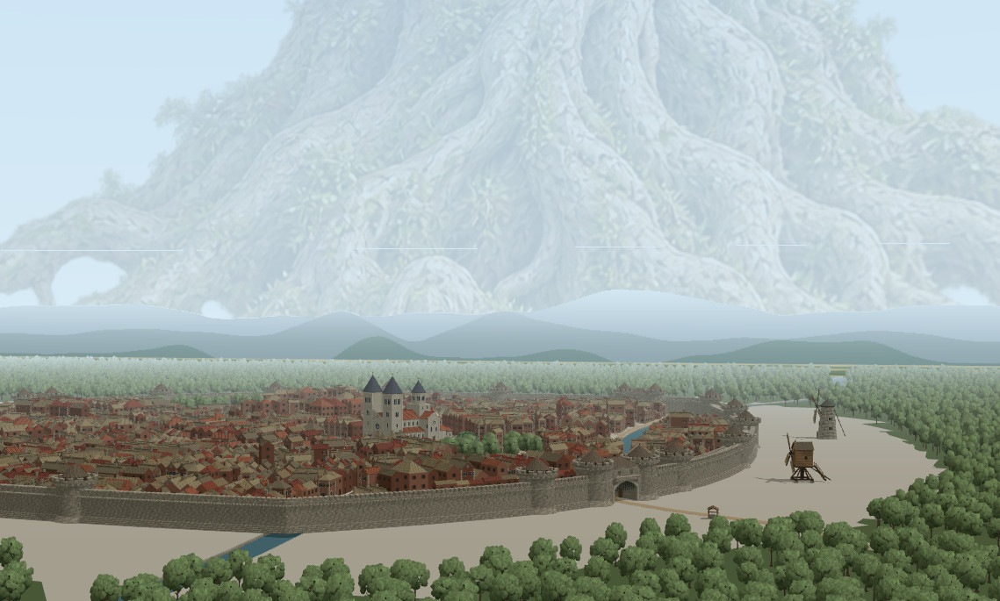

# Fantasy Map Generator

Azgaar's _Fantasy Map Generator_ is a free web application that helps fantasy writers, game masters, and cartographers create and edit fantasy maps.

## City Editor

### Port sample

### Slope sample

### Forest / Fog / Wallpaper

