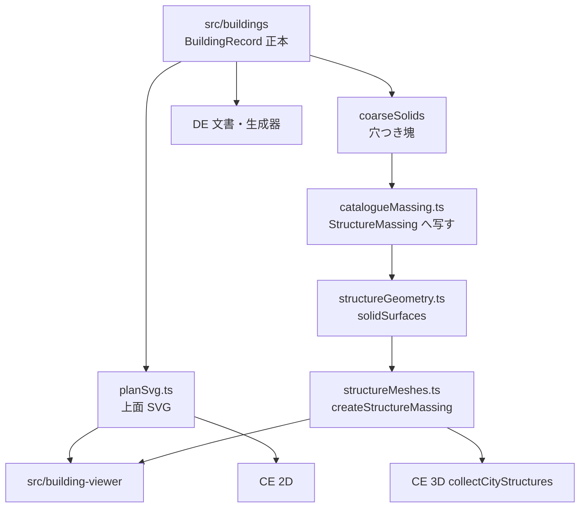

# 建造物正本と建造物ビューワー

- 日付: 2026-10-17
- 状態: Draft
- 著者: placeholder

## 概要

City Editor（CE）のヨーロッパ中世城は、上面 SVG を手続きで組む `FortressPlan`（`src/city-editor/renderers/castleLayoutBuilder.ts`）か、`classic` の矩形部品である。写真や測量で知る城と平面が一致しない。本設計は、実在の城から採ったメートル寸法を粗い多角形にした建造物記録を正本にし、そこから三つの投影だけを作る。

1. CE と新しいビューワが共有する粗い 3D マッシング。押し出しは既存の `src/city3d` を拡張する。
2. 同じ足跡から生成する正射上面 SVG。CE の 2D で、対象になる手続き城を置き換える。
3. Dungeon Editor（DE）が読む・編集する文書。現行の `DungeonDocument`（`format: "fmg-dungeon-editor"`, `version: 1`）は初期の仮モデルであり、正本にしない。合わせられないなら文書を置き換える。読み取りアダプタは持たない。

第 1 弾の名前は中世ラテン・ヨーロッパの城 9 件。同梱してポリゴンを確定するのは 8 件である。ボディアムは四角形の候補として表に残し、公表された矩形と塔径が一つの平面に閉じないため PR 5 では JSON にしない。修道院・住宅・水車はスキーマだけ通し、エントリは作らない。初期メッシュは粗い塊で足りる。

## 背景と動機

### 時代の呼び方

プロジェクトの Historical period は `src/types/historicalPeriod.ts` の `HISTORICAL_PERIODS` が正である。表示年は `src/i18n/locales/en.json` の通り、城郭史でよく使う区切り（前期を 1100 年頃まで）とは違う。

| id | 表示 | 年 |
| --- | --- | --- |
| `earlyMedieval` | Early Medieval | c. 500–1000 |
| `highMedieval` | High Medieval | c. 1000–1300 |
| `lateMedieval` | Late Medieval | c. 1300–1500 |

`period` の型は `HistoricalPeriod` のままである。後の住宅や水車が古代や近世を指せるようにするため、型を中世 3 値に縮めない。カタログ城（`kind: "castle"` かつ `generation` なし）の検証だけが、`earlyMedieval` | `highMedieval` | `lateMedieval` を要求する。11 世紀前半の石造ドンジョンは、城郭史では初期でも、ここでは `highMedieval` である。`langeais-keep` だけが `earlyMedieval` の記録である。この記録は、前期の地図が自動で出すモットの代わりにはならない。届く条件は配置の節に書く。

`resolveCastleStyle`（`src/city-editor/renderers/castlePatterns.ts`）は、城に明示された `castleStyle` があればそれを返す。無ければ城郭伝統を見る。`japanese` は `japanese-shiro`、`classical` は `ancient-castra` か `late-roman-walled-town`、`sinitic` は `classic`、`earthwork` は `motte-bailey`、`islamic` は時代により `bastion-citadel` か `islamic-qalat` である。ヨーロッパ系の時代既定は `earlyMedieval` → `motte-bailey`、`highMedieval` → `norman-keep`、`lateMedieval` → `concentric`、大航海時代以降は `bastion-citadel` である。`classic` は時代の既定ではない。

### 今の城がどう描かれるか

`CastleStyle`（`src/city-editor/types/contracts/castlePatterns.ts`）は `classic`、`norman-keep`、`motte-bailey`、`concentric`、`bastion-citadel`、`japanese-shiro`、`islamic-qalat`、`ancient-castra`、`late-roman-walled-town`。

`renderCastle`（`src/city-editor/renderers/castleSvg.ts`）は `classic` だけ `renderClassicCastle` に入り、それ以外は `buildFortressPlan` の縄張を描く。3D は `addFortress`（`src/city-editor/renderers/structureMassing.ts`）が同じ分岐で、`classic` は `CastlePart` の足跡、それ以外は `FortressPlan` の塔と建物を `StructureMassing` にする。天守 18 m、小天守 12 m、広間 9 m など高さは様式ではなく種類の定数である。

カタログを探すのは、解決済み様式が `classic`、`norman-keep`、`concentric` のいずれかで、かつ `document.civilization.fortification !== "sinitic"` のときだけである。`sinitic` は解決結果が `classic` でも手続きの `renderClassicCastle` のままである。ヨーロッパの `earlyMedieval` は自動で `motte-bailey` なので候補に入らない。石造キープをモットの上に描かない。`japanese-shiro`、`bastion-citadel`、`islamic-qalat`、`ancient-castra`、`late-roman-walled-town` も手続きのままである。明示の `castleStyle` が `classic` / `norman-keep` / `concentric` なら、`sinitic` 以外の伝統の上でも候補になる。明示が無ければ時代既定の `norman-keep` と `concentric` だけが候補になる。

`isNewStyleCastleWall` と `isNewStyleCastleCircuit`（`src/city-editor/renderers/castleStyle.ts`）は `profile.style !== "classic"` のときだけ真である。`featureLayerSvg.ts` は真の壁グループのストロークを省き、`townFortificationSvg.ts` は真の回路の隅塔と、真の壁の間隔塔を省く。`classic` はこの省略に入らない。カタログを載せた `classic` の城は、この判定を真に変えて省くのではなく、配置フィールドを見た生産者側で省く。`isNewStyleCastleWall` を `classic` について真にすると、間隔塔の間隔など新様式側の挙動まで変わる。

### 郭の寸法は城ごとに変わる

城の場所は `src/city-editor/generators/castlePlacement.ts` が決める。目標面積 `castleTargetArea` は tiny 1800、small 4000、既定 9000、large 18000 m²。最低面積 `minArea` は 1200、2500、5000、10000 m²。独立城は一辺 `sqrt(target)` の箱を切るので、既定で約 95 m、large で約 134 m、tiny で約 42 m、small で約 63 m である。

建物の枠は `layoutCastle`（`src/city-editor/generators/castleLayout.ts`）が、城壁を 4 m 縮めた核の中で半寸法 h を 48 m から 13 m まで探す。全体は最大で約 110 m × 96 m。コメントのとおり 13 m は通常のベイリー枠の下限で、集落の小さい郭はさらに小さい。核の多角形は `insetConvexKernel`（`src/city-editor/generators/lotGeometry.ts`）である。

実在の城は固定メートルである。郭に合わせて縦横を別々に伸ばすと、正本が二つになる。

### 3D の器

`docs/plan/ce-3d-building-massing.md`（2026-10-17）が CE 単体の M0–M3 を決めている。実装先は `src/city3d`。ビューアは `WebGLRenderer`。構造物は `StructureMassing`（`src/city-editor/types/contracts/structureMassing.ts`）で、`structureSurfaces`（`src/city3d/core/structureGeometry.ts`）が帯の押し出しと、穴なし足跡の `buildingSurfaces`（`src/city3d/core/massingGeometry.ts`）を使う。軸は `planVertex`（`src/city3d/core/planFrame.ts`）のとおり、three.js の X が平面 X、Y が高さ、Z が `-planY` である。実装コメントが正であり、平面の +Y は画面の上に残る。M4 以降（LOD 書き出し、FMG 3D、RE 3D）はこの設計の範囲外である。Babylon も、第二のメッシュライブラリも足さない。

`StructureKind` は `wall` | `tower` | `gate` | `bridge` | `landmark` である。`range` は無い。`StructureMaterial` は `stone` | `wood` だけである。`StructureRoof` は `none` | `flat` | `gable` | `hip` | `pyramid` で、`cone` は無い。`parapet` は `none` | `outer` | `both` の必須フィールドで、`parapetMeters` と `parapetWidthMeters` を伴う。`spire` は足跡の重心に立つ円錐である。`StructureMassing` は都市文書には保存しない。

`StructureMassing.footprint` のコメントは "Holes are not cut out." `structureSurfaces` は足跡があると `buildingSurfaces(structure.footprint, ...)` を呼ぶ。`earClip` は単一リングだけを三角形化し、`cross2 <= 1e-8` の耳を捨てる。幅ゼロの橋は、重複する同一直線上の頂点になり、耳が残らず空または壊れたメッシュになる。`createStructureMassing`（`src/city3d/three/structureMeshes.ts`）は `structureSurfaces` だけを呼び、本体メッシュと屋根メッシュを一つずつ、頂点色と `buildingIndex` と `MeshLambertMaterial` で出す。レンダラはフォークしない。中庭のある塊を今の足跡のまま押し出すと中庭が埋まる。穴の分岐は `structureSurfaces` に足す。

`collectCityStructures` の順は、壁の準備、`curtainTowers`、`cornerTowers`、`addGates`、壁の中心線、橋、ランドマーク、寺院、`addFortress` である。`curtainTowers` は `isNewStyleCastleWall` の壁だけ間隔塔を省き、中心線はそのあとで `classic` にも新様式にも積まれる。`cornerTowers` は `isNewStyleCastleCircuit` の回路を省く。`addGates` は `isNewStyleCastleGate` の門だけ脇塔を省く。`classic` の門は脇塔と楣が残る。カタログ配置がある城では、これらの生産者をその城について止める。止める一覧は配置の節に書く。

### ランドマークは正本にならない

`LandmarkAsset` / `LandmarkInstance` は都市文書 version 3 以降のスタンプである（`src/city-editor/types/document.ts`）。一つの資産は複数の `LandmarkPolygon` を持てる。`addLandmarkPolygons` は各 `outer` を別々に押し出し、`LandmarkPolygon.holes` は見ない。高さは `footprintHeight` が `Math.min(22, Math.max(7, Math.sqrt(Math.abs(polygonArea(ring))) * 0.55))` で決める。一つの屋根面に穴を開けた城、ではない。パンテオン、サン・ヴィターレ、シャルトルは `src/city-editor/assets/PROVENANCE.md` にある概形試作であり、測量復元ではない。

`docs/city-editor/plan/historic-landmarks.md` はウィンザーを、後世の増改築を分けられるまで不採用（優先度 B）としている。本設計でも分けない。カステル・デル・モンテとコンウィは、その文書の第二波の名前であり、確定したランドマーク資産ではない。カステル・デル・モンテは本設計では `BuildingRecord` として入れる。ランドマーク資産としては入れない。

ランドマーク SVG は階ごとの平面と高さをもたない。城だけの型にすると、後の住宅・水車と DE の床が別形式になる。カタログ城は `LandmarkAsset` ではない。必要なら後から屋根外形と SVG をランドマークへ射影できるが、その射影は正本ではない。

### DE の現行文書が足りない理由

`src/dungeon-editor/README.md` と `docs/plan/dungeon-editor.md` は、状態を「単層・矩形区画の初期版」と書いている。`src/dungeon-editor/core/types.ts` の `DungeonDocument` は `format: "fmg-dungeon-editor"`、`version: 1`。`validateDocument`（`src/dungeon-editor/core/document.ts`）が次を拒否または固定している。

- 階はちょうど 1。複数階はエラー。
- 頂点は 0.25 m 格子、枠は 1〜250 m。
- 壁は軸並行で、長さ 0.25 m 以上。斜めはエラー。
- 空間の面積がバウンディングボックスと一致しなければならない。矩形以外はエラー。
- 壁厚は 0.25〜2 m。カーテンの 3〜4.7 m は不正。
- 開口は `door` | `gate` | `arch` のみ。窓も狭間もない。
- 階段・梯子・スロープがない。
- 屋根形式、材料、由来、階高がない。`elevationMeters` は階に一つあるだけ。
- 家具は `well` | `table` で `blocking: false` 固定。
- 空間は部屋のグラフで、壁は共有辺（`Boundary` の `leftSpaceId` / `rightSpaceId`）である。中庭の穴をもつ壁のソリッドを書けない。
- 生成メタデータが必須で、`algorithmVersion` は `"dungeon-v1"`、`attempt` は 0〜31、`settings` は型付きの `GenerationSettings`、戦略は `caravanserai` | `room-corridor` だけ。

`GenerationSettings` のフィールドは `strategy`、`seed`、`widthMeters`、`depthMeters`、`courtyardWidthMeters`、`courtyardDepthMeters`、`roomBandDepthMeters`、`minRoomWidthMeters`、`corridorWidthMeters`、`entranceWidthMeters`、`outerWallMeters`、`partitionWallMeters`、`roomCount`、`loopCount`、`entranceSide`（`north` | `east` | `south` | `west`）、`symmetric`、`fixtures` である。`isGenerationSettings`（`src/dungeon-editor/core/gen/settings.ts`）がこの並びを見ている。

開口は加えて `state`（`open` | `closed` | `locked`）、`visibility`（`visible` | `secret`）、`locked` をもつ。`Entrance.role` は `main` | `secondary` で、`setMainEntrance` が一つを `main` にし残りを `secondary` にする。`connectivity.ts` の `buildAccessGraph` は、`mode !== "structural"` のとき `visibility === "secret"` の開口を通さない。`current` では `arch` か `state === "open"` だけを通す。

生成器（`src/dungeon-editor/core/gen/pipeline.ts`、`boundaries.ts`、`caravanserai.ts`、`roomCorridor.ts`）は矩形の `rect` からそのグラフを作る。`commands.ts` の `edit` は `levels[0]` だけを渡す。`moveBoundary` は直交で同一直線上の辺の鎖を、ロックされた開口が無い前提で動かす。

`renderDungeonSvg`（`src/dungeon-editor/render/svg.ts`）は `levels[0]` の `spacePolygon` から多角形を組む。置換後は `src/buildings/planSvg.ts` の階平面を呼ぶ。ラベル、選択、ヒット対象は DE のラッパに残す。`spacePolygon` を第二の幾何モデルとして残さない。

この型へ城を押し込むアダプタは、八角・円・アプス・複数階・厚い壁・階段を捨てる。それは「階段を落とすアダプタ」であり、採用しない。`fmg-dungeon-editor` version 1 を読むアダプタも置かない。古いファイルは拒否する。正本を DE が読む。手続きダンジョン（隊商宿、部屋と通路）は残すが、同じ文書形を出す。ダンジョン形式は二つにしない。

## 目的と非目的

### 目的

- メートルの建造物記録を、CE・ビューワ・DE の上流に置く。モジュールは `src/buildings`。`src/city-editor` と `src/dungeon-editor` に依存しない。
- 第 1 弾のうちポリゴンが閉じた 8 城を、公開された寸法と平面の記述から書いた粗い多角形として同梱する。図面のトレースは同梱しない。ボディアムは寸法が一つの組に閉じるまで同梱しない。
- 記録から上面 SVG と粗い 3D を再生成できること。配置の節の条件を満たし尺度が帯に入る城だけ、手続き縄張と重ねずにこの投影を描く。
- ビューワ `building-viewer`（建造物ビューワー）で、一覧、オービット、上面図、階、由来、メートル寸法を見る。
- DE の保存形式をこの記録に合わせる。旧 v1 は読まない。

### 非目的

- 細かいメッシュ、写真テクスチャ、家具、狭間やマチコレーションの個別形状。`BuildingRecord` に胸壁フィールドは無い。v1 のカタログ投影は `StructureMassing.parapet` を `"none"` にし、`parapetMeters` と `parapetWidthMeters` を 0、`spire` を false にする。狭間の幾何は記録しない。
- 修道院・住宅・水車のカタログエントリ。`kind` に語を足し、`planFamily` は省略か `"other"` で足りるようにする。
- FMG の viewMesh への配置、RE の 3D。マッシング計画の M4 以降のまま。
- `src/city-generator` の編集。
- 非ヨーロッパ中世様式と、自動の `motte-bailey` の置換。`sinitic` の `classic` も置換しない。
- 橋の斜角ポリシー（`src/utils/bridgeSkewPolicy.ts`）の変更。
- 現行 DE 型との互換を残すこと。v1 の読み取りアダプタを含む。
- v1 のメッシュに開口を彫ること。窓、狭間、扉は記録と階平面 SVG に残し、押し出しは壁を欠かない。

## 提案する設計

### 名前

英語 id は `building`。ビューワは `building-viewer`。日本語では建造物ビューワーと呼ぶ。比較は Key Decisions に書く。`fabric` は CE の街区ファブリック（`buildBlockFabric`）が使っているので使わない。`monument` は住宅と水車を外すので使わない。

### 依存の向き



`src/buildings` は `src/types/historicalPeriod.ts` の `HistoricalPeriod` だけを外に頼ってよい。three.js、`StructureMassing`、都市文書、ダンジョン文書は import しない。

`src/city3d` は既に CE の型を import している。`BuildingRecord` から `CoarseSolid` を作るのは `src/buildings/coarseSolids.ts` である。`CoarseSolid` から `StructureMassing[]` へ写し、穴つき押し出しへ渡すのは `src/city3d/core/catalogueMassing.ts` である。どちらも PR 2 で置く。CE とビューワは `catalogueMassing` を呼ぶ。`src/buildings` は `StructureMassing` を知らない。

### 正本と派生

権威があるのは記録の次のフィールドである。id、revision、kind、period、planFamily、occupancy、approachAzimuthRadians、levels（標高、階高、床板、壁ループ、開口、開放接合、家具）、verticalLinks、roofs、materials、provenance、placementStyles。手続きダンジョンだけ `generation` をもつ。

`contentHash` は、上記から `contentHash` 自身を除いた正規化 JSON の SHA-256 である。記録に保存するダイジェストであり、幾何の複製ではない。メッシュ、上面 SVG、`StructureMassing[]` は記録に保存しない。再計算したダイジェストが保存値と一致しなければならない。

正規化は `src/buildings/canonicalJson.ts` の `canonicalJson` 一つに置く。`validate.ts` と `scripts/build-building-plan-svg.ts` は両方これを呼ぶ。別々の `JSON.stringify` は使わない。

- オブジェクトのキーは、入れ子も含め、UTF-8 の辞書順にソートする。配列の順序は保つ。リングは順序が意味を持つ。
- 数値は先に `Object.is(n, -0)` を 0 にする。それから `Math.round(n * 1e6) / 1e6` で 1e-6 に丸め、丸めの結果の -0 も 0 にする。
- 安全整数の範囲に入り、丸め後が整数の値は、小数も指数も付けない（`16`。`16.0` も `1.6e1` も書かない）。それ以外は、丸め後の値の末尾ゼロの無い最短形を書く（`16.5`。`16.50` は書かない）。
- `NaN` と `Infinity` は検証が拒否する。シリアライザはそれらを出さない。
- UTF-8、無意味な空白は入れない。

`revision` は著者が幾何を変えたとき上げる整数。CE の配置、同梱 SVG の `data-revision` と `data-hash`、ビューワの表示は同じ組を持つ。どれかが違えば、その城は描かず手続きへ戻す。別 revision の幾何に `uniformScale` を掛けない。

都市のセーブには記録本体を埋めない。`CastlePlan` に変換だけを足す。カタログはアプリに同梱する。ランドマークのように資産 JSON を文書へ複製しない。城は生成物であり、スタンプの持ち歩きではない。

### 型

座標はメートル。原点は城ごとのローカル原点で、provenance に「どの点を原点にしたか」を書く。カタログ城では、occupancy のバウンディングボックスの中心が原点から 0.05 m 以内である。回転とスケールはこの原点のまわりで、中心がずれない。+X を東、+Y を北に揃える。閉じたリングは最初の点を繰り返さない。外形は反時計回り、穴は時計回り。曲線は記録の段階で 12 角形にする。`structureGeometry.ts` の `circle()` が 12 分割であり、押し出し時に再標本化しない。正八角（カステル・デル・モンテ）は 8 頂点のままである。分割数をメッシュ側だけで上げない。

```ts
// src/buildings/record.ts
import type { HistoricalPeriod } from "../types/historicalPeriod";

export const BUILDING_RECORD_FORMAT = "fmg-building-record" as const;
export const BUILDING_RECORD_VERSION = 1 as const;

export type BuildingKind =
  | "castle"
  | "monastery"
  | "house"
  | "watermill"
  | "dungeon";

export type PlanFamily =
  | "rectangular-keep"
  | "keep-with-forebuilding"
  | "apsidal-keep"
  | "polygonal-keep"
  | "octagonal"
  | "concentric"
  | "quadrangular"
  | "tower-house"
  | "donjon-chemise"
  | "procedural-rooms"
  | "other";

export type Confidence = "measured" | "scholarly-reconstruction" | "approximate";
export type Point = [number, number];

export interface WallLoop {
  id: string;
  kind: "curtain" | "keep" | "tower" | "range" | "partition" | "chemise";
  /** Solid between outer and holes. Thickness is the polygon, not an offset applied later. */
  outer: Point[];
  holes: Point[][];
  /** Label only. Curtains may exceed 2 m. */
  thicknessMeters: number;
  /** Required on kind "dungeon". Catalogue walls may omit it. */
  locked?: boolean;
}

export interface FloorPlate {
  id: string;
  use: string;
  outer: Point[];
  holes: Point[][];
  /** Required on kind "dungeon". */
  label?: string;
  kind?: "room" | "corridor" | "courtyard" | "yard" | "hall" | "court" | "other";
  roof?: "covered" | "open";
  locked?: boolean;
}

export interface FixtureRecord {
  id: string;
  plateId: string;
  kind: "well" | "table";
  footprint: Point[];
  /** v1 fixtures stay decorative. */
  blocking: false;
  locked: boolean;
}

/**
 * A gap between two plates. Not a wall and not a door.
 * Required on kind "dungeon" (the array may be empty). Other kinds omit the field.
 */
export interface OpenJoin {
  id: string;
  plateA: string;
  plateB: string;
  /**
   * Shared-edge length minus, at each end, the maximum of thicknessMeters / 2
   * among perpendicular barrier "wall" edges. Same quantity as boundaryClearance.
   * Not connection.width and not an invented door width.
   */
  clearanceMeters: number;
}

export interface LevelRecord {
  id: string;
  name: string;
  /** Metres above the local datum. A basement may be negative. */
  elevationMeters: number;
  /** Authoritative floor-to-floor height. Roof rise is not included. */
  floorToFloorMeters: number;
  plates: FloorPlate[];
  walls: WallLoop[];
  openings: OpeningRecord[];
  /** Required on kind "dungeon", and may be empty. Catalogue levels omit it. */
  openJoins?: OpenJoin[];
  fixtures: FixtureRecord[];
}

/** null hole = that wall's outer ring. A number indexes WallLoop.holes. */
export interface OpeningRing {
  wallId: string;
  hole: number | null;
}

export interface OpeningRecord {
  id: string;
  ring: OpeningRing;
  /** Distance along that ring, from vertex 0 to the opening start. */
  offsetMeters: number;
  widthMeters: number;
  sillMeters: number;
  heightMeters: number;
  kind: "door" | "gate" | "arch" | "window" | "arrow-slit" | "postern";
  /** Required on kind "dungeon". Omitted on a catalogue castle. */
  state?: "open" | "closed" | "locked";
  visibility?: "visible" | "secret";
  role?: "main" | "secondary" | "none";
  locked?: boolean;
}

export interface VerticalLink {
  id: string;
  kind: "stair" | "ladder" | "ramp";
  fromLevelId: string;
  toLevelId: string;
  /** Footprint on the lower level. */
  footprint: Point[];
  widthMeters: number;
}

export interface RoofRecord {
  /** Wall or plate id the roof sits on. */
  baseId: string;
  form: "flat" | "gable" | "hip" | "pyramid" | "cone";
  pitchDeg: number;
  ridgeAzimuth?: number;
}

export interface Provenance {
  constructionPeriod: string;
  depictedPhase: string;
  omitted: string[];
  dimensionSource: string;
  /** No shelfmark is invented. "well-published-survey" means a plan exists but this document did not pin every side. */
  planClass: "published-dimensions" | "well-published-survey";
  confidence: Confidence;
  /** Original simplification, not a facsimile. */
  note: string;
}

/** Moved from dungeon-editor GenerationSettings. Enough to regenerate. */
export interface DungeonGenerationSettings {
  strategy: "caravanserai" | "room-corridor";
  seed: string;
  widthMeters: number;
  depthMeters: number;
  courtyardWidthMeters: number;
  courtyardDepthMeters: number;
  roomBandDepthMeters: number;
  minRoomWidthMeters: number;
  corridorWidthMeters: number;
  entranceWidthMeters: number;
  entranceSide: "north" | "east" | "south" | "west";
  symmetric: boolean;
  outerWallMeters: number;
  partitionWallMeters: number;
  roomCount: number;
  loopCount: number;
  fixtures: boolean;
}

export interface BuildingRecord {
  format: typeof BUILDING_RECORD_FORMAT;
  version: typeof BUILDING_RECORD_VERSION;
  id: string;
  revision: number;
  contentHash: string;
  name: string;
  kind: BuildingKind;
  period: HistoricalPeriod;
  /** Optional for monastery, house, and watermill. Required for castle and dungeon. */
  planFamily?: PlanFamily;
  region: string;
  /** Axis-aligned size of the outer works at scale 1, in the local frame. */
  occupancyMeters: { width: number; depth: number };
  /**
   * Catalogue castles only. atan2(gy - cy, gx - cx) from the occupancy
   * centre through the main-gate outer face. Plan space, +Y north.
   * Outward, toward the door. Not "local +Y means the door".
   */
  approachAzimuthRadians?: number;
  placementStyles: Array<"classic" | "norman-keep" | "concentric">;
  levels: LevelRecord[];
  verticalLinks: VerticalLink[];
  roofs: RoofRecord[];
  materials: {
    wall: "stone" | "brick" | "timber";
    roof: "lead" | "tile" | "slate" | "thatch" | "flat-stone";
  };
  provenance: Provenance;
  source?: { catalogueId: string; revision: number; contentHash: string };
  generation?: {
    strategy: "caravanserai" | "room-corridor";
    seed: string;
    settings: DungeonGenerationSettings;
  };
}

/** Library-neutral mass. city3d extrudes this. Not stored. */
export interface CoarseSolid {
  id: string;
  kind: "wall" | "tower" | "gate" | "range";
  outer: Point[];
  holes: Point[][];
  baseElevationMeters: number;
  heightMeters: number;
  roof: "flat" | "gable" | "hip" | "pyramid" | "cone";
}
```

検証（`src/buildings/validate.ts`）:

- `format` と `version` が上記と一致する。
- 階は 1〜8。カタログ城が複数階なら `verticalLinks` が、隣接する階を一段で結ぶ。
- リングは単純で、穴は外形の内部にあり、穴同士は重ならない。
- 開口の `ring.hole === null` なら区間はその壁の外形上、数値なら `holes[hole]` の上にあり、同じリングで重ならない。中庭に開く扉（カステル・デル・モンテ、ボディアム、ボーマリスの範囲、隊商宿の中庭）と間仕切りの扉は穴側か間仕切りのリングに置く。
- 頂点間隔は 0.05 m 以上。0.25 m 格子は要求しない。測量の 16.2 m や 16.5 m を四分の一メートルに丸めない。
- 枠の上限は一辺 400 m。旧 DE の 250 m では内郭 0.30 ha の城と将来の大きい水車敷地が落ちる。
- `occupancyMeters` は全階の外形バウンディングボックスと 0.05 m 以内で一致する。カタログ城の外形中心は原点から 0.05 m 以内である。
- 1 階の頂点数は 512 以下。ボーマリスの地上階は、外郭 12 塔と内郭 6 塔を 12 角形にすると 216、二重カーテン（外郭の八角と内郭の方形、各外形と内縁）で約 24、門楼 4 つを粗い 8 頂点で約 32、範囲 2 つで約 8、合計約 280 である。256 ではこの概算を拒否する。512 は概算の倍の余裕がある。PR 1 の検証テストは合成の 280 頂点を受け、513 を拒否する。PR 5 は同梱するボーマリス JSON の各階が 512 以下であることを見る。12 角形をメッシュ側だけで増やして記録の頂点を逃がさない。
- カタログ城（`kind: "castle"` かつ `generation` なし）は provenance の各文字列が空でなく、`period` が三つの中世 id のいずれか、`planFamily` が城の族（`procedural-rooms` と `other` と欠落を除く）、`approachAzimuthRadians` が有限、`placementStyles` が空でない。
- `kind: "dungeon"` は `planFamily` が `procedural-rooms`、`generation` 必須、`openJoins` 必須である。配列は空でよい。カタログ城と `monastery` | `house` | `watermill` は `openJoins` を省く。空配列を書いて「接合が無い」と二重に表さない。`monastery` | `house` | `watermill` は `planFamily` を省略するか `"other"` にする。城の族を先に要求しない。
- 穴をもつ壁を `baseId` にする屋根は `form: "flat"` だけ。`gable` | `hip` | `pyramid` | `cone` は検証エラーである。穴の無い塔と範囲はそれらの形式を使える。黙って平らに落とさない。
- カタログ城で開口の `state`、`visibility`、`role`、`locked` を省略したときは、投影と階平面が `open`、`visible`、`none`、false として扱う。ダンジョンでは四つとも必須で、`role: "main"` の開口は階に一つだけである。

手続きダンジョンは階 1、`verticalLinks` は空でよい。これは生成器の出力規則であり、スキーマが全記録を単層に制限する規則ではない。

### 穴のある押し出し

`StructureMassing` に任意の `holes?: Point[][]` を足す。未設定または空は今どおり穴なしで、`buildingSurfaces` を呼ぶ。M3 の呼び出しは壊れない。`buildingSurfaces` は街区の凸に近い屋根のまま触らない。穴はそこへ通さない。

`structureSurfaces` は、足跡があり `holes` の長さが 1 以上のとき、`buildingSurfaces` を呼ばず `solidSurfaces` を呼ぶ。`solidSurfaces` の引数は、外形が `footprint`、穴が `holes`、高さと屋根は `StructureMassing` から取る。`createStructureMassing` は今どおり `structureSurfaces` だけを呼ぶ。変更しない。

`src/buildings/coarseSolids.ts` が記録から `CoarseSolid[]` を作る。v1 の外観は次の縦方向の統合だけを押し出す。

- 対象は `kind` が `curtain` | `keep` | `tower` | `chemise` | `range` | 門楼として切った `gate` のループである。`partition` は階平面に残し、v1 のメッシュには出さない。
- 連続する階で、外形と各穴が 0.05 m 以内で同じループは、一度だけ押し出す。底は走の最も低い階の `elevationMeters`、天端は走の最も高い階の `elevationMeters + floorToFloorMeters` である。階ごとに継ぎ目を積まない。
- そのソリッドの屋根は、走の最上階でその壁を `baseId` にする `RoofRecord` である。中間階に同じ `baseId` の屋根があってもメッシュには使わない。
- `roof: "open"` の `courtyard` | `court` の床板は、質量では穴であり、スラブとして押し出さない。床板としては残し、DE がラベルを付けられる。

`solidSurfaces` の面:

- 側面: 外形の各辺と、各穴の各辺を、底から天端まで立てる。法線の内側サンプルは壁の肉厚の中に取る。中庭側の面は中庭を向く。
- 上面と底面: 穴が無ければ既存の `earClip`。穴があるときは、各穴を外形へ有限幅のスリットでつなぎ一つの単純多角形にしてから `earClip` する。スリット幅は `max(1e-3, 1e-4 * bboxDiagonal)` メートル。最短辺 0.05 m に対して `cross2` は約 5e-5 になり、`earClip` が捨てる `1e-8` より上である。スリットは三角形化の人工物で、記録にも `CoarseSolid` にも保存しない。スリットが他の穴と交わる、または耳切りが閉じたメッシュを返せないときは `null` を返す。呼び出し側は開いたメッシュを出さない。幅ゼロの橋は使わない。
- 屋根: `cone` は 12 角形の `pyramid` として足跡の重心に頂点を置く。`pyramid` も重心に頂点を置く。`gable` と `hip` は穴の無いループだけである。穴のあるループにそれらが付いていれば、検証が先に拒否する。v1 は狭間を作らない。

`catalogueMassing.ts` の `CoarseSolid` から `StructureMassing` への写像は次で固定する。PR 2 がこの関数を所有する。

| CoarseSolid | StructureMassing |
| --- | --- |
| `kind: "wall"` | `kind: "wall"` |
| `kind: "tower"` | `kind: "tower"` |
| `kind: "gate"` | `kind: "gate"` |
| `kind: "range"` | `kind: "landmark"`。`StructureKind` に `range` は無い |
| `roof: "flat"` | `roof: "flat"` |
| `roof: "gable"` | `roof: "gable"` |
| `roof: "hip"` | `roof: "hip"`。`CoarseSolid.roof` が `hip` を運べるのはこのためである |
| `roof: "pyramid"` | `roof: "pyramid"` |
| `roof: "cone"` | `roof: "pyramid"`。12 角形の塔では円錐に見える。`StructureRoof` に `cone` は無い |
| 壁材料 `stone` | `material: "stone"` |
| 壁材料 `brick` | `material: "stone"`。頂点色は `structureMeshes.ts` の stone である。屋根材（鉛、瓦、石板、茅）は v1 のメッシュに載せず、記録に残る |
| 壁材料 `timber` | `material: "wood"` |
| 胸壁 | `parapet: "none"`、`parapetMeters: 0`、`parapetWidthMeters: 0`、`spire: false`。記録に胸壁フィールドは無い |

閉じているかは既存の `meshIsClosed`（`massingGeometry.ts`）で見る。加えて、穴の重心を通る鉛直線が上面三角形に乗らないこと、上面の面積が環（外形から穴を引いた面積）の 1% 以内であることをテストする。スリットが中庭を埋めていないことの確認である。

三角形予算は構造物あたり 4000 を上限、目標 2500 以下。塔 1 本の 12 角柱は壁 48、屋根 12、底 12 で約 70。ボーマリス級でも約 2000 の見込みで、頂点 512 の階からは 4000 三角形に届かない。これを超える記録はビューワが警告し、テストが失敗する。9 城を同時に出しても数万三角形に届かない。CE の都市全体の建物予算（マッシング計画の L0 で 10^5 程度）の中に収まる。

### 上面 SVG

`src/buildings/planSvg.ts` が記録から SVG 文字列を作る。three.js は使わない。`scripts/build-building-plan-svg.ts` が `src/buildings/catalogue/*.json` を読み、`canonicalJson` で hash を計算し、`src/buildings/plans/{id}.svg` を書く。SVG はコミットする。実行時に three.js で 2D を描かない。

図は屋根伏図である。カーテン、塔、門、中庭の抜け、屋根の外形が読めること。階の間仕切りは都市図には出さない。階平面はビューワと DE が記録からその場で描く。階平面には開口を、指定したリング上の区間として描く。v1 のメッシュは開口を彫らない。

コミットする SVG は、ローカル平面の点を CE の `svgPrimitives.line` と同じく `y → -y` して出したものである。`point[0]` が x、`-point[1]` が y である。回転は SVG の y 下向き空間には保存しない。

SVG のルートに `data-id`、`data-revision`、`data-hash` を置く。ビューボックスは occupancy と一致する。

### 生成された郭への配置

`CastlePlan`（現状 `version: 1`）に任意フィールドを足す。`CastlePlan.version` は 1 のままである。`CityDocument.version`（`1 | 2 | 3 | 4`）は上げない。

`parseDocument`（`src/city-editor/services/io/documentCodec.ts`）は `JSON.parse` のあと `isDocument` で必須形を見る。`CastlePlan` の未知キーを落とす許可リストは無い。今のパーサは `cataloguePlacement` を残す。許可リストの編集も、version の引き上げも、この設計ではしない。将来のデコーダが `CastlePlan` のキーを白名簿にするなら、その変更がこのフィールドを残す。それは今のデコーダの作業ではない。

```ts
cataloguePlacement?: {
  catalogueId: string;
  revision: number;
  contentHash: string;
  /** Local origin lands here. For a catalogue castle that origin is the occupancy centre. */
  origin: Point;
  /** CCW radians in plan space (+X east, +Y north). Not SVG y-down degrees. */
  rotationRadians: number;
  uniformScale: number;
};
```

点への変換は、SVG のパスを出す前と、押し出しの前に、平面の `Point[]` へ一度だけ掛ける。

```ts
function place(p: Point, placement: CataloguePlacement): Point {
  const c = Math.cos(placement.rotationRadians);
  const s = Math.sin(placement.rotationRadians);
  const x = p[0] * placement.uniformScale;
  const y = p[1] * placement.uniformScale;
  return [
    placement.origin[0] + x * c - y * s,
    placement.origin[1] + x * s + y * c
  ];
}
```

`rotationRadians` は平面の反時計回りである。コミット済み SVG をグループで置く必要があるときは、すでに `y → -y` されたローカル SVG に対する共役 `translate(ox, -oy) rotate(-θ°) scale(s)` だけを使う。`rotate(+θ)` は使わない。実装は、置いた点から `d` を作り直してから CE と同じ `y → -y` で出す方を採る。CE のパスとメッシュが別の符号を持たないためである。

候補に入る条件:

1. `fortification === "sinitic"` の城は候補にしない。解決済みが `classic` でも `renderClassicCastle` のままである。`cataloguePlacement` は付けない。
2. 解決済み様式が `classic`、`norman-keep`、`concentric` のときだけ候補を探す。自動の `earlyMedieval` は `motte-bailey` なので探さない。`buildFortressPlan` のモットのままである。石造キープをモットに重ねない。
3. 明示の `castleStyle` が三つのいずれかなら、`sinitic` 以外では候補にする。明示が無ければ、ヨーロッパ系の `highMedieval` → `norman-keep` と `lateMedieval` → `concentric` だけが候補になる。

`langeais-keep` は前期の自動生成では出ない。ビューワの一覧には出る。明示の `classic` または `norman-keep` で、`fortification` が `sinitic` でないことは、配置の必要条件である。下の式が空なら、その必要条件を満たしても `cataloguePlacement` は付かない。

尺度は一つのアルゴリズムである。非一様な伸縮はしない。記録に非一様スケールのフィールドは置かない。配置の可否はこの番号付きの手順だけが決める。

1. カタログ城は `approachAzimuthRadians` を持つ。occupancy 中心 `(cx, cy)` から主門の外面の点 `(gx, gy)` への `atan2(gy - cy, gx - cx)` で、平面空間の外向きである。「入口を北に書いてある」は検証規則にしない。
2. 郭の核は、城壁リングを `insetConvexKernel` で 4 m 内側に縮めた多角形である。`layoutCastle` と同じクリアランス。頂点が 3 未満ならカタログ配置はしない。
3. 郭の門から核の重心へ向かう向きの逆、つまり核の重心から郭の門へ向かう方位を `gateAxis` とする。`rotationRadians = gateAxis - approachAzimuthRadians` である。変換後、記録の主門の光線は郭の門を向く。`gate → centroid`（内向き）に合わせると扉が郭の内側を向くので、そちらは使わない。原点は核の重心に置く。中心をスライドして大きいスケールを探すことはしない。
4. `kernelShort` は、核を `gateAxis` とその法線へ射影した軸平行箱の短い辺である。回転キャリパーの幅ではない。`occupancyShort` は、記録の occupancy を `approachAzimuthRadians` とその法線へ射影した軸平行箱の短い辺である。回転後に同じ軸へ乗る。
5. `sMin = 0.85 * kernelShort / occupancyShort`。`sMax` は、回転と一様スケールのあと、全階の全部の外形頂点が核の中に入る最大の一様スケールである。occupancy の矩形だけではなく、実リングで二分する。
6. `lo = max(sMin, 0.75)`、`hi = min(sMax, 1.35)` とする。`lo <= hi` のときだけ採用し、その閉区間で 1 に最も近い値を `uniformScale` にする。共通部分が空ならその候補は捨てる。0.05 刻みで下げて、85% を割った値を採用したことにしない。
7. 次の二つの数は、生成される四つの郭ではない。式の点検用である。短辺 80 m の核に一辺 25 m の正方形を置くと `sMin = 0.85 × 80 / 25 = 2.72`、`sMax = 80 / 25 = 3.20` で、帯との共通部分は空である。同じ核に一辺 70 m の正方形を置くと `sMin = 0.85 × 80 / 70 = 0.97`、`sMax = 80 / 70 = 1.14` で、採用区間は `[0.97, 1.14]`、`uniformScale` は 1 である。
8. 帯に入った候補が複数なら、その中で `record.period === document.historicalPeriod` を先にする。同じ期間の中では `|uniformScale - 1|` が小さいもの、同点は城の seed で一つ。帯に入っていない記録は、期間が一致しても選ばれない。
9. その期間の集合が空でも、帯に入り `placementStyles` が解決済み様式を含む第 1 弾があればそれを使う。それも無ければ手続きのままである。第二の幾何は作らない。帯の外のスケールで合わせない。

独立郭の箱の一辺は `sqrt(castleTargetArea)` である。ここでの核は、その正方形から両側 4 m、合計 8 m を引いた正方形とする。`kernelShort` は K である。正方形の城で、辺が核の辺と平行なときの `sMax` は `K / L`、`sMin` は `0.85 × K / L` である。実リングを核の多角形へ入れた `sMax` は、この値以下にしかならない。この上限で区間が空の城は、実リングでも空である。矩形は短辺を `occupancyShort`、長辺を `sMax` の分母にする。主門が辺に直交する矩形では、アプローチ枠の軸平行箱の短辺はローカルの短辺のままである。

| 区分 | target m² | 箱 m | K m | 正方形が通る L m |
| --- | --- | --- | --- | --- |
| tiny | 1800 | 42.43 | 34.43 | 21.68 以上 45.91 以下 |
| small | 4000 | 63.25 | 55.25 | 34.79 以上 73.67 以下 |
| 既定 | 9000 | 94.87 | 86.87 | 54.70 以上 115.83 以下 |
| large | 18000 | 134.16 | 126.16 | 79.43 以上 168.21 以下 |

通る L は `0.85 × K / 1.35` 以上、`K / 0.75` 以下である。既定の郭に乗る正方形は一辺 54.70 m から 115.83 m までであり、60 m から 110 m という別の帯はない。

この表と式からの帰結は次だけである。

- `langeais-keep` は 17.5 m × 10 m なので `occupancyShort` は 10 m、長辺は 17.5 m である。最も緩い tiny でも `sMin = 0.85 × 34.43 / 10 = 2.93`、`sMax = 34.43 / 17.5 = 1.97` で、2.93 は 1.97 より大きく、1.35 よりも大きい。短辺を誤って 17.5 m にしても `sMin = 0.85 × 34.43 / 17.5 = 1.67` で帯の外である。small、既定、large は K が大きいので `sMin` はさらに大きい。四つの独立郭には置かない。ビューワの記録として残す。期間優先は、帯に入った記録の中だけで働くので、ランジェを盛期のキープより先に置く機会は、この四つの核には無い。
- 一辺 25 m の正方形は tiny だけに入る。`sMin = 0.85 × 34.43 / 25 = 1.17`、`sMax = 34.43 / 25 = 1.38`、採用区間は `[1.17, 1.35]` である。small では `sMin = 0.85 × 55.25 / 25 = 1.88` で落ちる。
- ホワイトタワーは短辺 32 m、長辺 36 m である。tiny では `sMin = 0.85 × 34.43 / 32 = 0.91`、`sMax = 34.43 / 36 = 0.96` で入り、`uniformScale` は 0.96 である。small では `sMin = 0.85 × 55.25 / 32 = 1.47` で落ちる。短辺 25 m から 32 m のキープを small にも置く、とは書かない。
- 配置に使う長さは、書いた外形のバウンディングボックスの短辺である。その箱の内側にある塔は `occupancyShort` を増やさない。外形の外へ出る頂点は `occupancyShort` に入る。短辺 L が大きくなると `sMin = 0.85 × K / L` も `sMax = K / L` も下がる。L を大きくして `sMin` が上がる、という読み方は式と逆である。既定の核で正方形が通る L は 54.70 m 以上 115.83 m 以下である。
- シュミーズを一辺 50 m の正方形とし、隅塔をその外へ出さないとき。small では `sMin = 0.85 × 55.25 / 50 = 0.94`、`sMax = 55.25 / 50 = 1.11` で入り、`uniformScale` は 1 である。既定では `sMin = 0.85 × 86.87 / 50 = 1.48`、`sMax = 86.87 / 50 = 1.74` で、1.48 は 1.35 より大きいので落ちる。50 m は 54.70 m より小さい。326 m の大囲壁は描かない。`sMax = 86.87 / 326 = 0.27` で 0.75 未満である。
- Structurae の直径 6.60 m の円塔は、一辺 16.2 m の主塔の各角に付く。角に心を置くと主塔の外辺は `16.2 + 6.60 = 22.80` m で、一辺 50 m のシュミーズの内側にある。この出は `occupancyShort` に足さない。同梱する外形の短辺は 50 m のままである。
- 同じ円をシュミーズの角に心を置いた箱は、外辺 `50 + 6.60 = 56.60` m になる。そのとき塔の出は `occupancyShort` に入る。既定では `sMin = 0.85 × 86.87 / 56.60 = 1.30`、`sMax = 86.87 / 56.60 = 1.53`、採用区間は `[1.30, 1.35]`、`uniformScale` は 1.30 である。既定の核は空にならない。この 56.60 m は Structurae のシュミーズではない。配置の平面には使わない。
- ボーマリスの外接を約 90 m と仮に置くと、tiny の `sMax = 34.43 / 90 = 0.38`、small の `sMax = 55.25 / 90 = 0.61` で、どちらも 0.75 未満である。小さい郭には入らない。90 m は当たりなので、同梱した occupancy を同じ式でもう一度見る。

大きい郭へキープを 3 倍して置かない、は式の結果である。25 m を既定の K = 86.87 m に置くと `sMin = 0.85 × 86.87 / 25 = 2.95` で落ちる。

`cataloguePlacement` がある城では、その城について次を描かない。町の市壁、回路のレコード、堀は残す。描かない壁に開口の切れ目も入れない。

- `renderClassicCastle`
- `buildFortressPlan`
- `featureLayerSvg.ts` の、その回路の壁グループのストローク。`classic` を含む。`isNewStyleCastleWall` は `classic` で偽なので、これだけでは消えない
- `townFortificationSvg.ts` の、その回路の隅塔と、その壁の間隔塔と、その城の門の装飾。`isNewStyleCastleCircuit` と `isNewStyleCastleGate` は `classic` で偽である
- `curtainTowers` と、その回路の `cornerTowers`
- `collectCityStructures` が積む、その城の `wallGroupIds` に入る壁の中心線。新様式でも今は積まれる
- `addGates` が、その城の門に出す脇塔と楣。`isNewStyleCastleGate` が偽の `classic` も含む
- その城の `addFortress`

描くのは、`place()` を掛けた点から出したカタログ SVG と、同じ点を `catalogueMassing` で `StructureMassing[]` にし `structureSurfaces` を通した `createStructureMassing` のメッシュだけである。第二のメッシュ経路は作らない。回路そのもの（門、所有、堀の有無）は残す。堀は回路の面の外側のままで、カタログのカーテンへ寄せない。v1 の既知のずれとして、provenance ではなく配置の注記に書く。町の市壁は変えない。

hash または revision が同梱記録と違うセーブは、フィールドを残したまま手続き表示に戻す。違う幾何に `uniformScale` を掛けない。

### ビューワ

Vite の複数ページ入口を、CE・DE の隣に足す。`vite.config.ts` の `rollupOptions.input` に `buildingViewer: src/building-viewer/index.html`。起動は DE と同じ形で、`/Fantasy-Map-Generator/building-viewer/`（base が `/` のときは `/building-viewer/`）。CE のモーダルにしない。

画面:

- 一覧。名前、`period`、`planFamily`、occupancy。ランジェもここには出る。自動配置されなくてもカタログの一員である。
- 粗い 3D のオービット。`createStructureMassing` と `WebGLRenderer`。レンダラをフォークしない。カメラの数行は `src/city-editor/renderers/cityView.ts` の弟分にしてよいが、押し出しはコピーしない。
- コミット済み上面 SVG。
- 階の切り替え。選んだ階の床と壁と、リング上の開口を記録から描く。3D メッシュは切らない。v1 の 3D は外観の塊である。
- provenance、階高、occupancy、revision、hash の先頭、三角形数。

アカウントは無い。任意 SVG のアップロードは無い。カタログは静的 JSON。表示テキストは `textContent`。SVG は DOMParser で入れ、`script`、`foreignObject`、イベント属性を捨てる。

ビューワは照合面である。上面 SVG の `data-hash` と 3D に使った記録の hash が違えば、画面に「記録と SVG が一致しない」と出し、メッシュを出さない。開発者は `node scripts/build-building-plan-svg.ts` で SVG を作り直す。

### DE が正本を消費する

DE の文書は `BuildingRecord` そのものにする。`src/dungeon-editor/core/types.ts` の `DungeonDocument` は削除し、`src/buildings` の型を import する。編集用の選択や Undo は文書の外（今の `history.ts` と同じ）に置く。第二の幾何モデルを持たない。

`parseDocument` は `fmg-building-record` version 1 だけを受ける。`fmg-dungeon-editor` version 1 はエラーで拒否する。変換して開かない。読み取りアダプタは置かない。

拒否する理由: 初期版であり、外部に固定したファイル契約はない。薄い取り込みは階高・屋根・壁ソリッドを捏造し、測量記録と同じに見えてしまう。README の二つの生成器はリポジトリ内にあり、同じ PR 系列で新しい文書を出せる。既存テスト（`document.test.ts`、`pipeline.test.ts`、`commands.test.ts`、`render/svg.test.ts`、`ui/DungeonEditorPage.test.ts`）は新しい形へ書き換える。緑のままにするためのアダプタは置かない。

`caravanserai` と `room-corridor` は残す。出力は `kind: "dungeon"`、`planFamily: "procedural-rooms"` の `BuildingRecord`。階は 1。`verticalLinks` は空でよい。格子へのスナップは生成器の内部に残してよい。スキーマは 0.25 m 格子も 250 m 枠も 2 m の壁厚上限も要求しない。

v1 からの写像は次である。生成器が新しい記録を直接出すときの対応であり、古いファイルを読む経路ではない。

| v1 | BuildingRecord |
| --- | --- |
| `Boundary` で `barrier: "wall"` | 一つの `WallLoop`。軸並行の厚さ矩形で、長さは辺、幅は `thicknessMeters`。共有壁は一つのループである。`locked` を写す |
| `connection.kind === "open"`（`boundaries.ts` が `barrier: "open"` と `thicknessMeters: 0` にし、開口を作らない） | `OpenJoin`。壁ループも `OpeningRecord` も作らない。`clearanceMeters` は共有辺の長さから、各端で直交する `barrier: "wall"` の `thicknessMeters / 2` の最大値を引いた値で、`boundaryClearance` と同じ量である。`plan.connections` の `width` は写さない |
| `Space` | `FloorPlate`。`use`、`label`、`kind`（`room` \| `corridor` \| `courtyard` \| `yard`。城の `hall` \| `court` \| `other` はカタログ用）、`roof`（`covered` \| `open`）、`locked` を写す。`roof: "open"` の中庭は質量では穴、床板としては残す |
| `Opening` | その壁の `OpeningRecord`。`ring.hole` は外形なら `null`、中庭側ならその穴の添字。`state`、`visibility`、`locked` を写す。`role` は下の入口から取る |
| `Entrance` | 別配列にはしない。`setMainEntrance` に相当する操作が、一つの開口の `role` を `main` にし、他の入口開口を `secondary` にする。入口でない開口は `none` |
| `Fixture` | 階の `FixtureRecord`。`plateId` は元の `spaceId`。`kind` は `well` \| `table`、`blocking: false`、`locked`、`footprint`。足跡は床のバウンディングボックスから 1 m 以上内側、という生成器の既存制約は生成器に残す |
| `generation.settings` | `DungeonGenerationSettings`。上のフィールド一覧を `src/buildings` へ移す。`strategy` と `seed` は残す |
| `algorithmVersion: "dungeon-v1"` と `attempt` | 記録に置かない。再生成は `settings` と `strategy` と `seed` で行う。試行回数は生成器の戻り値のまま外にあり、文書の必須フィールドにしない |
| `boundaryRefs`、`leftSpaceId`、`rightSpaceId` | 落とす。到達可能性は床板、`OpenJoin`、開口から計算し直す |
| 矩形の面積テスト、直交の `moveBoundary`、単層のスキーマ強制、壁厚 2 m、枠 250 m、0.25 m 格子 | スキーマから落とす。手続きダンジョンの生成器は今までどおり単層の矩形を出してよい |

到達可能性は `kind: "dungeon"` だけに適用する。カタログ城と、その複製セッションにはグラフを作らない。12 角形、八角、環状カーテンには、厚さ矩形の長辺という隣接が無い。穴リング上の開口は階平面に描き、グラフの辺にはしない。到達不能の縁もダンジョンに限る。PR 8 が城を開いても、その縁は付けない。

ダンジョンのグラフは `buildAccessGraph` と同じ三つのモードを持つ。辺は二種類だけである。

- `OpenJoin` は、`clearanceMeters >= 0.75` のとき全モードで通す。0.75 未満は保存したまま、どのモードでも通さない。扉は作らない。`state` も `visibility` も見ない。`caravanserai.ts` の四つの回廊角と、中庭・入口前室・南回廊・入口棟の三つの `kind: "open"` は、この接合である。幅のフィールドは接合の通過幅ではない。`pipeline.test.ts` が主入口から全部の空間へ到達することを要求するのは、この接合が残るときだけ満たされる。接合を落とすと、角と門までの経路が切れる。
- 開口は、生成器が出す直交の厚さ矩形だけに隣接を定義する。矩形の長い二辺から 0.05 m 以内の床板が両側の部屋である。片側しか無い矩形は外壁で、二つの部屋の辺にはならない。通る条件は `widthMeters >= 0.75`、かつ `structural` 以外では `visibility` が `secret` でないこと、かつ `current` のときだけ `kind === "arch"` または `state === "open"` であること。`normal` は、幅と非秘密を満たす扉を `state` が `closed` でも `locked` でも通す。`room-corridor` の扉は生成時に `state: "closed"` になるので、`normal` で閉じた扉を拒むと `accessSummary` の `loops` が `settings.loopCount` と一致しなくなる。`pipeline.ts` はその一致を `room-corridor` の採用条件にしている。`loops` は `normal` のグラフから今どおり数える。開放接合もそのグラフの辺である。

根は、`role: "main"` の開口が載る外壁の内側の床板である。その開口が上と同じ通過条件（幅 0.75 m 以上、`structural` 以外では非秘密、`current` では `arch` または `state === "open"`）を満たすときだけ、その床板から歩き始める。`accessSummary` が主入口の開口に掛ける検査と同じである。外壁は二つの床板を結ぶ辺にならない。旧 v1 の読み取りは無く、`Boundary.leftSpaceId` は復活させない。

`renderDungeonSvg` は `planSvg` の階平面を呼ぶ。部屋番号、選択色、ダンジョンに限る到達不能の縁、ヒット用の透明パスは DE のラッパが足す。`src/dungeon-editor/render/svg.ts` は PR 7 のファイルに入る。`spacePolygon` で別の壁幾何を組み立てない。

残るもの: ロック、井戸、机、入口の `main` | `secondary`、`visibility`、`state`、開放接合、ダンジョンの到達グラフ、型付きの生成設定、二つの戦略、`normal` での閉じた扉。落ちるもの: 旧 `Boundary` の `leftSpaceId` / `rightSpaceId`、直交の辺ドラッグ、旧形式、`algorithmVersion`、`attempt`。

カタログ城を DE で開くときは記録を複製し、`source: { catalogueId, revision, contentHash }` を付ける。編集はセッションの複製に対して行い、同梱 JSON へは書き戻さない。v1 のビューワは読み取り専用。

PR 7 は `moveBoundary` を削除する。残すなら、直交の鎖を動かす代わりに、前提が外れた旨のエラーを返す。城をそのコマンドで開かせない。PR 8 は非直交ループの頂点編集を足す。同一直線の鎖ドラッグは戻さない。

### 第 1 弾カタログ

名前は 9 件。平面族が上面で区別できること。モット・アンド・ベイリーとシェルキープは入れない。十字軍のクラック・デ・シュヴァリエはラテン・ヨーロッパの外なので第 1 弾に入れない（Key Decisions）。ボーマリス以外のエドワード式同心円城（コンウィ、カーナーヴォン、ハーレック、ケアフィリ）は足さない。

寸法は一つの出典の組だけをポリゴンに使う。別の出典の辺を混ぜない。ページ数や請求記号は捏造しない。組が主塔・付属塔・高さ・壁厚、またはカーテン矩形・全体矩形・塔径を同時に供給しない城は、ポリゴンを確定しない。

| id | 名前 | 地域 | 描く段階 | 平面族 | period | 入れる理由 | 省くもの | 確度 | 寸法・平面の出典 |
| --- | --- | --- | --- | --- | --- | --- | --- | --- | --- |
| `langeais-keep` | ランジェのドンジョン | アンドル＝エ＝ロワール、フランス | 石造キープ、伝統的に 994 年まで。後世の年代論が 1000 年を少し越えても幾何は変えない | `rectangular-keep` | `earlyMedieval` | プロジェクトの前期に入る石造方形キープ。自動配置の前期モットの代わりではない。17.5 m × 10 m は四つの独立郭の核で帯が空なので、生成配置には出ない。上面は小さい矩形で、ロシュと大きさが違う | 1465 年以降のルイ 11 世の城館全体。木造段階があったという 992 年頃の話は描かない | 殻は measured に近い公表値。屋根と床は失われているので scholarly-reconstruction | 英語版 Wikipedia「Château de Langeais」: 高さ 16 m、幅 17.5 m、奥行 10 m、壁厚平均 1.5 m（最大約 2 m）。平面の存在は Atlas Archéologique de Touraine notice 166。plan class: well-published-survey。15 世紀城館のシルエットは使わない |
| `loches-donjon` | ロシュのドンジョン | アンドル＝エ＝ロワール、フランス | 1013–1035 年の主塔と北の前楼。年輪年代 | `keep-with-forebuilding` | `highMedieval` | 立っている初期の大ドンジョン。前楼が上面を単なる矩形と区別する | 15 世紀の新塔、マルトレ、後の王の居館。組 A の小塔は混ぜない | 組 B の高さと壁厚と平面を measured の桁として使う。床は落ちているので階は scholarly-reconstruction | 採用する組 B は richesheures.net の Loches 解説: 主塔 25.30 × 15.40 m、基部壁厚 3.60 m、高さ 36 m、前楼 7 × 15.50 m、高さ 25 m、基部壁厚 2.80 m。年輪の段階は 1013 頃と 1030–1035。不採用の組 A はフランス語版 Wikipedia「Château de Loches」: 主塔 25.2 × 13.7 m、高さ 36 m、小塔 13.2 × 9.1 m。組 A には壁厚が無い。provenance に不採用として残す。主塔だけの差は長辺約 0.1 m、短辺約 1.7 m で、前楼は別の矩形である |
| `white-tower` | ホワイトタワー | ロンドン、イングランド | キープのみ、c. 1078–1100 | `apsidal-keep` | `highMedieval` | 南東アプスと北東の円い階段塔が上面で一目で分かる | 後の宮殿全体、失われたヘンリー 2 世の前楼、18–19 世紀の窓とキューポラ（Historic England 1260258 が Salvin 1856–57 と後世の開口を挙げる） | 外形は measured。内部の後世の床割りは描かず、地下・入口階・上階の 3 層にまとめる | 英語版 Wikipedia「Tower of London」: 基部 36 × 32 m（塔の出を除く）、南の胸壁まで 27 m。ドイツ語版が壁厚 4.6 m（下）〜 3.4 m（上）、高さ 90 フィート級。形式は Historic England list entry 1260258 |
| `orford-keep` | オーフォードのキープ | サフォーク、イングランド | 1165–1173 年のキープのみ | `polygonal-keep` | `highMedieval` | 円い本体に三つの矩形の抱塔。他のどの城とも上面が違う | 1840 年代までに失われたカーテンとベイリーは復元しない。1831 年の鉛屋根は置換なので、尖塔は作らず低い円錐か平らにする | 殻は measured。元の屋根がドームと尖塔だったという記述は注記に留め、v1 の幾何にしない | 英語版 Wikipedia「Orford Castle」と English Heritage の History of Orford Castle: 中央塔の高さ 27 m（90 フィート）、幅 15 m（49 フィート）、三つの矩形抱塔。カーテンは 17–18 世紀に壊された |
| `castel-del-monte` | カステル・デル・モンテ | アンドリア、プーリア | c. 1240–1250 の八角。現存の高さ | `octagonal` | `highMedieval` | 八つの八角塔と八角の中庭。階をもつ正本として入れる。ランドマーク資産にはしない | 失われた塔の上階約 5 m（Wikipedia が「元は今より約 5 m 高かった」とする）、大理石の内装、1876 年以降の修復が戻していない装飾 | 外形は measured。内装の復元はしない | 英語版 Wikipedia「Castel del Monte (Apulia)」と Structurae「Castel del Monte」: 主八角の一辺 16.5 m、壁高 25 m、塔高 26 m、塔の一辺 3.1 m、直径約 56 m、中庭の対辺 17.63–17.86 m。2 階、各階 8 室。中庭は穴として抜く |
| `beaumaris` | ボーマリス | アングルシー、ウェールズ | 1295 年着工、1330 年頃までに実際に立った高さ。未完のまま | `concentric` | `highMedieval` | 対称な二重郭。後期の自動様式 `concentric` の参照。未完を完成品として描かない | 設計上の満高の門楼、町壁、ドックの細部、狭間 300 の個別形状。Cadw の平面図は同梱もトレースもしない | 壁厚と内郭面積は公表値。外郭の一辺はこの文書では概算。occupancy は書いた多角形のバウンディングボックスで確定する | Cadw「Beaumaris Castle」（未完、南門楼と内郭の六塔が意図の高さに達していない）。英語版 Wikipedia: 内壁の高さ 11 m、厚さ 4.7 m、内郭 0.75 エーカー（0.30 ha）、外郭は十二塔と二つの門。郭間約 18 m は郭の間の幅であり、城全体の一辺ではない。World History Encyclopedia の二次要約は約 18.3 m。外接約 90 m は、内郭約 55 m に両側の郭間を足した当たりである。plan class: well-published-survey。カーテンは公表の 11 m、塔はその少し上（例として +2 m）までで、満高の門楼は作らない |
| `bodiam` | ボディアム | イースト・サセックス、イングランド | 1385 年の認可から 1390 年頃の四角形。同梱しない | `quadrangular` | `lateMedieval` | キープのない中庭式。円隅塔と方形の中間塔。平面が閉じたらこの枠に入れる | 内島の外の池と土塁全体、バービカン、内戦後の解体とカーゾンの修復ディテール、狭間。閉じていないカーテン線 | 構成は measured。ポリゴンは未確定 | 下の「ボディアムの寸法」を正とする。堀の 155 × 115 m は建物ではない |
| `nunney` | ナニィ | サマセット、イングランド | 1373 年の認可の塔状居館 | `tower-house` | `lateMedieval` | 中庭が無く、四つの円塔が細い矩形に付く。ボディアムと上面が違う。後世の空想的修復が少ない。塔状居館の代表としてナニィを採る | 推定の外郭壁、1645 年の破壊後の廃墟表現、マチコレーションの歯 | 塔の内法と高さは measured。床は失われているので階は scholarly-reconstruction | 英語版 Wikipedia「Nunney Castle」と English Heritage の History of Nunney Castle: 認可 1373、内法 60 × 24 フィート（18 × 7 m）、壁厚 8 フィート（2.4 m）、高さ 54 フィート（16 m）、四隅の円塔と円錐屋根 |
| `vincennes-donjon` | ヴァンセンヌのドンジョンとシュミーズ | ヴァル＝ド＝マルヌ、フランス | 1361–1370 年のドンジョンと一辺約 50 m のシュミーズ | `donjon-chemise` | `lateMedieval` | 高い方形主塔、四つの円い隅塔、低い方形のシュミーズ。直径 6.60 m の隅塔は主塔の角に付き、外辺 22.80 m で一辺 50 m のシュミーズの内側にある。配置の `occupancyShort` は外形の箱で 50 m のままである。その 50 m は small の核 K = 55.25 m に入り、既定の核 K = 86.87 m では sMin = 1.48 で落ちる。塔をシュミーズの角に足した外辺 56.60 m は既定で sMin = 1.30、uniformScale は 1.30 になり、既定の核は空にならない。その足し算の平面は同梱しない | 1378 年以降の大囲壁（南北約 326 m。既定の郭に一様スケールでは入らない）、17 世紀のパヴィヨン、サント・シャペル | ドンジョンの桁は measured。シュミーズ 50 m は Structurae の記載。大囲壁は描かない | Structurae「Donjon du Château de Vincennes」: 中庭から 50 m、地下から 66 m、最初の 5 層は 16.2 m 四方、壁厚 3.2 m、主塔の各角の円塔の直径 6.60 m。角に心を置くと主塔の外辺は 22.80 m で、一辺 50 m のシュミーズの内側にある。シュミーズは一辺 50 m。公式の城館解説（chateau-de-vincennes.fr）も高さ 50 m、壁厚 3 m 超、1361 年から約 10 年。大囲壁は同 Structurae が南北 326 m |

ロシュの出典は閉じた組である。組 B だけが主塔、前楼、高さ、壁厚を同時に持つので、ポリゴンは組 B だけから書く。組 A の 13.2 × 9.1 m の小塔を組 B の主塔に付けない。差を「約 2 m」とは書かない。前楼を入れると、二つの矩形は別物である。

ボディアムの寸法は二つの公表があり、一つのカーテン多角形には閉じない。

- Historic England 1013554 は認可 1385、完成はおそらく 1390 年頃、円隅塔、東西の方形中間塔、北の門楼、南のポストーン、堀 155 × 115 m を書く。堀は建物の一辺ではない。
- Bodiam Castle Conservation Management Plan（Drury McPherson Partnership、National Trust、June 2016）§2.8.2: 壁が今つかんでいる矩形の島は約 0.2 ha、南北およそ 56 m、東西 52.1 m。同じ節の水盤は約 164.5 × 107 m で、Historic England の堀 155 × 115 m とは別の数字である。混ぜない。島は塔の出を含んだ外形であり、壁心でもカーテンの内法でもない。§2.10.4: 堀の水面から胸壁の笠石まで 13.15 m、基部の厚さ 2.2 m。§2.10.5: 円塔の外径はおよそ 8.7 m。この組には、塔の出を除いたカーテン矩形が無い。
- Charles Coulson が Late Medieval Castles 所収の「Some Analysis of the Castle of Bodiam」で Clark の計測として引く文（ページ番号は作らない）: 塔の出を除く矩形は南北 152 フィート、東西 138 フィート（約 46.3 × 42.1 m）。全体は 184 × 171 フィート（約 56.1 × 52.1 m）。カーテンは堀から笠石まで 40.5 フィート（約 12.3 m）、基部厚さ 6.5 フィート（約 2.0 m）。円塔の外径は 29 フィート（約 8.8 m）。全体フィートは CMP の島と約 0.1 m で合う。高さは 13.15 m と約 12.3 m、厚さは 2.2 m と約 2.0 m、塔径は 8.7 m と約 8.8 m で、組が違う。
- 円を両方の矩形に同時に乗せられない。塔径 29 フィートを、出を除く矩形の外側へ足すと 181 × 167 フィートになり、全体 184 × 171 フィートより南北 3 フィート、東西 4 フィート短い。隅に心を置いても同じ不足である。この差を写真に合わせて頂点をずらすと、計測していないカーテン線を作ることになる。CMP の島から塔径を引いてカーテンを作るのも、同じ発明である。
- そのため PR 5 は `bodiam` の JSON を同梱しない。大ホール 7.3 × 12.2 m（Castellogy が Thackray 系を要約した 24 × 40 フィート）も、外周が閉じるまで範囲として確定しない。代わりの城をこの設計では指名しない。空いた枠は手続きの四角形のままである。

配置の優先（`placementStyles`）:

- キープ系（`langeais-keep`、`loches-donjon`、`white-tower`、`orford-keep`）は `classic` と `norman-keep`。ランジェは前期の自動モットには選ばれない。四つの独立郭では式の区間が空なので、明示様式でも選ばれない。
- 囲郭系（`castel-del-monte`、`beaumaris`、`nunney`、`vincennes-donjon`）は `classic` と `concentric`。`bodiam` は同梱したときにこの組へ入れる。同梱前は候補に存在しない。
- その期間の候補が帯に無いときだけ、他の同梱済み城へ広げる（上の尺度の手順）。

同梱の見込み: JSON は 1 件 15〜80 KB、確定する 8 件で 500 KB 未満。SVG は 1 件 20 KB 前後、合わせて 1 MB を超えない。頂点は粗く、部屋のリブヴォールトは記録しない。

### 不採用

| 対象 | 理由 |
| --- | --- |
| ウィンザー | `docs/city-editor/plan/historic-landmarks.md` が、中世段階と後世の増改築を分けられるまで不採用としている。第 1 弾でも分けない。第二波の未確定名とは別の、既存の不採用である |
| ピエレフォン | 見える城はヴィオレ＝ル＝デュクによる 19 世紀の再建である |
| セゴビアのアルカサル | 1862 年の火災後の再建が、今の屋根のシルエットである |
| カルカソンヌ | 人気のある尖塔屋根はヴィオレ＝ル＝デュクの修復後の町並みである |
| エルツ | 複数家門の増築が 12 世紀から 17 世紀まで重なり、一つの中世段階に切れない |
| カルルシュテイン | 見える姿は 19 世紀末のモッカー修復である |
| コカ | 15 世紀末の煉瓦城で、修復後の装飾が強い。ナニィの方が平面が単純で段階が一つに切れる |
| ラグラン | 六角の大塔はあるが、居館翼と内戦の破壊が一つの段階にまとまらない |
| マルボルクの高城だけ | 多段階の煉瓦宮殿で、第 1 弾の粗い城には大きい。後続 |
| クラック・デ・シュヴァリエ | ラテン・ヨーロッパの外。第 1 弾の置換対象はヨーロッパ様式の見た目である。同心円はボーマリス一つで足りる |
| ロアーレ | 稜線上の不規則平面は実在するが、この調査では尾根全体の一貫したメートル測量を確定できなかった。Commons の平面は CC-BY-SA でありトレースしない。外郭は 1287 年で、描きたい 11 世紀の核と段階が違う。後続 |
| ベルベール | 円形で平面族としては欲しい。1300–1311 年、ジャウマ 2 世、本塔が分離することは Wikipedia で確認できる。外径の測量値をこの調査では確定できなかったので、数字を作って入れない。後続 |
| モット・アンド・ベイリー、シェルキープ | カタログの対象外。自動の `motte-bailey` は手続きのまま。ランジェをその代わりに自動配置しない |
| ドゥーエ＝ラ＝フォンテーヌ | 残る姿がモットに包まれた塔であり、モットを避ける第 1 弾に入れない |
| ヴァンセンヌの大囲壁 | エントリ自体は採用するが、326 m の囲壁は郭に乗らないので描かない |
| ボディアムのポリゴン | 候補の名前は残す。島 56 × 52.1 m は壁心ではなく、Clark の二つの矩形と塔径 29 フィートは 3〜4 フィート足りない。線を作らない |

## API とインタフェース

CE の 2D は、配置を描く前に `place()` で点を変換する。`cataloguePlacement` がある城では、上の一覧の 2D 生産者をその城について呼ばない。`buildFortressPlan` も `renderClassicCastle` も呼ばない。コミット済み SVG を使うときは、共役の `translate(ox, -oy) rotate(-θ°) scale(s)` で包む。`+θ` では回さない。無いときは今の分岐のままである。`sinitic` の `classic` と、自動の `earlyMedieval` モットは、今の分岐のままである。

CE の 3D は `collectCityStructures` が、配置のある城について `catalogueMassing(record, placement): StructureMassing[]`（`src/city3d/core/catalogueMassing.ts`）の結果を足す。入力の点は同じ `place()` を通っている。その城については `addFortress`、回路の壁の中心線、`curtainTowers`、`cornerTowers`、`addGates` の塊を足さない。`catalogueMassing` は `coarseSolids` の出力を、穴つきの `StructureMassing` に上の表で写す。`structureSurfaces` が穴を見て `solidSurfaces` に入る。`createStructureMassing` は変えない。

ビューワは都市文書を読まない。`import` した JSON を `validate` し、`canonicalJson` で hash を見、`catalogueMassing` と SVG を並べる。

DE の `generateDungeon` の戻りは、成功時に `BuildingRecord` を入れる。`format` 文字列が変わるので、呼び出し側のリテラルを同じ PR で更新する。`renderDungeonSvg` は `planSvg` の階平面を呼ぶ。

## データモデル

新しい保存対象は同梱 JSON と、都市側の `cataloguePlacement` だけである。都市文書の version は上げない。`CastlePlan.version` も 1 のままである。今の `documentCodec.ts` は余分なキーを残す。DE のファイル形式は `fmg-building-record` version 1 へ替わる。旧ファイルは移行関数を持たない。

権威と派生の境界は上に書いた。`contentHash` は権威フィールドのダイジェストとして保存する。メッシュと SVG は保存しない。配置の `uniformScale` はインスタンスの権威であり、記録の幾何ではない。記録を後から編集しても、hash が違う都市は手続きに戻る。

`LandmarkAsset` へは射影しない。住宅と水車を同じ `kind` で足すとき、階・開口・垂直動線を別型に分けない。`planFamily` はそれらの kind では省略できる。

## 代替案

### 1. 現行 `DungeonDocument` へアダプタで押し込む

城の階段と斜め壁を捨て、矩形の部屋グラフに近似する。DE のテストはほぼそのまま残る。却下する。正本が DE の仮モデルになり、八角と中庭と複数階が表現できない。ユーザーが明示して禁じた形である。旧 v1 を新記録へ読み替える薄いアダプタも、同じ理由で置かない。

### 2. ランドマーク資産を城の正本にする

`LandmarkAsset` はスタンプであり、複数多角形と SVG 文字列を持てる。3D は各外形を押し、穴は落とす。城をそこに足すと配置 UI を再利用できる。却下する。階と高さの正本にならない。住宅・水車・DE が別形式のまま残る。概形試作の provenance と、測量に基づく城を同じ「試作」に混ぜることになる。ウィンザーは既存の不採用のままで、この代替案の候補リストには入れない。

### 3. 郭いっぱいに非一様スケールで実在の城を伸ばす

どの都市にも有名なシルエットが出る。却下する。計測メートルがインスタンスごとに別幾何になり、上面と 3D と DE が一つの記録を指さなくなる。帯の外は手続きに戻す方が、偽の平面を量産しない。`sMin` と `sMax` の共通部分が空の候補も、スケールを割って採用しない。

ビューワ名の比較は Key Decisions にまとめる。`structure` は `StructureMassing` と衝突する。`edifice` は住宅と水車に大仰すぎる。`works` は城と住宅を指さない。`building` を採る。

## セキュリティと権利

脅威は、ビューワや CE が文字列 SVG を `innerHTML` に入れることである。対策は、任意 SVG を受け付けないこと、同梱 SVG も DOMParser のあとで `script` とイベント属性を除くこと、由来の文は `textContent` にすること。アカウントも、外部への送信も、v1 には無い。カタログ JSON はスキーマ検証の前に描画へ渡さない。

権利:

- 計測値と歴史上の事実は書ける。現代の Cadw、English Heritage、ガイドブックの平面図はベンダーしない。CC-BY-SA の Wikimedia 平面（ロアーレの Commons 図、People's Collection Wales のボーマリス平面を含む）はトレースしない。
- 19 世紀の図版がパブリックドメインでも、模写として同梱しない。簡略化した多角形はファクシミリだと書かない。出典と「省いたもの」を provenance に残す。`PROVENANCE.md` の三つの概形と同じ規律である。
- ボーマリスは未完を未完として描く。カステル・デル・モンテの失われた塔上階を足さない。ホワイトタワーに後世の宮殿を足さない。ランジェの 15 世紀城館を、前期のキープの代わりに出さない。ボディアムのカーテン線を、合わない二つの矩形から作らない。

## 観測

リモートのメトリクスは足さない。ローカルだけで次を見る。

- ビューワ: revision、hash の先頭 12 文字、`solidSurfaces` の三角形数、階数、occupancy。hash 不一致は画面のエラーで、メッシュは出さない。
- CE: カタログを試して手続きに戻したとき、`console.warn` に城 id と理由（`scale-band`、`hash-mismatch`、`no-candidate`）を出す。`sinitic` と自動モットは候補に入らないので、この警告の対象ではない。都市生成の成否にはしない。
- テストが三角形上限と、穴のある塊の閉鎖と、上面面積が環の 1% 以内であることを見る。実行時の監視サーバは無い。

## ロールアウト

機能フラグのサービスは無い。配置フィールドが無い城は今の描画である。戻すときは `cataloguePlacement` を付けない。既存のセーブは変わらない。今のローダは未知の `CastlePlan` キーを残すので、このフィールドのために version を上げる必要はない。hash 不一致は手続き表示なので、カタログ JSON を直したあとに古い都市が勝手に別の城へ伸びることはない。

DE は形式を一度で替える。旧 v1 を読む期間は置かない。生成器とテストを同じリリースで更新する。ビューワは静的ページの追加なので、CE の生成結果とは独立に出せる。

## 未決事項

適合の帯、十字軍城を第 1 弾に入れないこと、DE v1 を拒否すること、ビューワ名、ロシュの出典組、カタログ検索から `sinitic` と自動モットを外すことは本文で閉じた。

オーサリングまで開いているのはデータだけである。

- ボディアム。CMP の島 56 m × 52.1 m は壁がつかむ外形で、壁心ではない。Clark の「出を除く 152 × 138 フィート」と「全体 184 × 171 フィート」と塔径 29 フィートは、円を両方の矩形へ同時に置けず、南北 3 フィート、東西 4 フィート足りない。一つの出典がカーテン矩形と塔心を同時に与えるまで JSON にしない。頂点をずらして埋めない。代わりの城は指名しない。
- ボーマリスの外郭外形。内郭 0.30 ha と郭間約 18 m からの約 90 m は当たりであり、測量された一辺ではない。郭間 18 m は城の外寸ではない。occupancy は多角形を書いたあとのバウンディングボックスを正とする。頂点概算の約 280 は上限 512 を決めるための見積もりで、同梱 JSON の実数は PR 5 が数える。

## テスト

実装時に足すのは次だけである。実装の写しは足さない。

| テスト | 置く場所 | 見るもの |
| --- | --- | --- |
| 記録の検証 | `src/buildings/buildingRecord.test.ts`（新規。隣にスキーマを置く） | 必須フィールド、穴が外形の中にあること、開口が穴リングに載ること、複数階に階段が無いカタログ城を拒否すること、occupancy が外形と一致すること、カタログ城の `period` が三つの中世 id であること、`planFamily` を欠く住宅を拒否しないこと、ダンジョンが `procedural-rooms` であること、穴のある壁の `gable` を拒否すること、合成 280 頂点を受け 513 を拒否すること、`canonicalJson` が `16` と `16.5` と `0`（`-0` から）を安定して出すこと |
| 上面の範囲 | `src/buildings/planSvg.test.ts` | SVG のビューボックスが occupancy と一致すること。中庭の穴がパスとして残ること。`data-hash` が `canonicalJson` と一致すること。点の y が反転していること |
| 穴のある押し出しが閉じる | `src/city3d/core/structureGeometry.test.ts`（既存の "structure geometry"） | 外形 10 m、穴 4 m の平屋根が `meshIsClosed` を通り、穴の中心が上面に乗らず、上面面積が環の 1% 以内であること。`structureSurfaces` が穴のあるとき `buildingSurfaces` を通らないこと。三角形数が 4000 以下であること。同じ平面の二階が継ぎ目一つのソリッドになること |
| 尺度 | `src/city-editor` の配置テスト（新規、配置関数の隣） | 帯の中では `uniformScale` が一つ保存されること。帯の外と、`sMin` と `sMax` の共通部分が空のときは `cataloguePlacement` が無く手続きのままであること。非一様スケールのフィールドが無いこと。hash 不一致はフィールドを残して手続きに戻り、別記録に `uniformScale` を掛けないこと。17.5 × 10 m は tiny の K = 34.43 m で区間が空であること。一辺 25 m は tiny で入り small の K = 55.25 m では `sMin = 1.88` で落ちること。一辺 50 m は small で `uniformScale` が 1 になり、既定の K = 86.87 m では `sMin = 1.48` で落ちること。一辺 56.60 m は同じ既定の核で `sMin = 1.30`、採用区間 `[1.30, 1.35]`、`uniformScale` が 1.30 になること。短辺を増やすと `sMin` が上がる、という期待は書かない |
| 様式の門 | 同じ配置テストと `castleSvg.test.ts` | `fortification === "sinitic"` で解決済み `classic` は `renderClassicCastle` を呼び、`cataloguePlacement` が無いこと。`earlyMedieval` の自動モットは `buildFortressPlan` を呼び、`cataloguePlacement` が無いこと。`sinitic` を `buildFortressPlan` に変えない |
| 二重描画をしない | `src/city-editor/renderers/castleSvg.test.ts` | `cataloguePlacement` がある `norman-keep` が `buildFortressPlan` の塔クラスを出さないこと。同じフィールドがある `classic` が、フィーチャ層の壁ストロークと `renderClassicCastle` の部品を出さないこと。間隔塔と門の脇塔も出さないこと |
| DE の往復 | `src/dungeon-editor/core/document.test.ts` と `pipeline.test.ts` | PR 7 はダンジョンのフィクスチャで、壁・開口の `state` と `visibility` と `role`・井戸・ロック・`OpenJoin`・`DungeonGenerationSettings` が残ること。隊商宿は主入口から全部の空間へ到達し、回廊の四角と中庭から入口棟までの接合が `clearanceMeters >= 0.75` の `OpenJoin` であること。その接合を外すと到達が欠けること。`normal` は幅 0.75 m 以上の非秘密の `closed` 扉を通し、`current` は通さないこと。`room-corridor` の `loops` が `loopCount` と一致すること。カタログ城には到達不能の縁を付けないこと。`fmg-dungeon-editor` version 1 を拒否すること。PR 8 は PR 5 の同梱城を 1 件読み、壁・開口・階段が往復すること |
| ボーマリスの頂点 | PR 5 のカタログ検証 | 同梱 JSON の各階が 512 以下であること |

`src/dungeon-editor/core/gen/pipeline.test.ts` は、新しい文書を出す生成器に合わせて期待値を書き換える。直交と単層を「正しい契約」として残さない。

## リスク

| リスク | 重大度 | 対策 |
| --- | --- | --- |
| 平面図の著作権。トレースや Cadw 図の同梱 | 高 | 寸法と記述から多角形を新規に書く。図版をベンダーしない。provenance に出典と省略を書く |
| 郭と実寸の尺度が合わない | 高 | 一様スケールは `[sMin, sMax]` と `[0.75, 1.35]` の共通部分だけ。空なら別の城か手続き。非一様スケールはしない。中心はスライドしない |
| 未完のボーマリスや修復城を、完成した中世の姿として出す | 高 | ボーマリスは立った高さのまま。不採用表の城は入れない。省略リストを provenance に必須にする |
| 手続きカーテンとカタログの二重描画 | 高 | 配置がある城は、`renderClassicCastle`、`buildFortressPlan`、フィーチャ層の壁、町の防備図の間隔塔と隅塔、`curtainTowers`、`cornerTowers`、壁の中心線、`addGates`、`addFortress` をその城について止める。`classic` は `isNewStyleCastleWall` が偽なので、その関数に頼らない。テストは `classic` も見る |
| `sinitic` の平城や前期モットにヨーロッパのキープが乗る | 高 | `fortification === "sinitic"` は候補にしない。自動の `motte-bailey` も候補にしない。ランジェは四つの独立郭で区間が空なので置かない |
| DE 文書の置換が既存テストと保存ファイルを壊す | 中 | 初期版なので v1 は拒否する。生成器と 5 本のテストを同じ PR 系列で更新する。互換アダプタを残さない。ロック、井戸、入口役割、秘密扉、開放接合、`normal` で通る閉じた扉は残す |
| ロシュの出典を混ぜる、ボディアムの辺を作る | 中 | ロシュは組 B だけ。組 A は provenance の不採用。ボディアムは二つの矩形と塔径が閉じないので同梱しない |
| 堀がカタログのカーテンではなく回路の面に残る | 低 | v1 は許容する。堀のポリゴンを第二の正本にしない |
| 12 角形が円塔に粗く見える | 低 | 予算内の粗さとして許容する。分割数をメッシュ側だけで上げない |
| スリットが `earClip` で潰れる、または中庭を埋める | 中 | 幅は `max(1e-3, 1e-4 * bboxDiagonal)`。失敗は `null`。上面面積が環の 1% 以内であることをテストする |

## 参照

- `docs/plan/ce-3d-building-massing.md`（M0–M3、`src/city3d`、`StructureMassing`、穴は抜かないという現行）
- `docs/plan/dungeon-editor.md`、`src/dungeon-editor/README.md`、`src/dungeon-editor/core/types.ts`、`src/dungeon-editor/core/document.ts`、`src/dungeon-editor/core/commands.ts` の `moveBoundary` と `setMainEntrance`、`src/dungeon-editor/core/connectivity.ts` の `buildAccessGraph` と `boundaryClearance`、`src/dungeon-editor/core/gen/boundaries.ts`、`src/dungeon-editor/core/gen/caravanserai.ts`、`src/dungeon-editor/core/gen/pipeline.ts`、`src/dungeon-editor/core/gen/settings.ts`、`src/dungeon-editor/render/svg.ts`
- `src/city-editor/types/contracts/castlePatterns.ts`、`src/city-editor/renderers/castlePatterns.ts` の `resolveCastleStyle`
- `src/city-editor/renderers/castleStyle.ts` の `isNewStyleCastleWall`（`style !== "classic"`）
- `src/city-editor/renderers/castleSvg.ts` の `renderCastle`、`src/city-editor/renderers/featureLayerSvg.ts`、`src/city-editor/renderers/townFortificationSvg.ts`
- `src/city-editor/renderers/castleLayoutBuilder.ts` の `FortressPlan`
- `src/city-editor/renderers/structureMassing.ts` の `collectCityStructures`、`addFortress`、`addGates`、`curtainTowers`、`cornerTowers`、`addLandmarkPolygons`、`footprintHeight`
- `src/city-editor/generators/castlePlacement.ts` の `castleTargetArea` と `minArea`
- `src/city-editor/generators/castleLayout.ts` の `layoutCastle`、`src/city-editor/generators/lotGeometry.ts` の `insetConvexKernel`
- `src/city-editor/renderers/svgPrimitives.ts` の `line`（`y → -y`）
- `src/city-editor/services/io/documentCodec.ts` の `parseDocument`
- `src/city3d/core/structureGeometry.ts` の `structureSurfaces`、`src/city3d/core/massingGeometry.ts` の `earClip`（`cross2 <= 1e-8`）と `buildingSurfaces` と `meshIsClosed`、`src/city3d/core/planFrame.ts`
- `src/city3d/three/structureMeshes.ts` の `createStructureMassing`
- `docs/city-editor/plan/historic-landmarks.md`、`src/city-editor/assets/PROVENANCE.md`
- `src/types/historicalPeriod.ts`、`src/i18n/locales/en.json` の時代年
- `vite.config.ts` の `cityEditor`、`dungeonEditor`、`regionEditor`
- 城の出典はカタログ表のとおり。Cadw のボーマリス解説、Historic England 1260258 と 1013554、英語・フランス語 Wikipedia、Structurae、English Heritage のオーフォードとナニィの History ページ、chateau-de-vincennes.fr、richesheures.net の Loches、Bodiam Castle Conservation Management Plan（June 2016）§2.8.2、§2.10.4、§2.10.5、Coulson が引く Clark のボディアム計測

## Key Decisions

1. **正本は `src/buildings` の `BuildingRecord` である。** メッシュでも SVG でも `DungeonDocument` でも `LandmarkAsset` でもない。階・壁・開口・垂直動線・高さが一つの記録にあり、CE の 2D/3D とビューワと DE はそれを投影する。`contentHash` は権威フィールドの保存ダイジェストで、`canonicalJson` が正規化する。ダイジェストが違う投影は出さない。メッシュと SVG は保存しない。
2. **ビューワ名は `building-viewer`（建造物ビューワー）、モジュールは `src/buildings`。** `structure-viewer` は `StructureMassing` / `structureGeometry.ts` と語が重なる。`edifice-viewer` は大建築を指し、住宅と水車に合わない。`works-viewer` は工場か土木で、城と住宅に合わない。`building-viewer` は城・修道院・住宅・水車のどれにも無理がない。`fabric` は街区ファブリックが使用中なので使わない。
3. **押し出しは `structureSurfaces` が穴のあるとき `solidSurfaces` を呼ぶ。** `buildingSurfaces` は穴を知らない街区経路のままである。`createStructureMassing` は変えない。穴は幅 `max(1e-3, 1e-4 * bboxDiagonal)` のスリットでつなぐ。幅ゼロの橋は `earClip` の `1e-8` で潰れる。同じ平面の外壁は階をまたいで一度だけ押し出す。`catalogueMassing.ts` はこの押し出しの PR が所有し、`range` を `landmark` に、`cone` を `pyramid` に、`brick` を `stone` に、`timber` を `wood` に写す。胸壁は `parapet: "none"` とメートル 0 である。曲線は記録の時点で 12 角形、三角形は 1 構造 4000 以下、頂点は 1 階 512 以下。
4. **配置は実寸に一つの一様スケールを掛け、採用は `[sMin, sMax] ∩ [0.75, 1.35]` が空でないときだけ。** `sMin = 0.85 * kernelShort / occupancyShort`。`sMax` は回転後の実リングが、4 m インセットの核に入る最大スケールである。共通部分の中で 1 に最も近い値を使う。`approachAzimuthRadians` を、核の重心から郭の門へ向かう外向きの軸へ合わせる。非一様スケールはしない。中心はスライドしない。共通部分が空ならその城は使わない。独立郭の帰結は本文の K の表が正である。ランジェは四つの核で空、一辺 25 m と短辺 32 m は tiny だけ、一辺 50 m は small だけで既定の K = 86.87 m では `sMin = 1.48` で空である。空なのは 50 m が 54.70 m より小さいからである。短辺を大きくすると `sMin` は下がる。外辺 56.60 m は既定で `sMin = 0.85 × 86.87 / 56.60 = 1.30`、`sMax = 1.53`、採用区間 `[1.30, 1.35]`、`uniformScale` は 1.30 である。ヴァンセンヌの直径 6.60 m の隅塔は一辺 16.2 m の主塔に付き、外辺 22.80 m でシュミーズの内側にある。`occupancyShort` は 50 m のままである。
5. **第 1 弾の名前はラテン・ヨーロッパの 9 城。同梱する多角形は 8 件。クラックは入れない。** 候補にするのは、解決済みが `classic` / `norman-keep` / `concentric` で、`fortification !== "sinitic"` の城だけである。自動の `motte-bailey` と非ヨーロッパ様式は手続きのまま。`langeais-keep` は前期の自動置換ではない。同心円のエドワード式城はボーマリスだけ。ボディアムは矩形と塔径が閉じないので同梱しない。クラックはレヴァントであり、同心円の二件目にもなる。
6. **時代名はプロジェクトの年を使う。** 前期は c. 500–1000、盛期は c. 1000–1300、後期は c. 1300–1500。ロシュ（1013–1035）とホワイトタワーは `highMedieval`。ランジェの石造キープだけが `earlyMedieval` の記録である。17.5 m × 10 m は四つの独立郭で区間が空なので、生成配置には出ない。期間優先は帯に入った記録の中だけで働き、空のランジェを盛期のキープより先には置かない。ボーマリス（1295）は年の上では盛期で、平面族は同心円なので後期の `concentric` 候補にもなる。カタログ城の `period` は検証が三つの中世 id に限る。型自体は `HistoricalPeriod` のままである。
7. **ボーマリスは未完の高さのまま描く。** 設計満高の門楼を補完しない。ウィンザーは `historic-landmarks.md` の既存の不採用である。ピエレフォン、セゴビア、カルカソンヌ、エルツ、カルルシュテインも後世のシルエットとして入れない。カステル・デル・モンテは `BuildingRecord` であり、ランドマークの第二波の未確定名を資産として採用したのではない。
8. **DE の v1 は拒否する。** `fmg-dungeon-editor` version 1 は単層・矩形・直交・壁厚 2 m 以下・階段なしで、城の正本になれない。初期版なので読み取り専用の取り込みも持たない。隊商宿と部屋通路は同じ `BuildingRecord` を出す。壁は厚さのループ、部屋は床板、入口役割と秘密扉と井戸はフィールドとして残る。`barrier: "open"` は扉にせず `OpenJoin` とし、`clearanceMeters >= 0.75` で全モードを通す。`normal` は幅 0.75 m 以上の非秘密の閉じた扉を通す。到達グラフと到達不能の縁はダンジョンだけに使う。共有辺のドラッグは残さない。カタログ城の編集は複製セッションで、同梱 JSON へ書き戻さない。
9. **カタログ城はランドマーク資産ではない。** 都市文書には `cataloguePlacement` だけを保存し、記録は同梱 JSON が持つ。`CityDocument.version` も `CastlePlan.version` も上げない。今の `documentCodec.ts` は余分なキーを残す。
10. **上面 SVG は Node スクリプトの成果物としてコミットする。** アプリの 2D は three.js に依存しない。コミット SVG は CE と同じ `y → -y` である。回転の正は平面の反時計回りで、SVG に置くときは符号を反転する。ビューワは SVG と 3D の hash が違うときメッシュを出さない。

## PR Plan

### PR 1. Building record schema and validation

- タイトル: Add the shared building record schema
- ファイル: `src/buildings/record.ts`、`src/buildings/validate.ts`、`src/buildings/canonicalJson.ts`、`src/buildings/buildingRecord.test.ts`、`src/buildings/catalogue/.gitkeep`
- 依存: なし
- 内容: `BuildingRecord` と検証と `canonicalJson`。`HistoricalPeriod` 以外へ依存しない。`planFamily` は任意で、`"other"` を含む。カタログ城は三つの中世 `period`、城の `planFamily`、`approachAzimuthRadians` を要求する。開口は `ring.hole` で穴側に載る。頂点上限は 1 階 512。合成の 280 を受け、513 を拒否する。カタログ JSON はまだ空でよい。穴・階段なしの複数階・occupancy 不一致・穴のある壁の `gable` を拒否する。ダンジョン用の `state`、`visibility`、`role`、`locked`、`FixtureRecord`、`OpenJoin`、`DungeonGenerationSettings` を型に含める。`OpenJoin` は壁でも扉でもない。`kind: "dungeon"` は `openJoins` を必須とし、配列は空でよい。それ以外の kind はフィールドを省く。

### PR 2. Courtyard extrusion on the existing city3d path

- タイトル: Extrude footprints with holes in structureGeometry
- ファイル: `src/city3d/core/structureGeometry.ts`、`src/city3d/core/structureGeometry.test.ts`、`src/city-editor/types/contracts/structureMassing.ts`（`holes?` のみ）、`src/buildings/coarseSolids.ts`、`src/city3d/core/catalogueMassing.ts`
- 依存: PR 1
- 内容: `structureSurfaces` は `holes` があるとき `solidSurfaces` を呼び、`buildingSurfaces` は呼ばない。スリット幅は `max(1e-3, 1e-4 * bboxDiagonal)`。幅ゼロの橋は使わない。`meshIsClosed`、穴の中心が上面に乗らないこと、上面面積が環の 1% 以内、三角形 4000。`coarseSolids` は同じ平面の外壁を階をまたいで一度だけ押し出す。`catalogueMassing` が `range` → `landmark`、`cone` → `pyramid`、`hip` はそのまま、`brick` → `stone`、`timber` → `wood`、`parapet: "none"` とメートル 0、`spire: false` を写す。`createStructureMassing` は変えない。

### PR 3. Committed top-down SVG

- タイトル: Generate orthographic plan SVGs from building records
- ファイル: `src/buildings/planSvg.ts`、`src/buildings/planSvg.test.ts`、`scripts/build-building-plan-svg.ts`
- 依存: PR 1
- 内容: 屋根伏図と階平面。ビューボックスが occupancy と一致する。パスは `y → -y`。`data-revision` と `data-hash` は `canonicalJson` と同じ関数で計算する。three.js を import しない。フィクスチャ 1 件の SVG をコミットしてスクリプトが再現することを見る。

### PR 4. building-viewer page

- タイトル: Add the building viewer multi-page entry
- ファイル: `src/building-viewer/index.html`、`src/building-viewer/main.ts`、対応する CSS、`vite.config.ts` の `buildingViewer` 入口
- 依存: PR 2、PR 3
- 内容: 一覧、オービット、コミット済み SVG、階の平面、provenance、三角形数。`createStructureMassing` と PR 2 の `catalogueMassing` を使う。この PR は `catalogueMassing.ts` を新規に作らない。hash が違うときはメッシュを出さない。SVG はサニタイズする。アップロードもアカウントも無い。都市文書は読まない。

### PR 5. First castle records

- タイトル: Add the batch-1 castle catalogue
- ファイル: `src/buildings/catalogue/*.json`、`src/buildings/plans/*.svg`、由来の不足を落とす検証テスト
- 依存: PR 3。ビューワで目視するなら PR 4 の後がよいが、マージの依存は PR 3 だけで足りる
- 内容: 表のうちポリゴンが閉じた 8 件。ロシュは組 B だけを使い、組 A を provenance の不採用に書く。ボディアムは同梱しない。ボーマリスの各階が頂点 512 以下であることを、書いた JSON で数える。各 JSON の provenance.omitted が空でないこと。SVG を再生成してコミットする。Cadw 図や Commons 平面はリポジトリに置かない。

### PR 6a. Select a catalogue castle for a generated ward

- タイトル: Select catalogue castles inside the scale band
- ファイル: `src/city-editor/types/document.ts` の `CastlePlan.cataloguePlacement`、城の配置（`castlePlacement.ts` 付近）、配置のテスト
- 依存: PR 2、PR 5
- 内容: 候補は解決済み `classic` / `norman-keep` / `concentric` かつ `fortification !== "sinitic"`。自動モットは探さない。`approachAzimuthRadians` を核重心から門への軸へ合わせ、`[sMin, sMax] ∩ [0.75, 1.35]` が空でなければ 1 に最も近い `uniformScale` を保存する。空なら手続き。期間優先は帯に入った記録の中だけである。本文の数値をテストする。17.5 × 10 m は K = 34.43 m で空、一辺 25 m は tiny のみ、一辺 50 m は K = 55.25 m で `uniformScale` が 1、K = 86.87 m では空。一辺 56.60 m は K = 86.87 m で `uniformScale` が 1.30 である。短辺が増えて `sMin` が上がるテストは書かない。`sinitic` の `classic` が `renderClassicCastle` のままであること、前期モットが `buildFortressPlan` のままであることをテストする。`CityDocument.version` も `CastlePlan.version` も上げない。`documentCodec.ts` は今の `JSON.parse` が余分なキーを残すので、許可リストは編集しない。描画の抑制はこの PR に入れない。

### PR 6b. Suppress procedural castle drawing when a catalogue placement exists

- タイトル: Draw the placed catalogue castle instead of the procedural one
- ファイル: `castleSvg.ts`、`featureLayerSvg.ts`、`townFortificationSvg.ts`、`structureMassing.ts`（`curtainTowers`、`cornerTowers`、壁の中心線、`addGates`、`addFortress`）、`castleSvg.test.ts`。`castleStyle.ts` の `isNewStyleCastleWall` は `classic` を真にしない。抑制は各生産者が `cataloguePlacement` を見る
- 依存: PR 6a
- 内容: 配置がある城について、本文の 2D と 3D の生産者を全部止める。点は `place()` を一度だけ通す。SVG グループで包むときは `rotate(-θ°)`。3D は `catalogueMassing` の `StructureMassing` を既存の `createStructureMassing` に渡す。回路、堀、町壁は残す。描かない壁に開口の切れ目を入れない。テストは `norman-keep` の塔クラスに加え、`classic` のフィーチャ層の壁と門の脇塔が無いことを見る。

### PR 7. Replace the DE document with the building record

- タイトル: Make dungeon documents use the building record
- ファイル: `src/dungeon-editor/core/types.ts`（削除または再エクスポート）、`document.ts`、`commands.ts`、`connectivity.ts`、`gen/pipeline.ts`、`gen/boundaries.ts`、`gen/caravanserai.ts`、`gen/roomCorridor.ts`、`gen/settings.ts`、`io/dungeonEditorFile.ts`、`render/svg.ts`、対応する 5 本のテスト、`src/dungeon-editor/README.md` の形式の記述
- 依存: PR 1。幾何の表示に穴の押し出しは不要。カタログ JSON にも依存しない。往復はダンジョンのフィクスチャで足りる
- 内容: 読み書きは `fmg-building-record` version 1 のみ。旧 v1 は拒否し、読み取りアダプタは無い。二つの生成器は本文のフィールド対応で単層ダンジョンを出す。`connection.kind === "open"` は `OpenJoin` にし、扉も壁も作らない。`clearanceMeters >= 0.75` は全モードで通す。`normal` は幅 0.75 m 以上の非秘密の `closed` 扉を通す。`loops` は `normal` のグラフで数える。到達グラフと到達不能の縁は `kind: "dungeon"` だけである。`DungeonGenerationSettings` を使い、`algorithmVersion` と `attempt` は保存しない。`renderDungeonSvg` は `planSvg` の階平面を呼ぶ。`moveBoundary` は削除するか、前提が外れたエラーを返す。ロック、井戸、入口役割、秘密扉、開放接合の往復をテストする。

### PR 8. Edit non-orthogonal levels in DE

- タイトル: Edit catalogue levels in the dungeon editor
- ファイル: `src/dungeon-editor/core/commands.ts`、`ui/DungeonEditorPage.ts`、階の選択、`document.test.ts` の城の往復
- 依存: PR 5、PR 7
- 内容: 階 id を指定した頂点編集。同一直線の鎖ドラッグは戻さない。カタログ複製に `source` を付け、同梱 JSON へは保存しない。PR 5 の城を 1 件読み、壁・開口・階段が往復するテストを `document.test.ts` に足す。PR 7 のダンジョン往復とは別に、この城フィクスチャが PR 5 に依存する。
