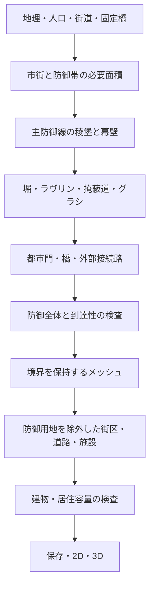

# CE: 都市全体を囲む星形要塞

作成日: 2026-10-25
状態: 2026-10-25 初版実装（B0〜B5）と後続の地理・兵舎。新規生成と生成し直しで、稜堡・幕壁・堀・ラヴリン・掩蔽道・グラシの内側に市街を収める。起伏は防御の区間ごとの基礎高と天端に反映し、土塁上の通路が15%を超える案は拒否する。川や海岸は動かさず、主防御線がかかる地点は水門または水際の開口にする。水堀は平らな内陸の閉じた水面に限る。兵舎と弾薬庫は主壁とは別に防御の内側へ置く。計画は `CityDocument.bastionedTown`（文書 version 5、レシピ `bastioned-city-v1`）。市壁と城塞の壁の共有、旧市街壁の併存、第三外郭、地下通路、射界は後続。
対象: `src/city-editor/`。都市モードの外周防御を稜堡式に置き換える。CGは参照・変更しない。

## 1. 目的と決定事項

星形要塞を「城の塔を尖らせたもの」から、**市街全体を囲む稜堡・幕壁・堀・外郭施設の組合せ**へ拡張する。住宅、商店、市場、寺院、広場を主防御線の内側に収め、星の中心に小都市がある景観を作る。

本書で採用する方針は次のとおり。

1. 都市の防御様式に「稜堡式要塞都市」を追加する。選択時は通常の都市外周城壁を置き換え、城塞の様式とは独立させる。
2. 主防御線は稜堡と幕壁が連続する一つの閉じた境界とする。別描画の尖った塔を普通の城壁に重ねる方法は使わない。
3. 標準は、主防御線と、その外側のラヴリン群による二層の防御とする。「同じ星形の城壁を二本」にはしない。
4. 防御施設とその空地を街区・建物より先に予約する。都市の居住容量は防御用地を引いた後に評価する。
5. 既存のskeleton-firstの `bastioned` を土台にする。従来の城塞、通常都市、既存の保存地図は自動変換しない。

初版は新規生成・生成し直しを対象とする。完成済みの市街を保持したまま外壁だけを稜堡式に改築する機能は別課題とする。

## 2. 史実とモデル化の境界

### 2.1 何を参考にするか

パルマノーヴァのラヴリンは、堀の向こうで幕壁を守る第二防御線を構成する。主防御線と外郭施設を区別する根拠とする。[市の観光案内: Ravelin n.2](https://www.visitpalmanova.it/en/ravelin-n-2-and-counter-mine-gallery/)

同市には稜堡・ラヴリンの外側に、ナポレオン期に追加されたリュネットもある。多重に見える形には、異なる時期に追加された施設が含まれる。すべての要塞に同じ数の輪が必要という規則にはしない。[市の観光案内](https://www.visitpalmanova.it/en/home-english/)

米国NPSのCastillo de San Marcosの解説では、ラヴリン、堀、掩蔽道、グラシが連携し、堀は通常空堀だったとされる。堀を一律に青い水面として描かない根拠とする。[NPS: Defense in Depth](https://www.nps.gov/places/000/defense-in-depth-wayside.htm)

以下の生成比率・寸法・辺数はCEの初期校正値であり、これらの史例の実測値でも、時代全体の普遍的規格でもない。史実から採用する構造と、生成を安定させる制約を区別する。

### 2.2 用語と役割

| 要素 | CEでの役割 |
| --- | --- |
| 稜堡（bastion） | 外へ張り出す砲撃用の低く厚い構造。隣接する幕壁前面を側面から守る |
| 幕壁（curtain） | 稜堡間をつなぐ主防御線。都市門を置く |
| ラヴリン（ravelin、半月堡） | 幕壁・門の前を守る独立した外郭施設。市街を囲む第二の都市壁ではない |
| 堀（ditch） | 主防御線への接近を妨げる空堀または水堀 |
| 掩蔽道（covered way） | 堀の外側で守備側が移動する帯 |
| グラシ（glacis） | 外へ緩く下る地面と、その上の見通しを確保した空地 |
| 城塞（citadel） | 都市から独立して防御できる軍事区画。要塞都市そのものとは別の所有者を持つ |

外郭施設だけの範囲に住宅を置かない。稜堡内も一般街区として埋めず、砲座と移動空間にする。

## 3. 現行実装との差

調査時点の実装に基づく。リンク先の既存APIと、本書の提案APIを混同しない。

| 現行箇所 | 現在できること | 本設計で必要な変更 |
| --- | --- | --- |
| `renderers/castleLayoutBuilder.ts` の `buildBastionCitadel` | 城塞輪郭の凸角に `star_bastion` を追加し、兵舎・練兵場などを描く | 独立城塞用として残す。都市外周には流用しない |
| `generators/generation/skeleton/wallShapes.ts` | `bastioned` の外周、稜堡形状、幕壁中点を作る | 稜堡・幕壁の意味を保持し、幅を持つ土塁と外郭施設まで計画する |
| `generators/generation/settings.ts` | skeleton-firstでは城、堀、二重城壁などを拒否する | 新経路で保証できる組合せだけを段階的に許可する |
| `generators/generation/skeleton/conformingMesh.ts` | 骨格線を動かさずメッシュへ組み込む | 防御用地の境界と門への道も組み込む |
| `generators/generation/assembly/skeleton.ts` | 通常の都市壁のfeature groupとtown circuitを作る | 要塞都市の所有関係と保存計画を組み立てる |
| `types/document.ts` の `DefenseCircuit` | town/castle、内外のring、堀の有無と幅を持つ | 旧市街の二重壁と稜堡式外郭を区別する |
| `generators/moats.ts` | 壁線と内側セルから堀の予約領域を導く | 新要塞では確定済みの堀形状を使い、別の帯を再推定しない |
| `generators/defenseClearance.ts` | 都市壁・門前堡の前に空地を確保する | 要塞の全予約領域を共通の障害物として使う |
| `renderers/structureMassing.ts` | 稜堡式城塞の壁と稜堡の高さを調整する | 都市外周にも専用の低い土塁・砲座を描く |

既存S4では、水際に合わせて外周頂点を放射方向に引き込むと稜堡が潰れることを許している。本設計の明示的な要塞都市では、形だけ失われた通常壁を成功扱いしない。[S4実装記録](../city-editor/reviews/1014-skeleton-first-s4-bastioned.md)

## 4. 利用者に見える設定

### 4.1 入口

生成パネルの都市防御欄に「通常の城壁」「稜堡式要塞都市」を設ける。後者を選ぶと都市モードのまま、防御外周全体が稜堡式になる。`castleStyle: "bastion-citadel"` を変更する操作にはしない。

提案する生成設定は次のとおり。型名・フィールド名は新設案である。

```ts
interface BastionedTownSettings {
  kind: "bastioned";
  outworks: "none" | "ravelins";
  ditch: "dry" | "wet";
  streetPlan: "radial" | "organic";
}

// Optional addition to GenerationSettings.
// townFortification?: BastionedTownSettings;
```

- 未指定は既存動作。`wallShape: "bastioned"` だけの旧レシピも既存の輪郭生成のままとする。
- 要塞都市を新規選択した既定は `ravelins`・`dry`・`radial`。外郭なしも選べるが、その状態を二層防御とは表示しない。
- 星の角の数は既存の `wallSides` を使い、初版は5〜9を許可する。通常の多角形壁の3〜12の制約は変えない。
- UIで選択した際に `generationMethod: "skeleton-first"`、`wallShape: "bastioned"`、`walledAreaShare: 1`、都市壁ありを設定し、選択中の値を表示する。生のAPI・共有入力で矛盾する指定を受けた場合は理由付きで拒否し、黙って値を修正しない。
- `mode: "fort"` との併用は不可。軍事施設だけを作るFortSiteとは別の機能とする。
- `townWallRings: "double"` との併用も初版は不可。二層の星を旧市街壁のring数として保存しない。
- `moats.town: false` の明示指定は要塞都市設定と矛盾するため拒否する。未指定またはtrueでは、堀の実体は `ditch` の値で決める。
- 独立城塞を生成する設定との併用は§11のB5まで不可。UIには理由を表示し、利用者が城塞を外してから生成する。FMGの `burg.citadel` も黙って無視しない。
- `bram`・`circulade` の明示指定は初版では拒否する。新設定の `streetPlan` が市街の構成を選ぶ。`layout: "auto"` はこの経路では既存のランダム選択を行わない。

### 4.2 時代

既存の `bastionEra` と同じく `ageOfExploration` 以降を対象とし、時代未設定の既定も既存規則に従う。これはCEの開始条件であり、世界のすべての国が同時に稜堡式になるという意味ではない。

初版では明示選択のみとし、通常生成の `auto` 候補を要塞都市へ自動昇格させない。国家の築城技術・富による自動選択、近代要塞への更新、歴史進行による改築は後続課題とする。橋の技術別上限は既存のFMG入力をそのまま利用する。

## 5. 全体配置と生成順序

### 5.1 面積の意味

要塞都市では、主防御線が**生成対象の都市市街全体**を囲む。通常都市のように、都市の大きさに応じて城壁内を20%・45%などに減らさない。外側の農地・街道・地域背景は許すが、門前の住宅帯や商業郊外を自動生成しない。

都市人口から居住面積を確保したうえで、公共施設、内周道路、防御用地を加え、必要な図枠を見積もる。人口を満たすために稜堡や堀へ建物を押し込まない。防御用地を含む総包絡面積、壁内の市街面積、住宅に使える面積、収容人口と不足人数を別々に診断する。

図枠が固定なら、その中に収まる案だけを探す。収容不足を表示し、人口を下げる・図枠を広げる・角の数を減らす修正案を出す。要求人口を保存値だけ減らして成功にしない。

### 5.2 計画の流れ



外郭施設を最後に描き足さない。門とラヴリンは接続路を含む候補として同時に解き、道を後から施設へ貫通させない。失敗時は候補計画全体を破棄し、元文書を保持する。

### 5.3 主防御線

1. 外郭まで入る余白を先に図枠から引き、都市中心、向き、辺数、規模の候補を作る。
2. 既存 `bastionedPolygon` を出発点に、稜堡ごとの左右の面・側面・接続する幕壁を意味付きで記録する。メッシュ分割後も角の識別を失わない。
3. 稜堡を含む主防御線の外縁を連続させ、その内側に土塁の幅を取る。稜堡と幕壁の重複する内部面は描かない。
4. すべての稜堡について、稜角が隣接幕壁より外にあり、側面が市内へ反転せず、隣の稜堡・門と干渉しないことを検査する。
5. 幕壁前面の検査点へ隣接稜堡側面から障害物なしで線が通るかを検査する。これは幾何学的な側防の検査であり、砲の射程・弾道・攻城戦を再現する機能ではない。

頂点だけを海岸へ引き込んで稜堡を消す補正は使わない。中心移動・全体の回転・規模調整・辺数候補の変更を有限回試す。要求した市街面積や防御帯が成立しなければ失敗とする。

### 5.4 外郭施設と寸法

主防御線の外側に堀を作り、`ravelins` の場合は各幕壁の外側に一つずつラヴリンを配置する。ラヴリンの突出方向は、稜堡の先端方向ではなく幕壁の外向き法線を基準とする。外郭が主防御線の凹みを守る配置にする。

初期値の基準は、稜堡の肩を除いた幕壁の有効長 `L` とする。以下は校正値で、画面サイズに合わせた縮尺変更は行わない。単位はメートル。

| 寸法 | 初期候補 | 成立の検査 |
| --- | --- | --- |
| 幕壁の土塁幅 | `clamp(0.06 L, 10, 20)` | 内周道路と重ならない |
| 主堀の幅 | `clamp(0.12 L, 12, 30)` | 凹部でも土塁へ逆流・自己交差しない |
| ラヴリンの幅 | `0.35 L` | 隣接稜堡の側防を塞がない |
| ラヴリンの奥行き | `0.25 L` | 主堀・外部接続路・隣の外郭と干渉しない |
| 掩蔽道の幅 | 5 | 施設間の必要な連絡路が連続する |
| グラシの水平幅 | 25〜60 | 施設の裾と用地境界が図枠内に入る |

ラヴリンは主堀の外側に独立した土塁として置き、その周囲にも必要な堀を確保する。多角形の単純な拡大縮小だけで全帯を作らず、凹角で分裂・合流するオフセットを処理する。ポリゴンは穴を含む複数領域として保持できるようにする。

`ravelins` を明示した案は、幕壁の一部で外郭が欠落したまま成功にしない。用地不足なら配置を解き直し、解けなければ失敗を返す。外郭なしへの変更は利用者の設定変更で行う。

## 6. 門・街路・都市内部

### 6.1 都市門と接続路

- 都市門は幕壁の中央付近に置き、稜堡の先端・側面には置かない。門の両側に土塁と通行幅を確保する。
- すべての必須外部街道を都市門から内側の道路網へ接続する。複数の街道は、門間隔と容量を満たすなら門を共有できる。
- ラヴリン付きの門前は、外部街道→外郭の側方の通路→堀を渡る橋→幕壁の門→市内道路として計画する。ラヴリン中央を直線道路で切り裂かない。
- 門前の折れ曲がりは陸上の通路・橋台間に置く。堀や川の上の橋面を折り曲げない。
- 普通の門前堡・双塔門の自動装飾は、この防御計画が所有する門では抑止し、低い要塞門として描く。
- ラヴリンへの守備用連絡路は、市民用の都市門とは別に記録する。施設を置いた結果、守備側も到達できない状態を許さない。

### 6.2 市街

`radial` は中央広場と主要な門を結ぶ幹線、土塁内側の環状道路、それらの間を埋める街区を生成する。全稜堡に向けて放射道路を引くのではなく、実際の門と施設入口へ接続する。`organic` は同じ防御境界・内周道路を使い、内側を不規則な街路と街区で埋める。

住宅・商店・工房・市場・寺院は通常の都市生成を利用する。都市全体をcastle地区・練兵場にしない。兵舎・弾薬庫は防御に近い予約区画へ置き、主都市壁とは独立した施設として所有する。独立城塞は任意であり、都市全体を星形にするための必須条件ではない。

一般建物、ランドマーク、農地、樹木、自動用地の造成は、防御の予約領域を同じ判定器で除外する。グラシを通常のpark地区へ置換して、後から樹木で埋めることも禁止する。

## 7. 地形・水域・FMG連携

### 7.1 地形

平坦な内陸地を最初の対象とする。起伏地では都市全体を一枚の水平面へ強制せず、防御の区間ごとに基礎高と縦断を持たせる。土塁上の移動路を連続させられない急斜面は候補を拒否する。

防御の土塁・空堀・グラシは [地形の層](ce-terrain-layers.md) と [造成の層](ce-terrain-grading-layer.md) に接続する。要塞の土塁が一般道路の造成で削れないよう、通行を許す回廊を先に確定する。橋面は堀の底へ接地させない。建物用padや城塞台地からも防御用地を差し引く。

防御用の高さは§8の保存計画から導出し、`terrain.features` に別の手編集可能な正本を重複保存しない。既存の造成評価器へ渡す導出フィーチャーの合成順を定義し、自然地面→水系→防御造成→防御外の一般pad・道路とする。水系と防御が衝突する案は生成前に拒否し、重ね順で押しつぶさない。

### 7.2 堀

空堀は底・内外の法面を描き、一般の川として登録しない。水堀は閉じた水面を持つ独立した水域とし、流れる川の向き判定に参加させない。水堀の水位、堀底、周囲の最低地盤高を保存し、周囲より高い水面や不自然に斜めの水面を作らない。

水堀の初版は水位を共有できる平坦地に限定する。水源・排水を表現できない場合は水堀案を拒否し、空堀の選択を案内する。自動的に川へつなげたり、空堀へ置き換えたりしない。

堀を渡る橋も、その地点の堀中心線に直交する最短の直線区間を優先する。河川の橋はすべて `src/utils/bridgeSkewPolicy.ts` の判定を使い、Historical periodとFMGから渡る国家技術の上限を守る。川とほぼ平行、または水上で屈曲する橋は作らない。数値を要塞用コードへ複製しない。[橋の斜角規則](bridge-skew-policy.md)

### 7.3 河川・海岸

B4で河川横断・水際を扱う。それ以前は明示的に対象外として返し、水域を動かして生成しない。

- 川の中心線、実測の岸、FMGの固定橋は入力として固定する。
- 川が市街を通る場合は、主防御線の水門・川岸の土塁端部・堀の終端を計画する。川の上を通常の石壁や土塁で塞がない。
- 水門は通行用の門や道路橋とは別の要素とする。自然水域で途切れる境界も含め、都市の内外が判定できる防御境界を持つ。
- 海岸・大河側は自然障壁とし、陸側の稜堡式防御へ接続する。完全な正星形を海上へ張り出させない。閉じた星が成立する内陸型と、水辺で閉じる部分型を診断・表示で区別する。
- 陸側の必要な稜堡・外郭が収まらなければ拒否する。水域の切り抜きで消えた稜堡を残存数だけで成功扱いしない。

FMG由来の固定街道は、既存の固定区間と橋を保持し、許可された市内側の接続範囲だけで門へ導く。固定区間が稜堡に入る場合は外周の位置・向きを再探索し、門を稜堡先端へ移して帳尻を合わせない。変更可能な範囲が無く解けなければ理由を返す。

CEへの入口は既存の都市・都市ラベルの右クリックメニューを使う。Burg Editorを経由する操作は追加しない。CEで選んだ防御形式をFMG全体の軍事施設や都市履歴へ自動的に書き戻すことは、この設計の対象外とする。

## 8. 正本・保存・編集

### 8.1 防御計画を保存する

提案する `CityDocument.bastionedTown` に、完成した意味付き防御計画を保存する。表示のたびに輪郭から稜堡や外郭を再推測しない。

```ts
interface BastionedTownPlan {
  version: 1;
  id: Id;
  circuitId: Id;
  boundaryKind: "inland-closed" | "waterfront";
  bastions: BastionPlan[];
  curtains: CurtainPlan[];
  outworks: RavelinPlan[];
  ditches: DitchPlan[];
  coveredWays: DefensePathPlan[];
  glacis: DefenseRegion[];
  accesses: DefenseAccessPlan[];
  locked: boolean;
}
```

上記の構成型も新設する。各部品は安定したIDと、所有する主防御線または幕壁のIDを持つ。最低限、次を保持する。

| データ | 保存内容 |
| --- | --- |
| 稜堡・幕壁 | 向き付きの外縁、土塁の面、砲座の面、基礎高・天端高の縦断、対応するwall edge chain |
| ラヴリン | 守る幕壁ID、外縁、土塁・砲座、守備用入口 |
| 堀 | 穴を含む領域、底と岸の縦断、空堀/水堀、水位と給排水の根拠（水堀のみ） |
| グラシ・掩蔽道 | 領域、標高または縦断、一般建築禁止の範囲 |
| 接続路 | 門ID、道路ID、連続する陸上路・橋面、橋台、通行幅、必要な縦断 |

`DefenseRegion` は外周と穴を持つポリゴンの配列とし、点・面積・高さは有限値で検証する。計算用の空間索引、三角形、2Dパス、3Dメッシュ、集計診断は保存せず導出する。

### 8.2 既存データとの役割分担

- `DefenseCircuit.scope: "town"` を主防御線の所有者にする。`areaFaceIds` は市街の内外判定、`wallGroupIds` は編集可能な壁線との接続を担う。
- ラヴリンを `scope: "castle"` や旧市街の `ring: 1` として登録しない。外郭施設の所有者は `bastionedTown.id` とする。
- 外縁の平面形状は既存のwall edge chainから参照し、別座標で二重管理しない。生成中のベクトル形状はメッシュ組込み後に参照へ変換する。厚みを持つ土塁面・外郭面などは計画側に保存する。
- 不変条件は「計画の主防御線と参照先の壁線が一致する」。片方だけ更新する操作は禁止する。
- 新計画があるcircuitは、旧 `moat` からの堀の導出、普通の塔・門前堡、通常壁の3D生成を抑止する。対応する `moat` は未指定とし、計画と矛盾する両方の指定は読込検証で拒否する。
- 防御の予約領域は保存計画から一つの共通サービスで導く。街区・建物・農地・ランドマーク・地形造成が同じ領域を利用する。

### 8.3 保存形式と再現性

防御用地を認識しない旧読込器で編集すると破損するため、新計画を持つ文書は `CityDocument.version: 5` とする。既存のv1〜v4は従来のまま読み、新計画がなければ一律にv5へ上げない。現在のv4で導入された地域描画などの検証はv5にも適用し、`version === 4` の条件を単に飛ばさない。

完成生成レシピのalgorithmには `bastioned-city-v1` を追加する。旧 `skeleton-city-v1` の乱数消費・候補集合・生成結果を変えない。新経路は外周・外郭・街路で乱数系列を分け、同じseed・入力・設定から同じ計画とIDを再現する。

`documentCodec.ts`、`incomingCity.ts`、共有の生成設定、`fabricDistricts.ts` の許可リスト、再生成のalgorithm分岐を同じ段階で更新する。完成文書の共有は保存した形状を使い、レシピ共有だけが生成を実行する。新設定を解釈できない共有形式には別バージョンを割り当て、旧形式へ重要な情報を落として出力しない。

### 8.4 編集と削除

初版では主防御線・外郭の頂点を通常壁のツールから個別移動できないようにし、要塞計画の一体編集または生成し直しで変更する。一般の街区・建物・道路編集でも予約領域と必須門への到達性を検査する。違反する編集は採用せず理由を表示する。

削除は専用の「稜堡式防御を削除」で、計画、所有壁、門、外郭、橋、導出造成を一操作として除去する。市街は残す。通常壁への置換は別の再生成操作とし、削除の副作用で作らない。Undo/Redoはこの変更単位を保持する。

後続で頂点編集を許す際も、隣接稜堡・幕壁・堀・外郭・接続路まで再計画し、検証が通った文書だけを採用する。

## 9. 2D・3Dの描画

2Dは外側からグラシ、掩蔽道、堀、外郭、主土塁、胸壁、門・橋の順に地物の重なりを解く。水堀は水面、空堀は底と法面の陰影で区別する。稜堡は砲座を持つ広い面として描き、屋根付きの塔にはしない。

3Dは同じ平面計画と縦断を使い、土塁、石張りの斜面、胸壁、砲座、堀、グラシを生成する。普通の高い中世城壁や尖塔を要塞の幕壁へ流用しない。初期の幕壁・稜堡天端の地面からの高さは4〜6 mを校正範囲とし、砲座と胸壁の接続が連続することを優先する。

堀やグラシは建物の押出しとして作らず地面の面にする。粗い地形グリッドで細い堀が消えないよう、防御境界を制約として追加分割する。表示を遠くしたときも主防御線と外郭の二層、門の開口、橋の通路を保持する。

BVの建物カタログは、兵舎などの建物を必要に応じて描くために利用できる。都市防御全体を一個の巨大な建物モデルとしてBVへ登録する必要はない。

## 10. 失敗・診断・性能

### 10.1 成立条件

次のいずれかに違反する候補は採用しない。

- 主防御線が単純で、必要な市街を内包し、すべての稜堡が意味のある突出・側面・砲座を持つ。
- 防御面、土塁幅、堀、外郭が自己交差せず、許可した橋・通路以外に一般の道や建物が入らない。
- 内陸型は全周閉鎖し、水際型は自然障壁と水門を含む境界が閉じる。
- 必須外部街道、都市門、主街路、市内の公共施設が接続する。守備用連絡路も成立する。
- 河川、固定橋、ロックした地物を改変しない。橋の斜角が共通規則を満たす。
- 必要人口の居住容量と、図枠内の防御用地を同時に満たす。
- 保存・読込・2D・3Dで、防御の位置と通行可能な区間が一致する。

### 10.2 探索上限と失敗理由

既存の `SKELETON_ATTEMPTS = 16` を外周候補数の初期上限とし、外郭・門の局所候補数も固定上限を設ける。既存の外側リトライと乗算して探索が膨らまないよう、新algorithm全体に候補評価数の上限を置き、診断に出す。一般壁・外郭なし・小人口へ黙って退避しない。

提案する失敗理由は `fortress-insufficient-space`、`fortress-invalid-bastion`、`fortress-outwork-overlap`、`fortress-access-unreachable`、`fortress-housing-shortfall`、`fortress-water-conflict`。既存の橋・骨格の詳細理由も保持する。UIには設定変更につながる理由を出し、元の地図を保持する。

性能は外郭の面数・予約領域の頂点数・メッシュ分割数・候補評価数・計画/街区/描画の所要時間を分けて記録する。共通予約サービスに空間索引を持たせ、建物ごとに全ポリゴンとの総当たりを行わない。初版ではGPUごとの一律フレーム時間を保証せず、固定の代表地図で既存の稜堡輪郭だけの場合との差を測る。

## 11. 実装の段階と完了条件

各段階が完成しても、本書全体を実装済みとは記載しない。B3で単独内陸の利用開始、B5で本設計の初版完了とする。

| 段階 | 作業 | 完了条件 |
| --- | --- | --- |
| B0: 契約と互換性 | 新設定、意味付き計画、v5、algorithm、入力検証、共有を追加 | 旧レシピの結果が変わらず、新計画の保存・読込と不正参照の拒否が成立する |
| B1: 主防御線 | 内陸・平坦地、稜堡/幕壁、土塁、全市街の内包、予約サービス | 普通の塔に依存せず星形外周が閉じ、住居が土塁に入らない |
| B2: 外郭と門 | 空堀、ラヴリン、掩蔽道、グラシ、橋と門への連続路 | 既定設定で二層の防御が成立し、外郭と道路が互いを切断しない |
| B3: 都市と表示 | 放射/不規則街路、公共施設、居住容量、2D/3D、編集保護、削除/Undo | 星形防御の内側に生活する都市が生成でき、保存・共有して同じ形を再表示できる |
| B4: 地理とFMG | 起伏、条件付き水堀、河川、水際、固定街道・橋、FMGからの生成 | 入力の地理と接続を保持し、成立しない場所では理由付きで拒否する |
| B5: 城塞との共存 | 独立城塞の事前予約と接続、所有権、別個の防御境界 | 都市全体を囲む稜堡式外周の内側に独立城塞を置け、削除・描画が重複しない |

B5の城塞は初版では外周と壁を共有しない内側の独立型を対象とする。市壁と城塞の一部共有、既存旧市街壁の併存、ナポレオン期の第三外郭、地下通路、攻城戦の射界・砲撃シミュレーションは後続とする。

主な変更先は、`types/generationSettings.ts`、`types/document.ts`、防御計画用の新contract、`generators/generation/settings.ts`、`generators/generation/skeleton/`、`generators/generation/assembly/skeleton.ts`、`generators/moats.ts`、`generators/defenseClearance.ts`、街区・建物の配置判定、`components/generationPanel.ts`、`services/io/`、`renderers/wallSvg.ts`・`moatSvg.ts`・`structureMassing.ts`、地形/水面の3D組立てとする。新計画と共通予約サービスは専用モジュールへ置き、城塞描画の関数に都市生成を追加しない。

## 12. 検証と受入

### 12.1 必要な自動テスト

実装時に変更範囲のテストを明示実行する。既存の星形頂点数の検査を増やすだけでなく、次の振る舞いを検証する。

1. 固定した単独内陸入力で、必要な市街と人口容量が主防御線内に収まり、土塁・外郭・堀・グラシに一般建物がない。
2. 門を守るラヴリンがあっても、外部街道から市内へ通れる。道が外郭を貫通せず、橋面が直線である。
3. 狭い図枠・干渉する固定街道・不正な橋角度で理由付きの失敗となり、元文書を変更しない。
4. v5の保存・読込・完成文書共有でID、平面、縦断、所有関係が保たれ、レシピ再生でも同じ計画になる。旧レシピの代表入力も従来結果を保つ。
5. 2Dと3Dが同じ稜堡・外郭・門・橋を使用し、通常壁・塔・堀が重複しない。空堀と水堀の表示が区別される。
6. B4で固定河川・橋・街道を保持し、B5で都市防御と独立城塞の所有権が分離する。
7. 街区の再生成や建物・道路編集も予約領域を守り、防御削除とUndo/Redoが一体で動く。

関連する既存の `skeleton.test.ts`、`integration.test.ts`、`conformingMesh.test.ts`、堀・防御用地・保存・生成パネル・3D構造のテストから、各段階の影響先を選ぶ。新規テストは外郭の到達性・所有権・互換性などの再発防止に必要なものに限る。全件テストや多数seedの計測は通常の完了条件にしない。

### 12.2 見た目と操作の確認

代表例を固定入力で用意する。内陸5稜堡、内陸9稜堡、用地不足、河川通過、水際、城塞ありの各一例を、対応段階で確認する。内陸5稜堡では空堀/水堀、外郭あり/なしの設定差も同じ入力で比較する。

- 上面表示で「星形防御の中に都市」があり、外側のラヴリン群が独立して読める。
- 斜めの3D表示で、尖った高塔ではなく広い土塁と低い胸壁が見える。堀・橋・法面・グラシが浮いたり埋まったりしない。
- 門から中央広場まで、外郭を迂回して連続する道を追える。
- 生成失敗時に元地図が残り、保存・読込・共有・Undo後も欠落や二重描画がない。
- FMGの人口が必要な例ではSettlement patternをStandardにし、生成前提を確認する。

## 13. 関連設計

- [骨格先行生成](../city-editor/plan/skeleton-first-generation.md): 本書はS4の稜堡式を、都市防御の厚み・堀・外郭・都市生活まで拡張する。
- [城郭生成と都市城壁](../city-editor/castles-and-fortifications.md): 都市防御と独立城塞を分ける原則を引き継ぐ。
- [3D建物と構造物](ce-3d-building-massing.md)、[3D水面](ce-3d-water-boundary.md): 従来対象外だった要塞の堀・法面を、本書の新計画に限って追加する。
- [地形の層](ce-terrain-layers.md)、[造成の層](ce-terrain-grading-layer.md): 要塞の用地と高さを同じ平面計画から導く。
- [軍事施設](military/fort.md): 世界側の軍事施設・技術進行と、CEの都市全体の幾何生成を分離する。
