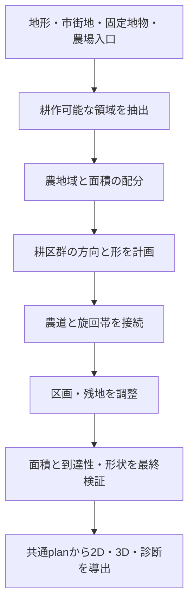

# CE郊外の耕作地領域・耕区形状・農道の再設計

作成: 2026-10-21。状態: 第2版実装。以下の長期設計と、現在の実装範囲を区別する。

## 実装状況（2026-10-21）

第1版の測量格子による矩形配置、および第2版初期の「矩形を変形」「異なる向きの小集団を散らす」方式は、中世向けの配置として不適切だった。前者は都市全域の規則性、後者は集団間の大きな未利用地を残したため、現在の伝統型では使用しない。

### 現行の配置

`ruralFieldGroups.ts` は物理的に到達できる農地域と実在道路への経路を求める。`ruralFieldTerritories.ts` は種点のVoronoi領域を直線の半平面で定義し、各群を局所道路に沿った平行な利用帯へ分ける。群境界のあぜ道は幅1.2 mを両群から半分ずつ確保し、内部・接続用の道も同幅で予約する。利用帯から道路予約幅だけを切り取り、`ruralFieldAccessGeometry.ts` で到達可能セルにclipする。セル間の内部辺を相殺するため、格子を粗くしても群境界や内部農道の余白はセル幅まで広がらない。

`RuralFieldSettings.targetAccessCells` は探索セル数の目安で、既定25,000、保存時に許可する範囲は整数1,000〜1,000,000。探索幅は従来どおり最低4 m、2 m刻み。小さい値は探索負荷を減らす一方、水域・市街地・予約地付近で失う余白を増やす。内部のあぜ道幅とのトレードオフではなく、探索精度とのトレードオフに変更した。機械化型には適用しない。水域・未知域・建物・ロック・防御空地を侵さず、穴は塗りつぶさずに分割する。安全確認済みセルで外縁を取得した後、予約領域・土地被覆・区画の単純性を確認した直線へ置き換える。150 m²未満の残片は従来どおり採用しない。

機械化型は整備圃場として `ruralFieldPlan.ts` / `ruralFieldDetails.ts` の規則的な矩形配置を残す。伝統型と機械化型は共通の畝・線分clip処理 `ruralFieldGeometry.ts` を使う。

新規都市と「郊外の農地を再生成」は `ruralFieldVersion: 2` を保存する。旧文書と第1版は既存方式を維持し、再生成・農地形式・輪作年の変更はUndo/Redoと保存・再読込の対象になる。農地形式は時代・文明traditionによる初期値を持ち、CEの都市装飾欄でも指定できる。これは地域の歴史や所有制度を一意に定めるものではない。

開放耕地の輪作年は冬作・春作・休耕の表示を巡回する。都市近接部は園芸表示へ切り替え、生垣型は外周に入口付きの生垣を表示する。利用帯は図上の表現であり、実在の所有者・税・収量等の経済モデルは生成しない。

`FaceProperties.farming.soilQuality/wetness` の入力があれば使用し、未取得ならバイオームの保守的な推定と区別する。描画と同じ連続標高モデルから急斜面を除外する。土壌0.2未満・湿潤0.85超・勾配0.18超は生成用の仮説であり、農学的な普遍閾値ではない。

面積0・欠測・極小・不足、固定農地の先取りと予算超過を扱う。候補・到達可能・採用・不足面積と内部格子幅は `DistrictFabric.ruralFields` に保持する。CEでは採用・不足ha、主な制約、適性情報の出所を表示する。制約理由は複数要因の厳密な寄与分解ではない。座標、ロック、適性、地域地表、農地設定等をキャッシュkeyに含める。

表示範囲と既知の土地領域は別入力とし、既知領域がframe外へ続く場合は `holdingPolygon` を保持する。表示端を架空の生垣で閉じない。CE標準文書にはframe外の土地情報がないため、その外側を推測で補わない。

### 生成ステージへの組み込み（2026-10-22）

通常のCity generation stagesは「16: 建物 → 17: 耕作地 → 18: 道路・小道の非表示」とする。内壁優先・Skeleton-firstでも、耕作地は最後の非表示処理の直前に置く。一括生成は建物等を確定してから耕作地まで生成し、そのステージを表示する。

`ruralFieldStage.ts` はRegenerate farmlandボタンと同じ土地再分類・`applyRuralFields` を使い、現在の範囲・方角・被覆率・耕作方式で生成する。未指定の被覆率はボタンと同じ70%。`off` は尊重する。結果は `CityDocument.ruralFieldSnapshot` に入力fingerprint、区画、農道、面積診断とともに格納する。保存・共有・Worker転送・Undo/Redo後も再計算せず復元する。読み込み時には座標列等の構造を検証し、描画時は現在のfingerprintに一致する結果だけを採用する。土地や農地設定が変わった古い結果は使用しない。

建物以前のステージではsnapshotを外し、耕作地と最後の非表示ステージでは完成結果を再利用する。通常の文書cloneでは生成済みsnapshotを不変データとして共有し、農地の再生成は新しいsnapshotに置き換える。生成recipeの入力と再試行用の入力keyにはsnapshotを含めず、生成の繰り返しで派生結果を蓄積しない。ボタンによる一時的な再生成結果がある場合は、従来どおりそちらを優先する。

### 都市側外周の直線化（2026-10-22）

前回の直線分割は群境界・内部農道を対象としており、都市や水域に接する外縁には到達可能セルの輪郭を残していた。外周抽出後に除くのは同一直線上の頂点だけだったため、水平・垂直を交互に進む輪郭は斜めの線にならなかった。

`ruralFieldMargins.ts` で、各凸な利用帯の内部にある外周の階段を始点・終点の弦に置き換える。利用帯と接する頂点は固定し、元の輪郭とのずれが探索幅の1.25倍以内の候補に限定する。候補全体を三角分割して実際の土地被覆・障害物を検証し、同じ利用帯から生じた別成分にも重ならないことを確認する。検証に通らない長い弦は最大偏差の点で分割し、安全な短い弦を探す。障害物に沿う必要がある箇所は折れ線を残す。別の利用帯との非重複は凸な包絡領域内に留まることで保証し、全区画間の重なり探索は再導入しない。

置換するのは農地polygonそのものであり、畝・生垣も整えた輪郭から生成する。描画だけを丸める処理ではない。穴の分割、面積上限、表示枠のclipは維持する。

### 旧方式: 格子輪郭の段差除去（2026-10-22）

以下は直線分割へ置き換える前の実装記録であり、現行の伝統型生成ではこの境界再構成処理を呼ばない。

内部格子の外周を描画用polygonへ直接渡したため、畑の外周と生垣に縦横の階段状境界が残っていた。角丸描画や局所的な頂点平均では解消しない。`ruralFieldBoundaries.ts` で共有境界を連続するchainへ復元し、隣接区画へ同じ直線・折れ線の置換を適用する。単純性、土地被覆、予約地、農道、他区画への侵入を確認し、制約に当たる部分だけ再分割する。畑全体を元の格子輪郭へ戻すfallbackは廃止した。農道側の格子折れ線も接続点を保持して復元し、その実形状を農地の予約判定へ戻す。外観用テストは追加しない。

### 確認方針と制約

- **見た目の調整を目的としたテストは追加しない。** 外観・配置を数値で合格判定するために追加したテストは削除した。外観は実画面で確認する。
- 保存、Undo、面積上限、障害物への侵入、水域による分断等は既存の機能テストで確認する。テスト成功を外観の妥当性の根拠にしない。
- 提示URLのv559/v597そのものの復元は未確認。実画面の確認は別seedの都市で行った。

## 1. 目的と判断

都市郊外の畑が粗いメッシュの頂点へ向かって尖り、街道沿いに帯状に偏る問題を改善する。**農地の広がりを決めてから、その領域内に耕作方向を揃えた耕区と農道を配置する**。粗いセルは地形・土地利用・編集の参照単位として残すが、通常の共有辺を畑の境界にしない。

平坦で障害物の少ない土地では、対辺が概ね平行な長方形・台形を優先する。ただし中世の帯状耕地、曲がった耕地、囲い込まれた不整形区画、川沿いの楔形地も実在する。「全区画が四角形」や「三角形を一律禁止」を目標にしない。避けるのは、地形・通行・既存境界の理由がないのにセルの頂点や三角形分割へ収束する形である。

本書はCEの描画・生成計画。FMG/REの土地利用面積や農業収量を変更しない。CGは調査・変更対象に含めない。

### 1.1 提示例の扱い

ユーザーから `localhost:5174/Fantasy-Map-Generator/city-editor/#gz.…` の共有URLと、Vertex `v559`・`v597` 周辺の指摘を受領した。今回その共有状態をブラウザで復元して頂点と耕区を計測するところまでは確認できていない。以下の原因分析はコードで確認した生成経路に基づき、個別頂点での直接再現結果とは区別する。

実装開始時にURLの文書をfixtureとして取り込み、seed・時代・frame・fabric版と該当頂点の座標、周辺区画を記録する。頂点IDはその文書内だけで有効であり、再生成後の同じIDが同地点とは限らない。巨大な圧縮URLそのものを本書へ転記しない。

## 2. 現行処理と問題の所在

2026-10-21時点のコードを確認した。

| 箇所 | 現行の振る舞い | 設計上の影響 |
| --- | --- | --- |
| `src/city-editor/generators/wards.ts` の郊外割当 | 未割当のoutskirtsを確率・compactness・海岸適性でfarm/emptyへ分類 | 道路外にも畑はできるが、連続する農地域を計画していない |
| `roadsideFarms.ts` / `cultivateRoadside` | beyond付き街道からの重心距離が `max(blockSizeMeters * 2.5, cityRadiusMeters * 0.45)` 以内の対象セルをfarmへ変更。最寄りがEnemy方面なら既存farmもemptyにする | 街道中心の帯状分布を強く作る。実際の農道到達性・斜面・農場配置の代わりに道路距離が使われる |
| `generation/generateCity.ts` | settled文書に対して `roadside-fields` 工程を呼ぶ | 土地利用選択段階の置換先 |
| `fabricDistricts.ts` / `resolveDistricts` | 同じlandUse・buildable・settlementの隣接faceを統合。保存済み地区、保護辺、ロック、予約地、穴・pinchを含むunion等で止まる | 既にセル統合は存在する。「常に1セル=1畑」が原因ではない。ただし畑に不要な区分でも領域が分かれる |
| `blockInfill.ts` のfarm生成 | 統合輪郭を `convexInfillParts` へ渡し、外周を既定8 m、内部の分割辺も3 m後退させ、各凸片に `openFieldPlots` を適用 | 凸分解の人工的な継ぎ目が未耕作帯になる。粗い輪郭の尖りも受け継ぐ |
| `openField.ts` | 4 m間隔の列、32 m×70 mを基準に分割し、広い区画で50–90°向きを変える。入力輪郭を帯でclip | 角を切り落として長い対辺を得る処理はなく、端の畑が三角・楔形になり得る。時代も受け取らない |
| `fieldChord.ts` | 凸片内の直線弦を作る | 凹形・穴付き領域へそのまま拡張すると、列が領域外を横切る危険がある |
| `blockInfill.ts` / `finishFabric` | 海岸clip、水域・防御施設・予約地等の除外、メッシュ外道路との干渉排除 | これらの後処理でも面積や形が変わる。生成直後だけの品質判定では足りない |
| `suburbanLanduse.ts` | 郊外farmの列方向とkindを調整し、kitchen-garden等へ変える | 新計画の耕作方向・用途を後から上書きしないよう整理が必要 |
| `blockInfill.ts` の面積上限 | `farmlandAreaHectares * 10_000` を予算に、中心に近い完成区画から丸ごと採用 | 大きな区画への変更だけでは、残予算に入らず表示面積が減る可能性がある |
| `localInfill.types.ts` / `FarmPlot` | `faceId`, `polygon`, `rows`, 任意のkind | 複数セルにまたがる区画の所有・検索・無効化を単一faceIdでは表し切れない |
| `townFabricSvg.ts` / `farmSheds.ts` | SVGの農地描画と、道路近くの小屋配置 | 表示だけ丸めても配置原因は解決しない。新農道を小屋の到達先にも使う必要がある |

`blockInfill.ts` には放射・環状等の別layoutやfabricなし文書で `farms: []` を返す分岐もある。新しい郊外農地計画は、通常地区の末尾だけへ追加せず、各都市内layoutから共通に呼べる工程へ置く。

## 3. 史料調査から導く配置規則

調査対象は主に英国・フランスと欧州の圃場整備事例。欧州全域の普遍的な年代境界や寸法分布を確定する調査ではない。下記の史実と、後述のCE向け数値仮説を区別する。

### 3.1 中世: 集落を囲む耕地のまとまりと帯状耕地

Historic EnglandのWalburnの記録では、村落共同体が耕地・草地・森林を利用し、同じ方向の耕作帯をfurlongとしてまとめ、その端に犂の旋回場所であるheadlandを置く。[S1] Forraburyの現存する開放耕地にも概ね長方形の帯状区画がある。[S2]

CEでは「農地域→向きの揃う耕区群→帯状の利用区画→畝の描画」を区別する。同一耕区群の畝を無作為に回転させず、旋回帯を両端に確保する。全ての利用区画に街道接道や生垣を付ける必要はない。共同利用の端部通行帯へ接続できればよい、というのはこの構成を生成器へ落とす設計上の推論である。

開放耕地を欧州中世全体の唯一の型にしない。近接する囲い地、菜園、草地、森を残す。二圃・三圃等の区分は畑の外周形状とは別であり、一都市を必ず三つの扇形へ切り分けない。

### 3.2 中世後期〜近世: 古い境界と囲い込みの共存

Historic Englandの景観分類は、漸進的な囲い込みと計画的な囲い込みを分ける。[S3] フランスのボカージュは、生垣で結ばれた区画と草地・水路・森林等からなる景観であり、地域差と長い形成過程を持つ。[S4]

CEでは時代だけで一斉に長方形へ更新しない。旧耕作帯に由来する細長い区画、曲がった境界、小さな囲い地を混在させる。生垣や石垣を使う型でも、すべての畝を囲うのではなく管理区画の外周に置く。地形に沿う台形・緩く曲がる長辺を許容する。

### 3.3 18〜19世紀: 計画的囲い込みと都市近郊園芸

英国議会の解説は囲い込みが近世から20世紀初頭まで続き、景観を変えたことを示す。[S5] 計画的な整形圃場と、既存境界を引き継ぐ区画を区別する必要がある。[S3]

パリ近郊の園芸は均一な同心円ではなく地域差が大きく、平坦さ・排水・交通軸・地価に左右され、19世紀後半の市街化で外側へ移った。[S6] CEでは近接園芸と外側の穀物耕地を別の用途とし、道路への便利さは評価要素にするが必須の直付け条件にはしない。都市からの距離のみで一様な輪帯を描かず、建物進出で残る農地区画も表現する。

### 3.4 20世紀〜現代: 機械化・整備と残存する小区画

FAOは第二次大戦後の西・中欧で圃場整備が機械化を支えた一方、欧州の一部には小区画・分散所有が残ることを説明する。[S7] 整備には区画の再配置だけでなく農道や水管理も含まれる。[S8] スペインArnedoの事例でも新区画と農道網を協調して計画している。[S9]

CEでは機械化型は長い直線走行、大きめの管理区画、広い旋回帯を優先する。現代でも伝統的囲い地や園芸地を残し、全域を巨大矩形にしない。住宅・施設・自然保全による分断も認める。

### 3.5 地形による例外

Marais poitevinの管理主体は、水路で区分される湿地・草地と、排水された開けた農業景観の違いを示す。[S10] 「建物がない土地=耕作可能」ではない。湿地、急傾斜、林地、海岸、防御上の空地は候補から除外または低評価にする。水路と排水条件を確認できない場所に、整った畑を無条件で増やさない。

## 4. 入出力と責務

新規の純粋計画器 `ruralFieldPlan.ts` を提案する。都市内の建物parcel分割とは別の責務とする。

```ts
planRuralFields(input: RuralFieldInput): RuralFieldPlan
```

入力はseed、frame、時代・地域プロファイル、現状の面積予算、候補陸地、建物等の予約地、既存道路・農場入口、河川・海岸・標高、明示された固定境界。出力は農地域、耕区群、耕作区画、通行網、未利用地と面積診断。世界経済やグローバル状態を直接参照しない。

概念上の型は以下。既存契約との詳細調整は実装時に行う。

| 単位 | 主な情報 |
| --- | --- |
| RuralRegion | 安定ID、外周と穴または複数polygon、交差するfaceIds、適性、予算、除外理由 |
| FieldBlock | 安定ID、regionId、耕作方向、型、外周、headland、アクセス先 |
| RuralPlot | 安定ID、blockId、用途・作付状態、polygon、sourceFaceIds、固定状態 |
| RuralAccess | 安定ID、中心線、幅、接続先、種別 `track` / `headland` / `gate`、通行可能状態 |
| Diagnostics | 要求/候補/収容可能/採用/不足面積、shape指標、到達率、除外・失敗理由 |

既存FarmPlotは描画用のadapter出力として残す。`faceId` は互換用の代表faceに限定し、帰属や衝突判定の正本にしない。`plotId`, `sourceFaceIds`, `blockId` の導入と、SVGの `data-farm-face` を参照する選択・編集・診断、3D地表、小屋、空地樹木等の利用箇所を監査する。畝の線から利用区画や面積を逆算しない。

## 5. 生成の順序



### 5.1 地形と固定物を先に予約する

海・河川幅・河岸余白、城壁・堀・防御空地、施設・建物・道路幅、固定農地、既存の明示境界を予約する。水域・保護領域との判定は頂点だけでなく、辺の交差とpolygonの重なりを含む面積演算で行う。

既存の郊外用途・建物計画と順序が循環しないよう、まず住宅・施設の予約領域を確定し、その残りを対象にする。既存farmセルを強制的に宅地へ変える処理と同じ領域を二重に確保しない。`suburbanLanduse.ts` の園芸化判断はプロファイル/用途選択へ移し、完成後の畝の向きを変更しない。

### 5.2 セルを越えて農地域を選ぶ

非市街のlandで既存の予約と競合しないempty/farmを候補にし、任意の共有辺を越えて連続領域を抽出する。`buildable` の値だけで耕作不能としない。水域、ロック、市街、崖、明示境界は越えない。

単一外周しか扱えない `districtBoundary` を無理に流用せず、穴付きpolygonとMultiPolygonを扱う既存幾何機能を調査して採用する。建物を囲む農地域の穴を埋めない。処理用の三角分割は許すが、その線を表示境界や後退幅へ変換しない。

農地域の優先度は地形適性・まとまり・都市または農場からの到達費用・既存農地との連続性で決める。街道距離の閾値を外側の境界にしない。道路のない扇区にも、必要面積と適性があれば農道を通して広げる。河川を越えずに届く領域から先に評価する。

Enemy方面の街道一本を理由にその周辺農地全てを消さない。実際の危険度データが利用できる場合の抑制と、旧ルールを分け、データ欠測時に安全な道路側だけの帯を作らない。

### 5.3 耕作方向と区画を決める

1. 領域の主要軸、固定境界、農道方向、利用できる地形から少数の方向候補を作る。
2. 中世型なら、同じ方向の耕区群を数群作り、その内部で長い平行な利用区画を並べる。方向変更は群の境界で行う。
3. 囲い地・整備型なら、平行な対辺を持つ区画を優先して分割する。機械化型ほど短い走行と細い首を避ける。
4. 各区画を実在する制約でclipする。内側の計算分割線に後退帯を設けない。
5. 悪い残片は隣接区画へ統合、局所的な境界移動、幅・本数の変更の順に直す。草地等への転用は最後にする。

候補評価は面積確保、矩形充足率、最小作業幅、畝長のばらつき、狭い首、アクセス距離、通行帯の新設延長を用いる。矩形充足率は `area / area(minimum-area enclosing rectangle)` とし、正方形への近さや周長compactnessだけを最大化しない。細長くても幅が一定なら中世型の良い区画になり得る。

### 5.4 尖端を「耕さない」だけで終わらせない

`openFieldPlots` の短い列の除去だけでは、外周polygonの尖りは残る。耕作方向に直交する断面幅を調べ、実際に利用可能な連続長を確保した外形を作る。

例えば道路・川がない連続平地の三角セル2枚なら、まずunionして長方形の区画を置く。実在する道路2本に挟まれた三角地なら、その中の矩形・台形と端部の草地を組み合わせる。後者の三角残地は許容するが、その理由を診断へ出す。

残地へ生垣・草地・既存植生を配分する際は、耕作地予算から差し引く。農地域が極端に痩せる場合は別領域へ配分を回し、面積不足を黙って捨てない。

### 5.5 農道と耕区端の通行帯

街道、市街の出口、農場入口をrootとし、各FieldBlockの端部へ細い農道を接続する。開放耕地では接続済みheadlandから各利用区画へ入れる。囲い地では通行可能な門を設ける。接しているだけの生垣・水路をグラフ上の接続とみなさない。

農道は障害物を避ける経路を計算してから描く。建物や耕区中央を後から直線で貫かない。最短線を優先しすぎず、耕区端の共有と既存通路の再利用で新設延長を抑える。`farmSheds` はこのアクセス網を使い、街道沿いにしか小屋が置けない状態を解消する。

新規の渡河は初期段階では行わず、既存の合法な橋・渡しから到達する。将来農道橋を追加する場合も、`src/utils/bridgeSkewPolicy.ts` の判定を使用し、川の法線方向を基本とする。橋の上で曲げない。上限を満たせない地点は経路を変更または不採用とする。

## 6. 時代・地域プロファイル

時代値は `src/types/historicalPeriod.ts` の定義と `historicalPeriodIndex` を使う。存在しない近代時代キーを増やさない。以下は初期の重み付け案であり、特定年代の全欧州で必ず成立する制度ではない。

| 現行時代キー | 主に候補とする型 | 配置と描画 |
| --- | --- | --- |
| earlyMedieval / highMedieval / lateMedieval | open-field、small-enclosure、近接園芸 | 平行な帯、耕区群ごとの向き、端部通行帯。地域により囲い地を併用 |
| ageOfExploration / maritimeEra / preIndustrialEra | 開放耕地・漸進的囲い地・園芸の混在 | 古い細長い境界を一部保存。幹線以外の農道へ広がる |
| steamEra / industrialChemistryEra | planned-enclosure、伝統型、園芸 | 整形化と境界の残存、都市化で分断された農地 |
| petroleumEra / rocketryEra | mechanized、残存囲い地、園芸 | 長い作業走行、広い旋回帯と農道。保全境界・小区画も残す |

古代時代は既存互換のfallbackを用意し、中世用の三圃制等を自動適用しない。時代欠測も明示したfallbackを使う。文化・気候・地形・明示設定で型を選び、英国型を全文化の既定にしない。所有権・囲い込み制度の入力がない場合は、生成用プロファイルであると明示し、存在しない史実や経済イベントを生成しない。

以下の寸法・閾値は史料の平均値ではなく、CEの試作・検証用の初期値。

| パラメータ | 試作値 | 校正上の注意 |
| --- | --- | --- |
| 中世型の耕区群の走行長 | 60–220 m | 現行70 m上限寄りの表現を緩める。小領域では短縮 |
| 中世型の描画用畝間隔 | 現行4 mを暫定維持 | 一畝=一所有区画としない。史料上の普遍値ではない |
| 小囲い地/整備型の区画面積 | 0.2–2 ha / 1–8 ha | CEの表示範囲・予算に合わせて分布を切り詰める |
| 機械化型の区画面積 | 2–20 ha | 小さなCEでは領域外まで完成区画が続くものとして扱う |
| 旋回帯 | 畜力3–6 m / 機械化6–15 m | 将来の機械寸法と地形で再校正 |
| 農道幅 | 2–4 m / 機械化3–6 m | 実道と共用帯の面積を二重計上しない |
| 通常耕作区画の最小作業幅 | 8 m / 機械化18 m | 菜園は別設定。幅の狭い尖端を評価する |
| 障害物のない試験平地の矩形充足率 | 面積加重平均0.85以上 | 地形制約のある区画には一律適用しない |

## 7. 面積・frame・保存・編集

### 7.1 面積の正本と不足

`farmlandAreaHectares` の供給元は既存の `src/services/burgFarmland.ts` と関連する [耕地面積設計](farmland-area-estimation.md) に従う。人口×任意係数で本書独自の世界耕地面積を推定し直さない。

- 0: 予算で管理する耕作区画を生成しない。
- 有限の正値: 新区画の採用面積の上限。負値・NaN等は入力診断に記録し、既存の互換方針と統一する。
- undefined: 現行の面積欠測モードを残す。適性とframeに基づく有限の表示候補を作り、正本の耕地面積が判明したとは扱わない。

現行の「近い完成区画を丸ごと採用」を置き換え、領域への予算配分後に区画幅・本数を調整する。残予算を尖った最後の区画へ詰め込まず、複数区画へ分散する。最小実用面積に届かない余り、障害物、到達不能、frame容量による不足を別々に報告する。

農地域のgross面積、畑polygonのnet面積、農道・headland・草地を分ける。用途間の重複をunionで除き、家庭菜園を同じ耕地予算へ含めるかは供給元の意味に合わせて一箇所で決める。初期実装では現行のfarm polygonとして数える範囲を維持し、休閑の追加で面積を増減させない。休閑を経済上の耕地に含むかを未確認のまま輪作率で面積を倍増しない。

固定農地が予算を超える場合は固定地を削らず、新規生成を止めて超過を診断する。描画予算を経済側の実際の作付面積へ書き戻さない。

### 7.2 表示範囲の端

frame境界は所有区画の境界ではない。外側までの少量の計画余白で区画を作り、表示時にclipする。区画の本来の形と可視部分を分け、frameが切った三角形を形状不良の統計へ混ぜない。可視面積と計画面積を別に測り、CE内で需要の全量を表現できない場合もframeを勝手に拡大しない。

### 7.3 ロックと互換

新規生成は新版plan、既存保存文書は旧表示を維持し、明示的な「郊外農地を再生成」で移行できる構成を提案する。planのversion、profile、seed、固定境界を保存し、畝の全座標は導出キャッシュとする。生成版の変更で既存URLの表示が黙って変わらないようにする。

ロックしたface/edge/vertexと明示した農地境界は固定制約。跨いだ区画に対する編集は、変更前後のsourceFaceIdsと空間的な影響領域を用いて無効化する。代表faceだけのロック確認・キャッシュ破棄を廃止する。undo/redo、保存・URL再読込、部分更新で同じ結果になることを確認する。

seedはregion/block/plotの安定IDから派生させ、Object列挙順や一つの区画削除で遠くの区画を回転させない。地形・道路・予算・プロファイル・ロック・生成版をキャッシュkeyに含める。

## 8. 実装順序と変更箇所

| 段階 | 内容 | 主な変更先・完了条件 |
| --- | --- | --- |
| M0 | 提示都市の復元・現状計測 | v559/v597周辺の実際の輪郭、districtと凸分解線、街道距離を重ねて原因を特定。別地点の一般論と区別する |
| M1 | 農地域・幾何の共通化 | 新規 `ruralFieldPlan.ts` / `ruralFieldGeometry.ts`。穴・予約地を守り、人工辺を消す。描画農地の供給口を全layoutで共通化 |
| M2 | 作業しやすい区画と面積配分 | `openField.ts` を耕区内の列描画へ限定するか置換。予算の後置filterを統合し、最終polygonで品質判定 |
| M3 | 街道帯からの移行・農道 | `wards.ts` / `roadsideFarms.ts` / `generateCity.ts`。二重のfarm割当を整理し、非街道沿いの適地にも到達可能な区画を配置 |
| M4 | 時代・用途・表示・互換 | `suburbanLanduse.ts`, `FarmPlot`, SVG/3D, `farmSheds.ts`、保存版と再生成操作。時代・地域で型を選ぶ |

M1–M3を実装してから「尖りと街道偏在の改善」を完了とする。矩形だけをセル内へ置く、畝だけを短縮する、街道距離だけを大きくする変更では完了扱いにしない。機械化や園芸の詳細表現はM4で追加できる。

全polygon同士の総当たりを避け、領域・障害物・通路を空間索引へ載せる。方向候補数、領域分割回数、農道路線の探索回数に上限を持たせ、失敗時は理由付きの未利用地へ戻す。形状の悪い案を最後に強制採用しない。既存のprofilerに農地域抽出・区画分割・農道・最終検証を分けて計測する。

## 9. 検証と受入条件

以下を実装時の受入条件とする。初期実装では、メッシュ非依存・到達性・障害物・面積・時代差・保存互換・Undo/Redoの関連テストと、実都市のSVG描画を確認した。全件E2Eや大量seed試験は実行していない。

| 試験 | 受入条件 |
| --- | --- |
| 同一の矩形平地を異なる三角メッシュで表す | 同じ外周・seed・制約なら農地域と主要方向が一致。通常の内部辺やその頂点へ畑が収束しない |
| 広い平地で街道一本、予算は街道帯の容量を超える | 適地と入口がある場合に帯の外へ広がる。生成区画の100%が農道/headland経由でrootへ到達。袋状の接触だけで到達扱いにしない |
| 提示都市v559/v597 | 位置を座標で固定してbefore/afterを比較。尖った各区画が人工辺由来か実制約由来か診断でき、前者が解消される |
| 川・海岸・穴・施設のある領域 | polygon全体と畝・農道が予約へ侵入しない。凸分解の継ぎ目に不要な隙間を作らない |
| 実在する二道路間の楔形地 | 安全な台形・矩形と残地、または理由付きの不採用。全ての三角形を無理に四角へ変形して道路を覆わない |
| 十分な容量のある矩形平地と正の予算 | 採用面積が予算を超えない。不足は `max(要求面積の2%, 当該profileの最小区画面積)` 以下を初期基準にする。超過時は原因を報告 |
| 面積0・欠測・極小・過大・固定地超過 | 0で対象農地なし、他は§7の診断と制約を満たす。NaNや無限ループなし |
| 中世・近世・機械化の固定profile | 同一耕区群の方向が揃う。機械化型の方が長い走行・広い旋回帯を選ぶ。全profileに同じ70 m/4 m描画を強制しない |
| frameとロックの境界 | 可視clipを形状不良から除外。固定地の座標維持。代表face以外の編集も反映 |
| 通常・放射・環状等のlayoutと旧文書 | 共通の郊外生成が働き、旧版表示と明示移行を検証。再読込・undo/redo・同一入力の決定性を維持 |

新規の幾何・到達性・予算テストは `ruralFieldPlan.test.ts` にまとめる。変更した経路に応じて既存の `openField.test.ts`, `fabricDistricts.test.ts`, `generate.test.ts`, `farmSheds.test.ts`、海岸・防御予約関連の対象ケースを明示して実行する。畝長を一律120 m未満とする既存テストは、根拠なく削るのではなく、profile別の走行長・作業幅・旋回帯の契約へ更新する。

描画確認は提示都市と障害物の少ない平地・河川沿いの少数fixtureで、セル線・人工分割線・農道・区画IDを重ねて行う。計測値は面積加重の形状品質、尖端面積、街道距離帯別の面積、到達率、不足理由、処理時間。十分な人口が必要なFMG連携fixtureはSettlement pattern=Standardを確認する。

## 10. 参照資料

確認日: 2026-10-21。史実の根拠とCE向け仮説を区別し、数値の試作値は§6に集約した。

- [S1: Historic England — Medieval settlement and field system at Walburn Hall](https://historicengland.org.uk/listing/the-list/list-entry/1019102)。村落の土地利用、同じ向きの耕作帯、furlongとheadland。
- [S2: National Trust Heritage Records — Forrabury open field system, MNA151696](https://heritagerecords.nationaltrust.org.uk/HBSMR/MonRecord.aspx?uid=MNA151696)。現存する帯状耕地と概ね長方形の区画。
- [S3: Historic England — London Historic Character Thesaurus](https://historicengland.org.uk/research/methods/characterisation/historic-landscape-characterisation/london-thesaurus/)。漸進的囲い込み・計画的囲い込みを区別する景観分類。
- [S4: Office français de la biodiversité — Connaître la haie et le bocage](https://ofb.gouv.fr/connaitre-la-haie-et-le-bocage-leurs-composantes-et-les-enjeux)。生垣ネットワークと複合的な農業景観。検索結果の記載を参照し、本文取得はtimeoutとなったため細かな年代・寸法の根拠には使わない。
- [S5: UK Parliament — Enclosing the land](https://www.parliament.uk/about/living-heritage/transformingsociety/towncountry/landscape/overview/enclosingland/)。囲い込みの長期的進行と景観変化。
- [S6: INRAE — Quand la petite couronne de Paris était maraîchère](https://www.inrae.fr/actualites/quand-petite-couronne-paris-etait-maraichere)。都市近郊園芸の立地条件、地域差、市街化による移転。
- [S7: FAO — Greener agrifood systems: Land consolidation as a catalyst for change](https://www.fao.org/platforms/green-agriculture/news/news-detail/greener-agrifood-systems--land-consolidation-as-a-catalyst-for-change/en)。戦後の整備・機械化と現在も残る分散区画。
- [S8: FAO — The Design of Land Consolidation Pilot Projects, Chapter 3](https://www.fao.org/4/Y4954E/y4954e06.htm)。区画再配置、農道・排水等を含む整備。
- [S9: EU CAP Network — Land consolidation supporting infrastructure in Arnedo, Spain](https://eu-cap-network.ec.europa.eu/good-practice/land-consolidation-supporting-infrastructure-arnedo-spain_en)。新しい区画配置と農道アクセスの協調設計。
- [S10: Parc naturel régional du Marais poitevin — Paysages du Marais poitevin](https://www.parc-marais-poitevin.fr/faune-flore-paysage/paysages-du-marais-poitevin)。湿地・水路・排水地で異なる農業景観。


### 初期実装の確認記録

- 新計画器の回帰試験: セルの三角分割変更、街道から離れた農地への接続、穴と分断水域、面積予算、時代差、斜め道路に合わせた方向と予約地回避。
- CE接続の回帰試験: 郊外適地の拡張、ロック・占有地の保持、保存版の検証、旧文書の明示更新とUndo/Redo、固定地面積の先取り、複数face区画の無効化。
- 既存の生成・海岸・小屋・郊外用途、Workerと文書codecの関連テストを実行。`fabricDistricts.test.ts` の密度変更時の遠隔建物比較1件は、既存のmassing tintが配列indexに依存するため変更前の `blockInfill.ts` でも失敗することを切り分けた。本実装では建物色の仕様を変更していない。
- 別seed `rural-visual-check` のsmall/evolution、内陸・河川なし・城壁なしの都市をブラウザで生成し、矩形417区画、農地約45.0 ha、街道から離れた耕区と接続農道を確認。予算欠測の表示候補モードであり、農業面積の史実校正ではない。
- TypeScript、変更ファイルのBiome、CEの依存方向とruntime cycleを含むarchitecture lintを確認する。

### 2026-10-22: 都市本体を優先する実行方式

耕区形状の計算は都市本体の生成・人口収容の反復・初期描画から分離する。v2の既定値は手動生成。市壁内とバービカンを含む都市本体を先に表示し、希望時のみ農地を追加する。

- 実行方式: 手動／都市表示後に自動／生成しない。自動は描画を2フレーム待って専用Workerを起動する。
- 専用Workerは起動・入力転送を含む5秒を上限とし、完了しなければ終了して農地を省略する。Worker非対応・失敗時の同期フォールバックは設けない。文書変更・エディタ破棄時も中止し、古い結果は適用しない。
- 配置: 表示範囲全体／都市近傍（中心から都市半径の1.7倍まで）、全方向／東西南北の半面。量は対象適地面積の0〜100%を上限とし、既存の農地面積上限があれば小さい方を使う。固定耕地は維持する。
- 耕区の分割・境界生成方法は維持する。結果は文書と生成条件に対応するセッション内キャッシュに保持し、都市本体の生成結果へ重ねる。設定は保存するが派生した農地ポリゴンは保存しないため、再読込後は選択した実行方式に従う。
- 計測: 同じ保存都市（seed `phase7`、建物6,171棟）のfabric生成は従来相当約505ms、新農地同期計算時約5,131ms、分離後のコールド実行約458ms。単一都市の計測であり、全都市の時間保証ではない。
- 確認対象は時間制限・キャンセル・Worker非対応・保存設定・既存の生成UI。見た目の合否テストは追加しない。

2026-10-22追記: 計測対象都市の実処理時間が旧2秒上限を超えていたため、上限を5秒に修正した。境界の重なり検証では相手ポリゴンを三角形に分けたまま再利用し、境界箱で交差しない組合せを除外する。候補境界のクリアランス判定と耕区の分割方式は維持する。比較入力の農地・畝・農道JSONは変更前と一致し、通常のWorker経路で568区画が約2.45秒、上限5秒以内に完了した。
