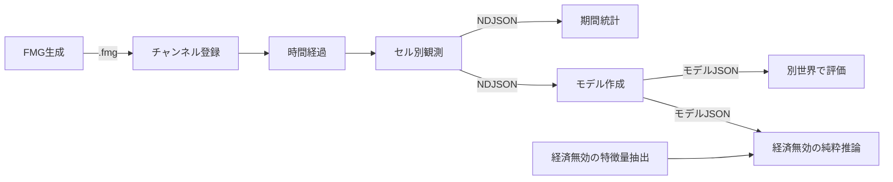

# 耕地面積の観測・統計・経済無効時の近似 API

作成: 2026-10-19。研究用APIを実装。校正モデルの自動適用は未採用。

## 1. 目的と範囲

経済拡張を有効にしたFMGを `sim:server` で数年間進め、人口規模・バイオーム・気候などと耕地面積の関係を観測する。その結果から、経済拡張を読み込まない環境でも都市付近の耕地を近似できるようにする。

生成・時間経過・観測・集計・学習・評価・推論を独立したAPIとし、保存した成果物を次の工程へ渡す。一つのHTTPリクエストで生成から学習まで実行しない。途中で集計方法だけを変えたときに、地図生成や10年間のシミュレーションをやり直す必要がない構成とする。

ここでの「都市付近」は、まず**都市が所属するFMGセル**とする。隣接セルを半径内で集める面積や、輸入食料を生産している遠隔地の面積とは区別する。CEへ渡す値は、このセルの耕地をrural・urban人口比で按分した都市側の面積である。

## 2. 既存実装と接続先

| 既存実装 | 役割・今回の扱い |
| --- | --- |
| `scripts/generateSmallMaps.mjs` | ブラウザーで実際のFMGを生成し `.fmg` を保存。今回 `--scope world` を追加。`points=1` は約2,500セルの世界全体であり、Province切り出しではない |
| `scripts/simServer.mts` / `simChannelWorker.mts` | `.fmg` をチャンネルへ登録し、NodeのSimulationHostで時間を進める。現在は生成条件から地図を直接生成するAPIではない |
| `scripts/observe.mts` | 新規生成→登録→準備期間→年次観測を既存のAPIで連携するクライアント。生成器・統計器の正本を兼ねない |
| `src/generators/landUse.ts` | 経済無効時にも使える `resolveStaticLandUseInputs` / `estimateWorldLandUse` が既に存在。新しい人口比例式で置き換えず、近似の基準に使う |
| `src/generators/settlementClearance.ts` | 人口、収量、労働、土地利用方針、移送制約等から耕地を配分する純粋な計画器 |
| `pack.landUse` | FMG/REの耕作地の正本。`provenance` が `authoritative` / `estimated` / `legacy` のいずれか |
| Economy `getCultivatedArea()` | 経済の農業計算が保持する現在の耕作面積。描画用土地利用の面積とは別項目として観測 |
| `src/services/burgFarmland.ts` | セルの耕地を都市へ按分してdescriptorへ渡す既存経路。今回の研究モデルを自動的に適用する変更はしない |

経済拡張にはCharactersへの依存がある。今回の実験ではEconomy・Characters・Nobility・Shipbuildingの通常構成を明示する。経済無効の推論側にはこれらをimportしない。

## 3. APIの分担



### 3.1 地図生成・登録・時間経過

| 操作 | 契約 | 状態変更 |
| --- | --- | --- |
| 生成 | `fmg:small -- <dir> --scope world --seed <seed> --local-storage <settings.json> --wait-extensions` | 新しいファイルのみ |
| 登録 | `POST /api/sim/channels?id=<id>&extensions=economy,characters,nobility,shipbuilding`、body=`.fmg` | 新しいチャンネル |
| 概要確認 | `GET /api/sim/channels/<id>` | なし |
| 進行 | `POST /api/sim/channels/<id>/ops`、body=`{type:"advance", years:1, sampleEvery:{months:12}, sampleDetail:"farmland", runId:"..."}` | 日付・人口・経済等を進め、確定時にrevisionを増やす |
| 保存 | `GET /api/sim/channels/<id>/archive` | なし |

書き込み認証は既存のBearerトークン規則を使う。大きい地図でHTTPの時間制限を超えないよう、長期間の観測でも進行要求は原則1年ごとに分ける。初期の条件はSettlement pattern=Standard、十分なInitial population %とし、生成後の都市数・人口・実際のバイオームを確認する。

### 3.2 観測API（実装済み）

| 操作 | 出力 |
| --- | --- |
| `GET .../observe/farmland` | 現在の `revision`、暦、`FarmlandSnapshot` |
| `GET .../observe/sample?detail=farmland` | 既存観測レコードの `farmland` に同じsnapshotを格納 |
| `advance` の `sampleDetail:"farmland"` | 各観測時点を `observe.ndjson` に追記 |
| `GET .../observe/samples` | 保存済みNDJSON。後から集計・再学習できる |

`farmland` は明示指定時だけ計算する。既存の既定観測項目には加えず、通常の交易観測に全セル分の計算・保存費用を上乗せしない。

観測は読み取り専用であり、時間を進めたり `pack.landUse` を更新したりしない。基準面積もその場で純粋計算し、観測対象へ書き戻さない。`GET` で経済を初期化して測定値を作ることもしない。

現行の定期観測ファイルは `advance` の途中で追記され、snapshot保存より先行する。生の `revision` は観測開始時点の値であり、観測完了時点の版と同じではない。正式なデータセットには正常終了した進行と対応するサンプルだけを採用する。既存runnerは要求が失敗したチャンネルのサンプルを成果物へコピーしない。途中ファイルを直接学習に使わない。

### 3.3 特徴量抽出・統計・近似API（実装済み）

```ts
readFarmlandFeatures(world, currentYear): FarmlandFeatures[]
collectFarmlandSnapshot(world, currentYear, economyEnabled, cultivatedArea?): FarmlandSnapshot

annualFarmlandFrames(frames): FarmlandFrame[]
summarizeFarmland(frames, periodYears = 5): FarmlandPeriodSummary[]
fitFarmlandModel(frames, {trainingWorldIds, minimumCells?, minimumWorlds?}): FarmlandModel
evaluateFarmlandModel(frames, model, validationWorldIds): FarmlandEvaluation
estimateFarmland(features, model?): FarmlandEstimate
```

特徴量・観測は `src/services/farmlandObservation.ts`、統計・学習・推論は `src/services/farmlandCalibration.ts`。公開関数の型を契約とする。`currentYear` は読み込んだ世界の現在年であり、任意の過去年の状態を復元する引数ではない。

集計・モデル作成・評価のファイル入出力は `scripts/farmlandResearch.mts` に分ける。各コマンドは地図を生成せず、時間も進めない。推論APIはファイル・HTTP・経済のグローバル状態に依存しない。

## 4. 観測データの意味と単位

`FarmlandSnapshot` は `{version:1, seed, year, economyEnabled, cells:[...]}`。定期観測の外側には既存の `date`・`tick`・`channel`・`runId`・`revision` がある。セルの行は以下を持つ。

| 項目 | 意味 |
| --- | --- |
| `cellId`, `burgId` | 地図内ID。都市がないセルの `burgId` はnull |
| `biomeKey` | 安定したバイオームキー。数値IDだけで世界間を集計しない |
| `historicalPeriod`, `settlementPattern` | 時代と集落パターン。StandardとMegacityを同じ係数で混ぜない |
| `ruralPeople` | `cells.pop * populationRate`、実人数 |
| `urbanPeople` | `burg.population * populationRate * urbanization`、実人数。削除都市は0 |
| `physicalAreaHa` | 既存土地利用計算が使う物理的な陸地面積、ha |
| `cultivableAreaHa` | ホストの環境条件による耕作可能面積上限、ha |
| `baselineAreaHa` | 経済の面積列を参照せず、同じ人口・環境から静的計画器で計算した耕地、ha |
| `annualTemperatureC`, `annualPrecipitationMm` | 年平均気温と表示換算済み年降水量。欠測はnull。降水量proxyをmmとして扱わない |
| `height` | FMGの0–100標高コード。メートルではない |
| `river`, `forestCover` | 河川有無と森林被覆。森林被覆の欠測はnull |
| `cultivationAreaHa` | `authoritative` な `landUse.patches[kind=cultivation]` の面積合計。CE/REの描画用目標 |
| `economyCultivatedAreaHa` | Economyの `cultivatedArea[cellId]`。診断用であり、描画目標の教師値と入れ替えない |
| `landUseProvenance` | 出所。欠測はnull |
| `urbanAllocatedAreaHa` | `cultivationAreaHa * urbanPeople / (ruralPeople + urbanPeople)`。人口合計0なら0 |

描画用の耕作地は休閑地を含む面積であり、ある季節の作付面積・収穫面積や食料量とは異なる。牧草地・放牧地・森林を耕地に含めない。既知の0haは0、未計算・経済無効・推定由来の教師値はnullとする。

対象は全陸地セル。都市のあるセルだけを採ると無人地や農村セルが欠け、都市周辺の推定に選択の偏りが入る。都市セルの成績は全セルとは別に評価する。

## 5. 数年単位の統計

- 既定は準備期間2年を除き、同じ暦日の年1回観測を10年集め、世界ごとに最初の観測年から5年間ずつに分ける。
- 耕地は時点の面積である。5年分のhaを合計せず、**各年の世界合計の平均・最小・最大**を出す。都市側配分の世界合計も同じ扱い。
- 同じ世界・年に複数のサンプルがある場合は最後の日時の1件を採用する。月次から年平均を求めたい場合は別の集約方式が必要で、今回のAPIは年末スナップショット方式。
- バイオーム×時代×Settlement pattern×人口帯（0、1,000未満、1,000–9,999、10,000以上）でセル数、セル年数、面積平均・p10・中央値・p90、基準面積、人数、1人あたり面積を出す。
- 面積欠測がある年は世界合計の平均から除外し、`missingCellYears` と `completeAreaYears` を表示する。0haで補わない。
- 5年揃わない窓・欠測のある窓は `complete:false`。隣接する複数年の観測は独立標本と数えない。

## 6. 近似モデルと評価

### 6.1 人口だけの一律係数にしない

既存の静的土地利用計画は、人口に加え、収量、気候、土壌の推定、河川水、地形・バイオームの耕作可能面積、労働、森林、土地利用方針、隣接セルへの移送を既に考慮する。これを基準 `B` とする。

研究モデルは同じ層の実測 `A` と基準 `B > 0` の比率を校正する。

```
ratio = observed cultivation ha / static baseline ha
estimated ha = clamp(baseline ha * median ratio, 0, physical ha, cultivable ha)
urban allocated ha = estimated ha * urban people / total people
```

各seed・セル・層につき複数年の比率を平均して1標本とし、同じセルを10年観測しただけで10セル分の支持があるとは扱わない。既定の採用条件は層ごとに10セル以上・2seed以上。別チャンネルに同じseedを読み込んでも独立した支持に数えない。

比率のp10/p90は推定面積の経験的な幅として返す。将来観測に対する80%の予測区間が保証される意味ではない。未観測の層・支持不足・学習時の人口範囲外は `static-baseline` へ戻し、校正したと表示しない。基準が0のセルに比率補正で耕地を新設しない。

### 6.2 独立した世界で評価する

学習と検証の `worldId` とseedの重複を拒否する。同じ地図の後年だけを検証側に回さない。

比較対象は既存基準と校正モデル。全セル、都市セルだけ、都市側配分面積のそれぞれにMAE（ha）とWAPEを出す。WAPEは絶対誤差合計÷実測面積合計で、実測合計0ならnull。0haセルごとのMAPEを出さない。適用できたセル年数も併記し、基準へのフォールバックで見かけの精度を隠さない。

今回のモデルは必ず `status:"research"`。中世・欧州・Standardの少数seedだけの検証を、全バイオーム・時代・Fantasy・Megacityで有効な校正とは扱わない。

現行の層には文化／種族キーと国家別の技術stockを含めていない。研究モデルの利用条件は実験と同じ欧州設定に限定し、本番用にはこれらの適用条件をモデルmanifestと推論時の検査へ追加する。

### 6.3 本番採用の条件（次段階）

世界全体のseed・気候・人口規模・時代・集落パターン・文化／種族を増やし、独立した検証世界で都市側配分の誤差と0haの扱いを確認する。全体の改善だけで特定バイオームの悪化を見逃さない。採用する基準と許容誤差は検証用データを見て係数を選ぶ前に固定する。

採用時にはモデルの版・学習入力ハッシュ・基準実装の版・対象条件を同梱し、未対応条件は静的基準へ戻す。食料生産・人口扶養力・労働者数へ校正値を逆流させず、まず描画用面積だけの推定とする。

## 7. FMG/RE/CEへの接続設計

実測・推定・未取得を区別した結果型を将来のdescriptorアダプターへ導入する。

```ts
type FarmlandBudget = {
  source: "authoritative" | "calibrated" | "estimated";
  cellAreaHa: number;
  urbanAllocatedAreaHa: number;
  modelVersion?: string;
};
```

優先順位は (1) 現在の正本がauthoritativeならその値、(2) 採用済みモデルが条件に対応するなら校正済み推定、(3) 静的土地利用推定。保存されていたauthoritative値と現在の経済無効状態が共存する場合の再推定は、ロード／無効化時の土地利用更新方針に従い、CEのGET処理で勝手に上書きしない。

authoritativeな0haを欠測と見なして推定へ戻さない。REとCEで別々に総面積を計算せず、共通のセル予算から按分する。CEは `descriptor.farmlandAreaHectares` に都市側配分を受け取り、既存の畑ポリゴンの合計上限を適用する。描画できなかった面積を別セルへ重複配分しない。

今回実装した `estimateFarmland(readFarmlandFeatures(world, year)[...], model)` は経済拡張なしで呼べる研究APIであり、既存のCE連携を研究モデルへ自動切替するものではない。

特徴量抽出は周辺セルへの配分を含む世界全体の計算なので、CEへの接続時は世界の同じrevisionで共有する。都市ごとに全セルを再計算しない。人口・気候・森林・土地利用方針など基準計画への入力が変わったときに再計算する。現在の観測器は明示した年次観測時だけ計算し、推論関数自体は1セルの特徴量を受け取る。

## 8. 成果物・再現手順

実験定義は `experiments/farmland-pilot.json`。操作手順は [farmland-research.md](../tools/farmland-research.md)。

- `.fmg`、`run.json`、観測NDJSONを収集段階の正本として保存。
- 集計JSON、モデルJSON、評価JSONを別々に保存し、既存ファイルは上書きしない。
- 各派生成果物は入力NDJSONのSHA-256を保持する。地図生成条件・拡張構成はrunと実験定義に残す。
- 大きな地図・生観測は `temp/farmland-research/` に保存するためGit管理対象外。再現用実験定義と小さな統計・評価抜粋はリポジトリへ残す。
- 観測スキーマ・基準計算・学習器を変えた後のデータを無条件で混ぜない。将来のモデル配布時はバージョンだけでなく基準実装のハッシュも照合する。

## 9. 初回実測

2026-10-19に実行。機械可読の結果・入力ハッシュ・実装ハッシュ・モデル係数は [farmland-area-pilot-20261019.json](../calibration/farmland-area-pilot-20261019.json)。生データは `temp/farmland-research/runs/farmland-pilot-202610191429/`。

条件はhighMedieval、European、Standard、Initial population 60%、世界全体（約2,500 gridセル）、都市数設定60、国家・文化数設定6。Economy・Characters・Nobility・Shipbuildingを有効にし、通常の進行で準備期間2年＋観測10年を3seedで実行した。月・年を間引く高速化モードは使っていない。実際の生成直後の都市数は順に70、75、70で、設定60に厳密には一致しない。

30時点、55,540陸地セル年、26種類のバイオームを取得した。6つの5年窓はいずれも5年が揃い、教師面積の欠測は0。

| seed | 世界内の観測年 | 耕地面積の年平均（ha） | 都市側配分の年平均（ha） |
| --- | --- | ---: | ---: |
| 610191 | 923–927 | 13,410,823.9 | 428,007.6 |
| 610191 | 928–932 | 14,566,779.2 | 474,652.7 |
| 610192 | 1690–1694 | 16,682,409.0 | 673,236.3 |
| 610192 | 1695–1699 | 17,418,147.1 | 756,939.0 |
| 610193 | 365–369 | 15,796,130.2 | 597,693.1 |
| 610193 | 370–374 | 16,701,823.3 | 686,878.3 |

seed 610191・610192だけでモデルを作成し、10セル・2seedの条件を満たす17層を採用した。seed 610193は学習へ入れず検証に使った。検証は18,970セル年、そのうち都市セル1,063セル年。校正を実際に使えたのは全セルで6,605セル年（34.8%）、都市セルで713セル年（67.1%）。残りは静的基準へ戻っている。

| 評価対象 | 静的基準 MAE（ha） | 校正 MAE（ha） | 静的基準 WAPE | 校正 WAPE |
| --- | ---: | ---: | ---: | ---: |
| 全陸地セルの耕地 | 13,033.9 | 11,787.8 | 152.16% | 137.62% |
| 都市セルの耕地 | 16,786.4 | 16,775.2 | 81.95% | 81.90% |
| 都市側配分（CEの面積上限） | 4,842.0 | 5,218.5 | 80.14% | 86.37% |

**この校正式をCEの既定値には採用しない。** 全セルでは改善しても都市側配分は悪化しており、絶対的な誤差も大きい。これは既存基準の精度が十分という判定ではなく、研究モデルによる置き換えを正当化できないという判定である。検証結果を見て同じ検証seedに係数を合わせ直していない。

次のモデルでは、都市側配分そのものの損失、農村／都市比・人口密度・土地利用profile、供給元セルと需要先セルの違い、静的基準0なのに実測が正になるケースを調べる。新しい学習世界と未使用の検証世界を用意し、今回の検証世界を繰り返し使って採否を決めない。観測→集計→学習→評価が独立しているため、既存の観測を診断に再利用できる。

実機確認では `GET /observe/farmland` の前後で日付・revisionは不変。拡張登録を空にしたNodeホストでも特徴量抽出・研究モデル推論を実行でき、経済contextは未初期化のまま、計算前後の世界状態の正規化ハッシュも一致した。保存ファイルのタイムスタンプは世界状態ハッシュの対象外としている。

## 10. 検証

関連テストは `farmlandObservation.test.ts` と `farmlandCalibration.test.ts`。人数・降水量の単位、描画面積と経済面積の分離、OFF/推定値の教師からの除外、真の0ha、年度の重複除去、面積を年数分合算しないこと、独立seed、上限、未知条件のフォールバックを検証する。実測ではHTTP→チャンネルworker→定期サンプル→集計→モデル作成→独立世界での評価を通す。
