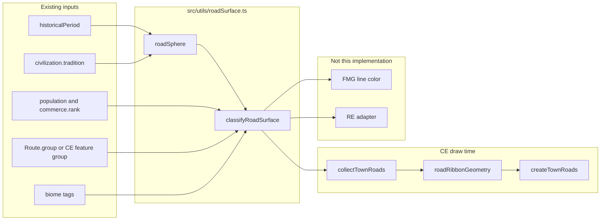
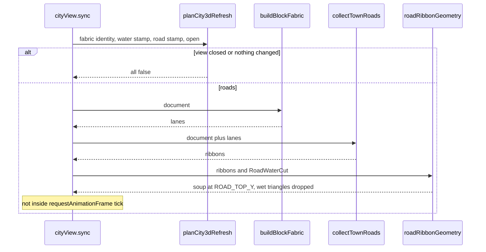

# 街道と都市内幹道の路面（CE 3D と FMG の共有分類）

2026-10-17 設計。レビュー合意済み。

正本は `docs/plan/road-surface.md`。`docs/plan/ce-3d-building-massing.md` と `docs/plan/ce-3d-water-boundary.md` には足さない。建物・構造・水面は保存せず描画時に導出する、という決着を変えない。`CityDocument.version` は上げない。`src/utils/bridgeSkewPolicy.ts` は変えない。実装 PR は `docs/plan` と `docs/plan/CHANGELOG.md` を編集しない。

CE の 3D が最初の消費者である。同じ分類関数を FMG の経路も後から読む。RE の描画はこの設計ではやらない。分類関数は RE の `highway | road | trail` を後から渡せる形にし、RE を塞がない。

## 1. 目的

CE の 3D（`mountCity3d`）で、街道と都市内の幹道が地面色の隙間ではなく道路として読めるようにする。見えるのは面である。丸石、版石、砂利、突き固め土、砕石、湿地の丸太道を、既定カメラの色で区別する。

分類は CE 専用の色ではない。FMG の `roads` と `trails` が今持っていない「何でできているか」を、時代・文化圏・経済力から同じ関数で決める。交易速度は変えない。`Route.group` が既に担っている「国家が維持する道か、そうでないか」も置き換えない。

史料が支えることと、ゲームが描く規則は分けて書く。開いた資料が薄い地域は、薄いと書き、石畳を発明しない。

## 2. 現状

| 項目 | 正本 | 今の見え方 | 3D |
| --- | --- | --- | --- |
| 幹道・街道 | `FeatureGroup` の `kind: "road"`（`src/city-editor/types/document.ts` の `EdgeFeatureGroup`）。幅は `style.widthMeters`。外から入る脚は `sourceRoad`。門の外の先は `beyond` | 町表示の線色は `#d5cfbf`、縁は `#57534b`（`featureLayerSvg.ts`）。編集色 `style.color`（生成時 `#735238`）は町表示では使わない | メッシュが無い |
| 街区の路地 | `buildBlockFabric` が導出する `InfillLane`（`widthMeters`、既定 3）。`localInfill.ts` の `laneWidth ?? 3` | `ce-infill-lane` は同じ `#d5cfbf`。郊外と classic/organic では中心線を `ce-infill-trail` でも描く | 無い |
| 幅の既定 | `defaultRoadWidthMeters(townExtentMeters(frame))`（`settlementExtent.ts`） | `townExtentMeters` は `settlementExtentMeters` が正の有限値なら `min(extentMeters, settlementExtentMeters)`、そうでなければ `extentMeters`。その値で 600 m 以下 3.5、1200 m 以下 4.5、2400 m 以下 6、それ以上 7.5。広げた表示枠の生の `extentMeters` ではない | 使っていない |
| 既存の「敷石」 | `roadTraffic.ts` の `cobbledApproach` | `group === "roads"` かつ `trafficRank >= 0.66` のとき、壁の外の脚だけを 1.6 倍幅の敷石模様にする（`appendCobble`）。壁の中の街路には付かない。`trails` は交通が多くても土のまま、とコメントにある | 無い |
| 段階⑩ | `hideStreetLines`。`generation.ts` は `stage.id === "conceal"` のときだけ `true`。生成完了時は `false`（同 317 行） | `true` のとき `concealStreets.ts` の `clipPolylineToExterior` で外壁の内側の道路線を落とし、`townFabricSvg.ts` は路地も描かない。橋のデッキ（`drawableBridgeDecks`）は残る | フラグを読まない |
| 橋 | `structureMassing.ts` の `addBridges`。`baseElevationMeters: 0.4`、`heightMeters: 0.55`（上面 0.95）、`parapet: "both"`、`parapetMeters: 0.9`（上面の上）。`structureGeometry.ts` は渡されたマッシングを押し出すだけ。`bridgeSkewPolicy.ts` は変えない | 2D デッキ色も `#d5cfbf`。`bridgeDecks` はメッシュ上の横断だけ。`frameRoads` の `kind: "bridge"` と `riverConnections.banks` はここには入らない | メッシュ上のデッキはある。路面ではない。枠の橋と河岸区間の 3D デッキはこの設計では作らない |
| 地面と水面 | `LAND_Y = -0.2`、`WATER_Y = -0.55`（`src/city3d/core/waterGeometry.ts`）。建物の床は y = 0 | 陸色 `0xd5cfbf` | 道路を置く段が無い |
| カメラ | `cityView.ts` の `frameCamera` | `position (0.85r, 0.62r, 0.85r)`、注視点 `(0, 4, 0)`、FOV 45°。`planVertex` は `(x, y, -planY)`。SVG の `(x, -y)` と一致する。反転しない | — |
| 再構築 | `planCity3dRefresh`（`waterMeshes.ts`）。`cityView.ts` の `sync` は `buildBlockFabric(city) !== built` を `fabricChanged` にし、`!plan.buildings && !plan.water` で戻る | 閉じている間は何も作らない。建物は fabric オブジェクトの参照。キャッシュは `blockInfill.ts` の `WeakMap` で、編集は文書オブジェクトを取り替えるので、道路が同じでも参照は変わる。`documentFabricFingerprint` はグループの id・kind・頂点数・セグメント数・幅であり、頂点座標は見ない。水面は `waterStampChanged`（文字列か `ce-water` の不在）。`tick` は `controls.update` と `render` だけ | 道路用スタンプは無い |
| FMG の道 | `Route`（`src/types/models.ts`）。`group` は `"roads" \| "trails" \| "searoutes"`、実行時に `"railways"` もある。勾配は `src/services/routeGrade.ts` がその場で計算する | 2D は `#roads` が実線寄り、`#trails` が破線（`public/index.css`）。色はスタイル抽出側。幅は画面ピクセルで、メートルではない | `buildRoutePaths` は `src/renderers/webgl/adapters/deckDataAdapters.ts`。`three-d-renderer.ts` の `createFloatingRoutes` が呼び、`addFloatingRouteBatch` が世界座標の `THREE.LineSegments`（`LineBasicMaterial` または `LineDashedMaterial`）を置く。`Line2NodeMaterial` は夜景の `addNightscapeRouteGlowBatch` だけ。路面色は無い |
| 交易の「舗装」 | `TradeRouteSegment.pavedShare`。`trade-animation.ts` は `group === "roads" \|\| group === "railways"` を舗装 1、それ以外を 0 にする | 速度は `getSurfaceSpeedMultiplier`。未舗装は 20% 遅い（`UNPAVED_ROAD_SPEED_PENALTY`）。`Route` 自身に表面フィールドは無い | — |
| 昇格 | `publicWorks.ts` | 交通が閾値以上で、所有者国家が払えると `trails` を `roads` に変える。表面の種類は記録しない | — |
| 時代 | `HistoricalPeriod`（`src/types/historicalPeriod.ts`）。CE は `CityDocument.historicalPeriod`。無い文書は `"ageOfExploration"` | 古代の開始段階は `technologyProgress.ts` の `EARLY_PERIOD_START_STAGE` | — |
| 文化圏 | `BurgCivilization.tradition`（`civilizationTraditions.ts` の id）。信仰は `faith`。城の系譜は `fortification` | 幻想文化も同じ id 空間（`elven`、`dwarven` など） | 路面表は無い |
| 富 | `BurgSiteDescriptor.burg.population`（絶対人口）。`BurgSiteEconomy.commerce.rank` は 0..1。`commerce.marketCenter`。`capital` | `stoneBuildingAndRoads` は era 0 で、通常開始が `diffused`、`earlyMedieval` だけ明示的に `adopted`。ローマと中世の差には使えない | — |
| 技術ノード | `stoneBuildingAndRoads` | 上のとおり。CE 文書は国家の技術段階を持たない | — |
| バイオーム | `CityDocument.biome`（`key` と `tags`）。タグは `BIOME_TAGS` | 湿地・砂漠・山地を路面に使っていない | — |
| RE | `region-editor/render/svg.ts` | `highway` 幅 8、`road` 幅 5、`trail` 幅 2（メートルに見える定数だが、描画スケール付き）。破線で区別 | この設計では描かない |
| 文書版 | `CityDocument.version: 1 \| 2 \| 3 \| 4` | マッシングも水面もフィールドを足していない | 路面も足さない |

`pavedShare` を `Route` に置く、という記述は `docs/plan/classical-antiquity-historical-period.md` §5.2 にある。実装は経路セグメントのスナップショットであり、`Route` のフィールドではない。この設計はそこを埋めて速度を変える仕事ではない。

段階⑩は「完成した町の 2D が街路を隠す」ではない。隠すのは生成スライダが `conceal` の間だけである。完成時は `hideStreetLines === false` で、幹道も路地も 2D に出る。3D はそのフラグを文書から読めない。

## 3. 範囲

### ゴール

- 路面 id の閉じた集合と、純関数の分類を1つにする。CE と FMG と、将来の RE が同じ関数を呼ぶ。
- CE 3D に、既存の道路ポリラインと fabric の路地から導出したリボンを出す。丸石と突き固め土が、`frameCamera` の距離で色として区別できる。
- 街道（壁の外、または FMG の `roads`）と、都市内の幹道（壁の内の `kind: "road"`）と、街区の路地と、小径を、別の面にできる。
- 規則は `historicalPeriod`、文化圏（既存の tradition id）、経済力で変わる。
- FMG には、導出で足りないときだけ任意の上書きフィールドを提案する。生成器は書かない。

### やらないこと

- 車両、人の流れ、交通アニメーション。
- 橋の構造、斜角、デッキの形、欄干。路面メッシュを川の上に出して斜めの橋にしない。`frameRoads` の `kind: "bridge"`、`riverConnections.banks`、渡し（`ce-ferry-*`）、堀のデッキに 3D のデッキを新設しない。それらの区間は路面もデッキも 3D には出さない。2D の線は残す。
- RE の描画。FMG の 2D 線色と破線。FMG の 3D 線の実装（消費者としての仕様だけ書く）。
- `CityDocument` への路面保存、メッシュの保存、`version` のインクリメント。
- `cobbledApproach`、`cobbledWidthMeters`、門の開口。2D の線色 `#d5cfbf`。
- `pavedShare`、`UNPAVED_ROAD_SPEED_PENALTY`、`publicWorks.ts` の昇格条件。
- 鉄道の路面。`group === "railways"` は分類しない。
- 新しいテクスチャ画像。WebGL を要求する単体テスト。E2E 全件。
- CG（`src/city-generator`）への対応。

## 4. 史料

開いたページに無い勅令、年代、材料は書かない。確度は、この設計のために開いた資料についての確度である。

### 4.1 調査

| 地域 | 時期 | 町の中 | 町の外の街道 | 小径・跡 | 誰が維持したか | 確度 | 出典 |
| --- | --- | --- | --- | --- | --- | --- | --- |
| ローマ、イタリア | 共和政後期〜帝政。リウィウスの契約は紀元前 174 年のケンソル | 41.27.5 のラテン語は `vias sternendas silice in urbe, glarea extra urbem substruendas`。市内の道は flint（`silex`）で舗装する（`sternendas`）。市外は砂利の基礎を据える（`substruendas`）であり、市外の摩耗層がすべて砂利だった、とはこの動詞は言っていない。北イタリアでは都市（壁の内だけでなく、都市だと認識された連続市街）に多角形石や板石、郊外は川原石、田園は砂利、という階層が発掘で見える。石畳は最初からではなく、砂利の上に後から載る都市もある（メディオラヌムはアウグストゥス期以降） | 主要な街道も、表面は砂利や突き固めであることが多い、というのは発掘と百科の層名からの読みであり、リウィウスの動詞そのものではない。全層が『ブリタニカ』の statumen / rudus / nucleus / 板石、という断面は代表例であり、どこでもそうではない。カマボコと側溝は共通しやすい | 私道・村道（`viae privatae` / `vicinales`）は国家の舗装街道ではない。ウァロや測量書の整理は二次文献（Smith）に頼るので、ここは確度を下げる | ローマ市と1マイル以内では、通りに面した所有者がアエディリスの指示で自分の前を直す（タブラ・ヘラクレエンシス）。アエディリスが舗装と修繕を監督し、怠れば請負に出す。ケンソルは臨時の大契約。消化 43.10 は貸家人が費用を家賃から引ける場合を伝える | 高（市内と市外の対比、前面所有者）。断面の普遍性は中 | リウィウス『都市建国以来』41.27（Roberts 訳の要約抜粋: ケンソルが市内を flint、市外を gravel で請け負わせた最初の例）<https://kwize.com/en/texts/Livy-From-the-Founding-of-the-City-Book-41-Perseus-and-the-States-of-Greece/> 。タブラ・ヘラクレエンシス英訳 <https://droitromain.univ-grenoble-alpes.fr/Anglica/heracleensis_johnson.html> 。北イタリア: Matteazzi ほか、Road Building in Roman Times（ResearchGate の公開 PDF に都市／郊外／田園の三層）<https://www.researchgate.net/publication/371475532_Road_Building_in_Roman_Times_an_Insight_from_Northern_Italy> 。層の名前: Britannica, “statumen” <https://www.britannica.com/technology/statumen> |
| 中世イングランド、ウェールズ、アイルランド | 1249 年のビバリーが文献上の早い pavage。農村への許可は主に 14 世紀 | 許可の多数は町の街路か市場を舗るためのもの。町全体ではない。1270 年代以降、ヨークやロンドンでは家の前を掃く義務が条例に出るが、それは舗装の証明ではない | ロンドンから放射する大路の修繕許可が 14 世紀にまとまって出る。恒常の石畳街道ではない | 許可が無い道は土。舗装税が無い村の道を石だとみなす根拠は、開いた資料には無い | 国王の特許状で、個人・都市・近隣の bailiffs が期限付きの通行料や税を取る。家の前を住人が掃く義務とは別の財政である | 高（許可の二種類と、最初の年）。個々の町の完成度は中 | Wikipedia “Pavage”（Cooper 2006 を典拠に挙げる）<https://en.wikipedia.org/wiki/Pavage> 。Cooper, *Bridges, Law and Power in Medieval England, 700–1400*（Boydell, 2006）pp. 127–148。掃き義務の概説: HistoryExtra <https://www.historyextra.com/membership/medieval-cities-london-filthy-chamberpots-windows/> |
| パリ | 13 世紀の特許状。15 世紀の市域会計（1424–1489）に舗石支出が残る | 国王が一部の道の舗装を決め、税をその道・街区・広場に紐づける。中世の原則では前面の住人が自分の前を持つが、パリでは 13 世紀から税で分担する。会計は頻繁に直した車道を数えており、全市が一度に石になった記録ではない | 市門の外の全国道まで同じ舗石だとは、開いた会計資料は言っていない | 税の対象外の路地は、この資料だけでは材料が決まらない | 商品・荷車・家への税。使用先は舗装に限定される、という説明 | 中（財政の仕組みは二次解説、会計の存在は目録で確認） | Histoires de Paris, 「Le droit de pavage à Paris」<https://www.histoires-de-paris.fr/droit-pavage/> 。Hermenault の会計地図 <https://nakala.fr/10.34847/nkl.9abevs92> 。同「Mesurer et localiser le travail des artisans paveurs」（*Histoire urbaine* 43, 2015） |
| 中世ヨーロッパ都市、横断 | 14 世紀後半まで | 作業稿は、人口およそ 2,000 を超える都市の多くで主要通りが何らかの舗装を持った、とまとめる。最初の材料は砂利であることが多く、その後に石や木。79 都市を扱い、例外と遅れを明記している。市場と教会通りから始まる、という個別条例の網羅はこの稿の要約だけではできない | 町の主要通りの話であり、国土の街道ではない | 裏通りまで同じ、とは書いていない | 財産税、pavage、専門の舗石工。家主の出資か監督を求める町が多い | 中（未完の作業稿の要旨。数値は稿の主張として使う） | “Paving Medieval Towns” <https://www.academia.edu/29961983/Paving_Medieval_Towns_Update_docx> |
| イスラーム都市（ダマスクス、カイロ） | 7–19 世紀のスーク史 | 開いた範囲では、スークが都市の背骨であり権力と商業の近くに建つ、という空間の話までである。舗装材料の条例はページを開いて確認できなかった（Rabbat、Raymond は有料または目録のみ。Al-Sayyad の MIT 論文要旨も街路構造であり材料ではない） | 同じ。隊商路の路面は未確認 | ハラ（居住区）の路地が土だった、とこの調査では断定しない | ワクフが商業施設を維持した、という通説を、開いた要旨だけでは路面に結び付けない | 低（材料） | Rabbat, in *The Bazaar in the Islamic City*（Cairo Scholarship, 2012）目次と要旨 <https://academic.oup.com/cairo-scholarship-online/book/21341/chapter/181062608> 。Raymond 編 *The City in the Islamic World*（Brill, 2008）目録 <https://brill.com/edcollbook/title/17776> 。Al-Sayyad, *Streets of Islamic Cairo*（MIT, 1981）<http://hdl.handle.net/1721.1/37161> |
| 秦の直道と、それ以降の中国の駅路 | 秦（紀元前 3 世紀末）。後代の駅制は資料を路面まで開いていない | 町の中の舗装は、この調査では発掘報告を開いていない。首都の大路がすべて板石だとは書かない | 直道は谷を埋め山を切った直線路として史書とルート論争の対象である。2025 年の報道は、陝西の新規区間について版築の法面、突き固めた路床、踏み固められた面を報じ、板石の摩耗層とは書いていない。幅数十メートルという報道値はゲームの街路幅に使わない | 駅路でない道の材料は未確認 | 国家事業。駅（伝）の制度全体は、この設計のために一次史料を開いていない | 中（直道が突き固め土系であること）。町中は低 | Sanft の論点を含むルート論文: *Frontiers of History in China* 6（2011）<https://link.springer.com/article/10.1007/s11462-011-0132-1> 。発掘の報道: Arkeonews, 2025-12-22 <https://arkeonews.net/china-discovers-2200-year-old-imperial-road-the-ancestor-of-todays-4-lane-highways/> （報道であり発掘報告書ではない） |
| 日本の五街道 | 江戸（1603–1868）。東海道の宿駅整備は 17 世紀初頭 | 宿場の街路が連続した敷石だった、とは開いた概説は言っていない | 五街道は江戸を中心に軍事と通信のために整備された。宿駅、関所、一里塚、伝馬。箱根など急坂に石畳（石だたみ）が残る。平坦部を砂利と砂で舗った、という記述は二次のストーリーマップにあり、この設計では平坦部を「管理された土」とし、石畳は山地に限る | 脇往還や村道は五街道の規格ではない | 幕府の道中奉行と宿場、助郷。通行そのものは多様（参勤、商人、巡礼） | 中（制度と、急坂の石畳）。平坦部の摩耗層は低 | Nippon.com, “The Five Highways” <https://www.nippon.com/en/japan-topics/c08604/> 。Vaporis, “Linking the Realm: The Gokaidô Highway Network”, in *Highways, Byways, and Road Systems in the Pre-Modern World*（Wiley, 2012）<https://onlinelibrary.wiley.com/doi/10.1002/9781118244326.ch4> 。箱根の石畳は史跡としての観光解説で、学術書の代替にはしない |
| インカのカパック・ニャン | 15 世紀に最大規模。地域によりそれ以前の道を含む | 町の通りと国土の道を、開いた UNESCO 文は分けていない | 石と土。地域で石種が変わる。敷石、階段、側溝、排水、橋。海岸砂漠、山地、熱帯林で工法が変わる。車輪のための舗装ではない | 支道や地元の道は幹線より弱い。幅は数メートルから場所によってずっと広い、という二次記述がある。ゲームの街路幅には使わない | 国家が労働を動員し、地元が路床を維持する、と UNESCO は書く。ミタの詳細な条文はこの調査では開いていない | 高（多様な面と、石と土）。町中だけ石、とは言えない | UNESCO, Qhapaq Ñan <https://whc.unesco.org/en/list/1459/> 。登録ガイドが Hyslop を研究史上の基準に挙げる: <https://qhapaqnan.cultura.pe/sites/default/files/mi/archivo/rcq.pdf> |
| 西アフリカ（トンブクトゥ、ジェンネ、カノ） | 交易都市として中世後期〜19 世紀。カノの近代道路は 1903 年以降 | 街路網と街区は残る。材料の発掘記述は、開いた要旨には無い。トンブクトゥの建物は版築（banco）だという概説があり、街路も石畳だったとは書いていない | サハラ横断は隊商の軌跡であり、舗装路ではない、という地図解説がある。カノの植民地以前の連絡は踏み分けと駄獣で、近代的な道路・鉄道は無かった、という研究稿がある | ブッシュトラック | 帝国や都市が隊商路の結節を持った、という以上の道路予算は未確認 | 低（「石畳が無かった」は消極的証拠）。隊商路が構築路ではない、は中 | Baumanova, Šmejda, Rüther, *Journal of Urban History* 45（2019）<https://doi.org/10.1177/0096144217746375> 。Umar, “Transportation and Trade in Precolonial Kano” <https://t2m.org/wp-content/uploads/2014/09/M%20Yusuf%20Umar_Transportation%20and%20Trade%20in%20Precolonial%20Kano.pdf> 。隊商路を点線で描く解説: <https://www.guidopicardi.com/en/portfolio/kanem-bornu-and-the-trans-saharan-trade/> 。建物の版築: <https://www.worldhistory.org/Timbuktu/> |
| インド | アルタシャーストラは紀元前 4 世紀末に帰せられる本文。シェール・シャーは 1538–1545 年 | 城内の車道・王道・港や牧地へ続く道の幅をダンダで指定する（王道などは 4 ダンダ）。材料の規定は、開いた章には無い | メガステネスを引く後代地理書は、パータリプトラへの王道に距離標があったと伝える。シェール・シャーのサダク・エ・アザム（後のグランド・トランク・ロードの前身）は路線、並木、サライ、コーズ・ミナールの行政路として説明される。マカダム舗装だとは開いた記事は言っていない。イギリスの改修で路線がずれた、とある | 村や墓地へ続く道は幅が違う。材料は未確認 | 国家の道路行政と、宿駅・里程標。路面工事の請負形態は未確認 | 中（幅と里程標とサライ）。摩耗層は低 | シャマシャストリ訳の城内道路: <https://chanakyadrishti.com/kautilya-arthashastra-book-two/> （Book II, ch. 4）。本文の置き場: <https://www.wisdomlib.org/hinduism/book/kautilya-arthashastra> 。コーズ・ミナール: Hindu Business Line, 2020-06-12 <https://www.thehindubusinessline.com/blink/takeaway/sher-shah-suris-kos-minars-in-north-india/article31811516.ece> |
| イギリスの有料道路とマカダム | マカダム『Remarks』の第7版は 1823 年の下院委員会報告を含む。ゲームの `preIndustrialEra` は c. 1750–1830 | 大都市の近くでは、中央およそ 12 フィートを正方形に近い硬い石で舗り、脇を砂利や砕石にする、という提案が本文側にある。都市の舗石と、郊外の砕石は別物として扱っている | 信託（turnpike trust）が通行料で郊外道を持つ。材料は地方により砂利、フリント、石灰岩、ホインストーン。欠陥は、土を溝に掘ること、丸い砂利のまま敷くこと、水を貯めること。マカダムの主張は、乾いた地山が荷重を支え、角のある砕石を一様な厚さに置く、道は周囲より上げる、である | 教区道は有料道路より悪い、とマカダムは書く | 信託のサーベイヤーと通行料。労役（statute labour）は廃止すべきだ、と彼は述べる | 高 | McAdam, *Remarks on the Present System of Road Making*（Project Gutenberg #65022、第7版）<https://www.gutenberg.org/files/65022/65022-h/65022-h.htm> 。Internet Archive の 1821 年版 <https://archive.org/details/remarksonpresent00macarich> |
| 湿地の丸太道 | 北欧の先史〜歴史時代の木道は知られているが、この調査では発掘報告を開いていない | 都市の標準路面ではない | 湿った地盤で土が沈む区間の工法であり、全域の街道ではない | 湿地の小径に最もありそう | 地元 | 低（種類としての存在は通説。このファイルは一次報告を引用できない） | 本文 §4.2。ゲーム規則では小径と、貧しい湿った街道に限る |

メソアメリカの路面は、この調査では報告を開いていない。確度は低。ゲームは土に落とす。

### 4.2 史料が支持すること（ゲーム規則ではない）

- 町の中と、町の外は、しばしば別の仕事である。ローマの紀元前 174 年の契約は、市内を flint で舗装し、市外には砂利の基礎を据える。市外の摩耗層を砂利にする、は §4.3 のゲーム規則であり、`substruendas` の訳ではない。北イタリアの発掘は、都市だけが板石で、田園は砂利、という別の支持である。
- 舗装は主要通りと市場から始まる。裏通り、貧しい町、門の外まで同時に石になるわけではない。人口 2,000 という閾値は作業稿の「主要通り」であって、全市ではない。
- 多くの町は土のままである。pavage は特許が要る特別な行為である。西アフリカの開いた資料は、石の街道を支持しない。秦の直道の新しい報道は突き固め土である。
- 「街道」は、幅と溝と宿駅を持つ管理された路床であり、石畳とは限らない。五街道、カパック・ニャン、インドの王道、ローマの砂利道がそれである。
- 「小径」は、国家が面を保証しない軌跡である。隊商の点線、教区道、`viae vicinales`、FMG の `trails`。
- 支払う主体は、前面の家、町の税、国家の労役、通行料の信託、に分かれる。一つの「道路局」ではない。
- 19 世紀初頭の郊外道の改良は砕石（マカダム）であり、都市の敷石を廃止した話ではない。ゲームの `preIndustrialEra`（c. 1750–1830）に入る。

### 4.3 負の事例（規則に入れる）

- 初期中世の小さいヨーロッパの町は、市場も含めて土でよい。2,000 人未満は作業稿の舗装側に入らない。
- 豊かな中世後期の町でも、舗るのは市場・教会前・幹道であり、街区の路地までは舗らない。門の外の国土道を敷石にしない。
- `trails` は、交通量が `COBBLE_RANK` を超えても敷石にしない。今の `roadTraffic.ts` と同じ原則である。昇格して `roads` になってから、その時代の「街道」の面になる。
- 古代でも市外の摩耗層の既定は砂利、とする。これはゲーム規則である。リウィウスが保証するのは砂利の基礎までで、摩耗層が砂利だとは書いていない。北イタリアの田園の砂利が、この既定の根拠である。アッピア街道の観光写真を全 `roads` の既定にしない。
- イスラーム都市、西アフリカの町中、メソアメリカの摩耗層は、この調査では一次史料を開いて確定できなかった。これは製品の選択ではなく、史料の限界である。規則は意図的に土へ寄せ、イスラームの豊かな市場だけ砂利へ一段上げる。これは史料の主張ではない。後から条例や発掘が出ても、変えるのは `src/utils/roadSurface.ts` の表だけである。メッシュ、スタンプ、2D の帯は動かさない。

## 5. 路面の閉じた集合

世紀ごとには切らない。描ける面は 7 つである。id は安定させる。

| id | 見た目の意味 | 史料との対応 | 既定カメラで陸 `0xd5cfbf` と分ける色 |
| --- | --- | --- | --- |
| `track` | 踏まれただけの小径。路床の管理が無い | 小径、隊商の軌跡、郊外の路地 | `0x6e5838` |
| `earth` | 形を整えた土、版築、突き固め。溝があっても石は無い | 秦の直道、五街道の平坦部、中世の未舗装街路、インカの土の区間、インドの行政路 | `0x8d6a3d` |
| `gravel` | 砂利、玉石、または結合材の無い小さな石。大判の板ではない | ローマの市外、中世の最初の舗装、有料道路の砂利 | 地 `0xa8926a`。近いと `0x7a6a48` と `0xc4b48a` のまだら |
| `setts` | 丸石・小舗石。目地が見える敷石 | ローマ市街の silex、中世の主要通り、山地の石畳、インカの敷石 | `0x7d7a74`。目地 `0x3e3c38` |
| `flags` | 大きい板石・煉瓦敷きの儀礼軸 | 豊かな古典都市の広場前。北イタリアの都市板石。首都の限られた区間 | `0xb7b1a4`。目地 `0x5c5952` |
| `macadam` | 一様な砕石の殻。目地の格子は無い | マカダム。都市の敷石とは別 | `0x4e4c49` |
| `corduroy` | 進行方向に直交する丸太 | 湿地の小径。一次報告は未引用 | `0x5c3b22` と `0x8a6240` の横縞 |

`macadam` と `corduroy` は「一段上げ」の梯子に入れない。梯子は `track < earth < gravel < setts < flags` だけである。`corduroy` は残す。使うのは湿地の小径と、貧しく湿った土の街道だけである。他の行は動かさない。この判断は閉じている（Key Decision 11）。

## 6. 分類

モジュールは `src/utils/roadSurface.ts`。DOM、three.js、`city-editor`、`region-editor` を import しない。`HistoricalPeriod` は `src/types/historicalPeriod.ts` から import してよい。`periodIndex` は同ファイルの `historicalPeriodIndex` を使う。

### 6.1 文化圏

幻想文化を、名前の雰囲気でローマや唐にしない。既存の tradition id と、必要なら `fortification` だけを見る。表は `ROAD_SPHERE_BY_TRADITION` としてこのファイルに置く。`civilizationTraditions.ts` には足さない（burial と城の表と混ぜない）。

| sphere | tradition id |
| --- | --- |
| `classical` | `roman`、`hellenic`、`latinMediterranean`。ただし `historicalPeriodIndex <= lateAntiquity` のときだけ。それ以降は `latin` |
| `latin` | `latinWest`、`gallic`、`anglo`、`norse`、`finnic`、`magyar`、`ruthenian`、`insularCeltic`、`basque`、および上の三つが古代を過ぎたあと |
| `islamic` | `maghrebi`、`arab`、`persian`、`swahili`、`levantine`。`turkic` は `faith` が `sunni` または `shia` のとき。それ以外の `turkic` は `steppe` |
| `sinitic` | `sinitic`、`korean`、`vietnamese` |
| `japanese` | `japanese` |
| `indic` | `indic` |
| `andean` | `andean` |
| `mesoamerican` | `nahua` |
| `westAfrican` | `westAfrican` |
| `steppe` | `mongol`、および上の `turkic` |
| `oceanic` | `polynesian`、`arctic` |
| `earthwork` | `mesopotamian`（古代の練瓦の儀礼路は、この調査では本文を開いていないので石にしない）、上に無い id |

`elven`、`darkElven`、`dwarven`、`giant`、`draconic`、`tribal`、`arachnid`、`serpent`、`infernal` は tradition では決めない。`BurgCivilization.fortification` を見る。

| fortification | sphere |
| --- | --- |
| `classical` | 古代二期間だけ `classical`、以降 `latin` |
| `european` | `latin` |
| `islamic` | `islamic` |
| `japanese` | `japanese` |
| `sinitic` | `sinitic` |
| `earthwork`、`fantastic` | `earthwork` |

`civilization` が無い CE 文書は `latin` ではない。`earthwork` にする。時代だけの町を、根拠無くヨーロッパの敷石にしない。スタンドアロンで時代が `ageOfExploration` でも、tradition が無ければ土である。FMG から開いた町は descriptor の `civilization` がある。

### 6.2 経済力

```ts
export type RoadMeans = "poor" | "middling" | "rich";

export function roadMeans(input: {
  population: number;
  commerceRank: number | null;
  capital: boolean;
  marketCenter: boolean;
}): RoadMeans;
```

- `rich`: `capital`、または `population >= 8000`、または `(commerceRank ?? 0) >= 0.66`。
- `middling`: 上ではなく、`population >= 2000`、または `marketCenter`、または `(commerceRank ?? 0) >= 0.35`。2,000 は §4 の作業稿が「主要通りの舗装」に使い始めた規模に合わせたゲーム閾値である。全市舗装の史料上の閾値ではない。
- それ以外は `poor`。

CE の人口は次の順で、最初の有限値を使う。`fabric.generation.settings.descriptor.burg.population`、`urbanMorphology.baselinePopulation`、`populationPlan.settings.targetPopulation`、無ければ 0。`capital` は descriptor の `burg.capital`、無ければ false。`commerceRank` と `marketCenter` は `siteEconomy.commerce`。経済プロファイルが無ければ rank は null、market は false。

### 6.3 入力と関数

```ts
export const ROAD_SURFACE_IDS = [
  "track", "earth", "gravel", "corduroy", "setts", "flags", "macadam"
] as const;
export type RoadSurfaceId = (typeof ROAD_SURFACE_IDS)[number];

export type RoadPlace = "trail" | "highway" | "arterial" | "street" | "civic";
export type RoadSphere =
  | "classical" | "latin" | "islamic" | "sinitic" | "japanese" | "indic"
  | "andean" | "mesoamerican" | "westAfrican" | "steppe" | "oceanic" | "earthwork";

/** "unknown" does not cap. "absent" forbids gravel, setts, flags, and macadam. */
export type StoneRoadKnowledge = "unknown" | "ready" | "absent";

export interface RoadSurfaceQuery {
  period: HistoricalPeriod;
  sphere: RoadSphere;
  means: RoadMeans;
  place: RoadPlace;
  /** FMG group. CE lanes that are not an imported route use "local". */
  group: "roads" | "trails" | "local";
  wetland: boolean;
  /** Mountain, snow, or a montane key. Japanese passes and Andean paving. */
  upland: boolean;
  /** hotDesert, coldDesert, or the desert tag. Andean coast stays earth. */
  dry: boolean;
  stoneRoads: StoneRoadKnowledge;
}

export interface RoadSurfaceDecision {
  id: RoadSurfaceId;
  maintainer: "state" | "town" | "frontager" | "toll" | "corvee" | "none";
}

export function roadSphere(
  tradition: string | null,
  fortification: string | null,
  faith: string | null,
  period: HistoricalPeriod
): RoadSphere;

export function classifyRoadSurface(query: RoadSurfaceQuery): RoadSurfaceDecision;

/** Whole-route helper. Railways and sea routes return null. */
export function classifyRouteSurface(input: {
  period: HistoricalPeriod;
  tradition: string | null;
  fortification: string | null;
  faith: string | null;
  population: number;
  commerceRank: number | null;
  capital: boolean;
  marketCenter: boolean;
  group: string;
  wetland: boolean;
  upland: boolean;
  dry: boolean;
  stoneRoads: StoneRoadKnowledge;
  /** Used only when it is a member of ROAD_SURFACE_IDS. */
  override?: string | null;
}): RoadSurfaceDecision | null;
```

`classifyRouteSurface` は `group === "trails"` なら `place: "trail"`、`group === "roads"` なら `place: "highway"`。`"searoutes"` と `"railways"` と未知の group は null。`override` が有効な id なら、それを返し、維持者は `"state"` にする。生成器は override を書かない。`trails` を既定で舗装路にしない、の例外は、編集者が明示したときだけである。

CE は技術グラフを読まない。`stoneRoads` は `"unknown"`。FMG の将来の呼び出しだけが、国家の `stoneBuildingAndRoads` が `locked` / `known` / `demonstrated` なら `"absent"`、`adopted` / `diffused` なら `"ready"` を渡す。通常の開始プロファイルはこのノードを高く始めるので、時代差は period と sphere が作る。ノードは退行した国家を石から外す負のゲートである。

湿地（`wetland`）は、CE では `document.biome.tags` に `wetland` があるか、`key` が `wetland`、`mangrove`、`borealPeatland`、`floodedForest` のとき。FMG の一本の経路では、陸上セルの過半数が同じ条件のときだけ true。一セルの沼で全線を丸太にしない。`upland` はタグ `mountain` または `snow`、または key が `montaneForest`、`alpineTundra`、`cloudForest`。`dry` はタグ `desert` または key が `hotDesert`、`coldDesert`。

### 6.4 適用順

1. `group === "trails"` または `place === "trail"` なら、湿地なら `corduroy`、そうでなければ `track`。維持者 `none`。ここで終わる。経済力でも時代でも敷石に上げない。CE の `collectTownRoads` はこの関数に `Route.surface` を渡さない。編集者の override は `classifyRouteSurface` だけが読む。
2. 下の基本表で `highway` / `arterial` / `street` を決める。`civic` は、同じ行の `arterial` を梯子で一段上げ、そのあと天井へクランプする。天井が `earth` なら上げた結果を `earth` に戻す。`classical` の middling は arterial が `setts` なので一段で `flags` になるが、天井 `setts` が後から戻す。`flags` が残るのは rich の classical civic だけである。天井は §6.5。
3. `stoneRoads === "absent"` のとき、`gravel` 以上を `earth` に下げる。`corduroy` は残す。`macadam` も禁止し `earth` にする。
4. 湿地かつ `means === "poor"` かつ結果が `earth` なら `corduroy`。豊かな街道を丸太にしない。湿地の豊かな街道は表の `earth`（土の堤）のまま。
5. 維持者は §6.6。

乱数は使わない。同じ入力は同じ id である。

### 6.5 基本表

行に無い組み合わせは `earth`、小径扱いになったものは手順 1 に戻る。`industrial` は `historicalPeriodIndex >= preIndustrialEra`。`late` は `lateMedieval`、`ageOfExploration`、`maritimeEra`。`high` は `highMedieval`。`early` は `earlyMedieval`。`antiquity` は `classicalAntiquity` と `lateAntiquity`。

**latin**（`islamic` は注記どおり縮める）

| 帯 | means | highway | arterial | street | civic の天井 |
| --- | --- | --- | --- | --- | --- |
| antiquity | すべて | earth | earth | earth | earth（上げない） |
| early | すべて | earth | earth | earth | earth（上げない） |
| high | poor | earth | earth | earth | earth（上げない） |
| high | middling | earth | earth | earth | gravel |
| high | rich | earth | gravel | earth | setts |
| late | poor | earth | earth | earth | gravel |
| late | middling | gravel | gravel | earth | setts |
| late | rich | gravel | setts | earth | setts |
| industrial | poor | earth | earth | earth | gravel |
| industrial | middling, rich | macadam | rich は setts、middling は gravel | earth | setts |

`antiquity` の行は、`gallic` など古典に入らない tradition が `classicalAntiquity` / `lateAntiquity` でもローマの敷石にならないためのものである。欠行を early の行で埋めたり、`latinMediterranean` の古代分岐を他の tradition に広げたりしない。`islamic` もこの antiquity 行をそのまま使う。

`islamic` は上表を読んだあと、`arterial` が `setts` または `flags` なら、civic の一段上げの前に `gravel` へ落とす。`civic` はその落とされた arterial から一段上げ、latin の天井を適用する。結果、late の rich は arterial が `gravel`、civic が `setts` である。highway も `setts` にしない（表も既にしていない）。これは §4 の確度が低いためのゲーム側の縮退である。

**classical**（古代二期間だけ。以降は latin の表）

| 帯 | means | highway | arterial | street | civic |
| --- | --- | --- | --- | --- | --- |
| classicalAntiquity | poor | earth | gravel | earth | setts |
| classicalAntiquity | middling | gravel | setts | gravel | setts |
| classicalAntiquity | rich | gravel | setts | setts | flags |
| lateAntiquity | rich | gravel | setts | gravel | flags |
| lateAntiquity | それ以外 | earth | gravel | earth | setts |

市外を板石にしない、はリウィウスの対比に合わせたゲーム規則である。`lateAntiquity` の非富裕な街道を土に落とすのは、維持が落ちるというこのプロジェクトの時代説明（`classical-antiquity-historical-period.md` §2.2）に合わせた規則であり、特定の勅令の引用ではない。

**sinitic**: industrial 未満は highway / arterial / street がすべて `earth`。rich の civic だけ `gravel`。industrial の highway は poor でなければ `macadam`、arterial と street は `earth`、rich civic は `gravel`。首都だから全市を板石にしない。

**japanese**: highway は `upland` なら `setts`、そうでなければ `earth`。arterial と street は `earth`。rich の civic は `gravel`。industrial で `upland` でない highway は poor でなければ `macadam`。山地の石畳は残す（industrial でも upland highway は `setts`）。CE の町は平坦なので、経路の途中で土と石を切り替えることはできない。町のバイオーム一つで町内の街道全線を決める。これは簡略であり、箱根だけが石だという史料より粗い。

**indic**: industrial 未満は highway `earth`、arterial は rich だけ `gravel`、そうでなければ `earth`、street `earth`、middling 以上の civic は `gravel`。アルタシャーストラのダンダ幅は適用しない。CE の大都市の既定 7.5 m が、訳文の 4 ダンダ（約 7.3 m）と同じオーダーなので、第二の幅を作らない。industrial の highway は poor でなければ `macadam`。

**andean**: `dry` なら highway も arterial も `earth`。`upland` なら highway と arterial が `setts`、street は `earth`。どちらでもない inland は `earth`。civic は arterial と同じで、一段上げない（市場だけ板石にする史料を開いていない）。industrial の highway は、`upland` の `setts` を残し、それ以外は poor でなければ `macadam`。

**westAfrican**: highway / arterial / street は `earth`。rich の civic だけ `gravel`。`setts` と `flags` と `macadam` には上げない。industrial でも macadam にしない（時期の産業化が、開いたカノ研究の「1903 年まで近代道路が無い」を飛び越えるため）。これはゲームの縮退である。

**mesoamerican、steppe、oceanic、earthwork**: highway が `group === "roads"` または `local` の幹道なら `earth`、arterial と street も `earth`。civic は上げない。industrial の highway は、`steppe` と `earthwork` と `mesoamerican` と `oceanic` では poor でなければ `macadam`。文化が産業時代まで石を拒む、とはしない。拒むのは `westAfrican` だけ（上の理由）と、手順 1 の小径である。

上の sinitic から earthwork までの段落は、latin の表と同じ拘束力を持つ。実装は散文を「だいたい」で埋めない。特に次は M0 が固定する。日本の highway は `upland` なら industrial でも `setts`、`temperateDeciduousForest` のような非 upland は industrial 未満 `earth`、industrial かつ poor でなければ `macadam`。アンデスは `dry` なら `earth`、`upland` なら highway と arterial が `setts` で civic は上げない。`westAfrican` の `preIndustrialEra` highway は rich でも `earth`。`stoneRoads: "absent"` は `setts` だけでなく `macadam` も `earth` に落とす。

### 6.6 維持者

描画は維持者で色を変えない。ツールチップと、FMG が後で出す注釈用である。

| 条件 | maintainer |
| --- | --- |
| `track`、`corduroy` | `none` |
| `macadam` | `toll`（`steamEra` 以降は `state`） |
| classical の `flags`、または classical の highway の `gravel` | `state` |
| `setts`、latin/islamic の civic の `gravel` | `frontager` |
| sinitic、japanese、andean、indic の highway の `earth` または `setts` | `corvee` |
| それ以外の `earth` と `gravel` | `none` |

中世の町が税で舗る場合と、家が前を持つ場合は、開いた資料では両方ある。ゲームは敷石を `frontager` にまとめ、特許状の税と家の義務を分けない。

### 6.7 例

人口と rank は §6.2 の閾値にそのまま乗る。

**貧しい初期中世のヨーロッパの町。** `period: "earlyMedieval"`、`tradition: "anglo"`、人口 800、`commerceRank: 0.1`、capital でも market でもない。sphere `latin`、means `poor`。FMG の `roads` の壁外は `earth` / `none`。壁内の `kind: "road"` は `earth` / `none`。コアの路地は `earth`。郊外の路地は `place: "trail"` なので `track`。広場の前も early の天井が earth なので土。湿地の `trails` だけ `corduroy`。敷石は出ない。

**豊かな中世後期のヨーロッパの町。** `period: "lateMedieval"`、`tradition: "gallic"`、人口 12_000、`commerceRank: 0.8`、`capital: true`。means `rich`。壁外の `roads` は `gravel`（敷石ではない）。壁内の幹道は `setts` / `frontager`。路地は `earth`。広場から 40 m 以内の幹道は `civic` で、既に setts なので `setts`。同じ町の `trails` は `track`。`ageOfExploration` でも表の late のまま。`maritimeEra` も同じ面で、highway の維持者は表が gravel なので `none` のまま（toll は macadam だけ）。

**ローマ、またはローマに相当する都市。** `period: "classicalAntiquity"`、`tradition: "roman"`、人口 50_000、`capital: true`。壁外は `gravel` / `state`。幹道とコアの路地は `setts` / `frontager`。広場前は `flags` / `state`。`tradition: "hellenic"` で `lateAntiquity`、人口 3_000、rank 0.2、capital でない。rank 0.2 は 0.35 未満なので rank では middling にならない。人口が 2_000 以上なので means は `middling`。rich ではない。highway は `earth`、幹道は `gravel`、路地は `earth`、広場前は `setts`。`earlyMedieval` の `roman` は sphere が `latin` に落ち、初期中世の土の行になる。同じ古代でも `tradition: "gallic"` は sphere が `latin` のままなので、antiquity 行の全 `earth` であり、ローマの `gravel` にはならない。

**東アジアの駅路。** `period: "highMedieval"`、`tradition: "sinitic"`、人口 30_000、`capital: true`。`roads` は `earth` / `corvee`。幹道も路地も `earth`。広場前だけ `gravel`。`tradition: "japanese"`、`period: "ageOfExploration"`、biome key `montaneForest` なら壁外の街道は `setts` / `corvee`、町中の幹道は `earth`。同じ日本で key が `temperateDeciduousForest` なら街道は `earth`。どちらの `trails` も `track`。

**辺境の小径。** `period: "earlyMedieval"`、`tradition: "finnic"`、`group: "trails"`。草地なら `track`。タグ `wetland` なら `corduroy`。`setts`、`flags`、`gravel`、`macadam` にはならない。交通量が大きくてもならない。`publicWorks` が group を `roads` に変えたあとだけ、その時点の latin の highway 行（初期中世なら `earth`）になる。昇格は敷石の購入ではない。

### 6.8 CE の place と、リボンに載せる線

`src/city-editor/generators/townRoads.ts` の `collectTownRoads` がリボンを作る。three.js は import しない。`roadUse` は呼ばない。`collectTownRoads` は `Route.surface` を読まない。FMG のピンは町のメッシュを舗装しない。

#### 6.8.1 group の引き方

`sourceRoad` は `{ index, routeId, terminal? }`（`document.ts`）。`index` は `fabric.generation.settings.descriptor.roads` の添字であり、`importedRoadsForSite` が後で落とした列も含む。`roadUse`（`roadTraffic.ts`）は `urbanMorphology` がある、または `traffic` と `trafficRank` が両方無いと `null` を返す。group は残っているので、この関数は使わない。

```ts
function importedGroup(
  document: CityDocument,
  index: number,
  routeId: number | undefined
): "roads" | "trails";
```

- 配列は `document.fabric?.generation?.settings.descriptor?.roads ?? []`。
- `entry = roads[index]` が使え、かつ `routeId === undefined || entry.routeId === routeId` のときだけ一致とする。
- 一致し、`entry.group === "roads"` なら `"roads"`。
- それ以外（要素が無い、`routeId` が違う、`group` が `"trails"` でも `"searoutes"` でも未知でも）は `"trails"`。
- 添字を渡した脚を `"local"` にしない。失敗は手順 1 の小径である。豊かな `lateMedieval` の arterial や、豊かな古典の street に落ちて `setts` になる穴を塞ぐ。

呼び出し側の `routeId`:

- メッシュの `kind: "road"` で `sourceRoad` がある: `sourceRoad.routeId`。
- `frameRoads` の脚: `leg.routeId`。
- `riverConnections`: 接続自身に `routeId` は無い。`sourceRoad.index === connection.sourceIndex` の道路グループがちょうど一つの `routeId` を持つとき、その値を渡す。ゼロ個、または複数の `routeId` が食い違うときは `undefined` を渡し、descriptor のその添字が実在するときだけ一致とする。実在しなければ `"trails"`。
- `sourceRoad` も `sourceIndex` も無いローカルな道路グループと、すべての `InfillLane`: group は `"local"`。この場合だけ `importedGroup` を呼ばない。

#### 6.8.2 載せる線と、載せない線

2D が壁の外の街道として描く線は、メッシュの `kind: "road"` だけではない。`appendFrameRoads`（`frameRoadSvg.ts`）が `document.frameRoads` を最外のメッシュ頂点から表示枠まで延ばし、`renderFeatureLayer` が `riverConnections` の `townRoad` と `farRoad` を `dryRuns` のあとで描く。`blockInfill.ts` は、枠の脚と河川接続のアプローチはメッシュ辺ではない、とコメントしている。ここを落とすと、3D の地面円（半径は `frame.extentMeters`）の上の街道が陸色のまま残る。

載せる:

- `kind: "road"` の中心線。頂点は `featureGroupVertices`（`generators/features.ts`）から `mesh.vertices` の `point`。`edgeGroupPoints` と同じ順であり、レンダラは import しない。
- `frameRoads` の `piece.kind === "road"` の `points`。
- `frameRoadTownConnection`（`generators/generation/routing/frameRoadConnection.ts`）が返す乾いた接続 `[Point, Point]`。`null` なら接続は出さない。両端を結ぶ線を新たに作らない。
- `riverConnectionFacts`（`generators/approachFacts.ts`）が 2D に渡す `townRoad` と `farRoad`。`dryRuns` は両方に掛ける。`townRoads` とレンダラは `generators` の事実関数を共有する。複製しない。

載せない。頂点を一つも出さない。両岸を幾何側でつなぎ直さない:

- `id` が `"gc:bridge-"` で始まるグループ。`"gc:bridgeApproach-"` はこの接頭辞に一致しないので残し、下の水切りに掛ける。
- `frameRoads` の `piece.kind === "bridge"`。2D はデッキ線を描く。3D のデッキは `bridgeDecks` に無く、この設計でも作らない。`ROAD_TOP_Y` の帯にしない。
- `connection.banks`。固定橋・可動橋のデッキも、渡しの航路も、ここは水面をまたぐ。路面にしない。
- 渡しの点線、曳き路、桟橋（`ce-ferry-*`）。
- `MoatRoadSplitter.decks`。乾いた部分だけを道路にする。堀のデッキは構造コードに足さない。

#### 6.8.3 水で切る中心線

メッシュ道路の順は `featureLayerSvg.ts` に合わせる。

1. `"gc:bridge-"` は空。
2. `riverRibbons(document)` が空でなければ `roadRunsOutsideRivers`（`generators/bridgeDeck.ts`）。川の中心線を横断する区間は別ランのまま残し、水路を跨がない隙間だけを繋ぐ。対角線のスパンを道路として描かない。
3. `dryRuns`（`generators/waterGeometry.ts`）に `waterPolygons(document)` を渡す。境界だけの接触は乾いたまま残る。
4. `new MoatRoadSplitter(document).dryRuns(runs, width)`。クラスは `generators/moatRoadFacts.ts` のものを呼ぶ。`townRoads.ts` に写さない。このクラスは `generators/moats` だけを import するので、生成器から呼んでよい。戻り値の乾いたランだけを使い、`decks` は捨てる。

枠の `kind: "road"`、接続スタブ、河川の `townRoad` / `farRoad`、路地にも `dryRuns` を掛ける。枠の橋片と `banks` は、切る前に捨てる。中心線が水を横断する枠の道路片は、片ごと捨てずに `dryRuns` の乾いた部分だけを残す。`sceneRegions` 付きの 2D が水に触れた片を丸ごとスキップすることがあっても、3D は乾いた部分を残す。

押し出し後の三角形が川に被る問題は §7.2 が受ける。中心線が岸の上にあるだけでは、半幅とマイターが水面に入る。

#### 6.8.4 place

group が `"trails"` の線は、壁の内外も面の種類も見ない。全区間 `place: "trail"`。civic にも上げない。

group が `"roads"` または `"local"` のとき:

外壁がある。`outerWallRing`（`concealStreets.ts`）が非 null なら、面は使わない。

- 外は `clipPolylineToExterior`。各ランは `highway`。カーテン上の頂点（`nearestOnPolyline` が `SAME_POINT_METERS` = 0.05 m 以内）は外に残る。既存の関数のまま。
- 内は新しい `clipPolylineToInterior`。同じファイルに置き、同じ `outside` 判定の補集合を歩く。カーテン上の頂点は内にも残す。門で内外が切れるが、零長の重複以外は同じ点を共有してよい。
- 0.4 m 未満のランは捨てる。

外壁が無い。`outerWallRing` が null のときだけ、中心線の各区間（隣り合う頂点の対）を標本で分ける。

- 標本は両端、中点、および 2 m ごと。端点は一度だけ入れる。区間が 2 m 未満なら両端と中点。
- `pointInPolygon`（`generators/geom.ts`）は even-odd である。辺上の点は `px <` の補間 x を満たさず、水平な辺は `yi > py !== yj > py` を満たさない。どちらも外を返す。メッシュ道路の中心線は辺そのものなので、標本をこの関数だけでは分類しない。辺上を `none` にすると区間全体が `highway` になり、§6.8.5 の civic が走らない。
- `landClass(sample)` は `properties.water === "land"` の面だけを順位づける。`settlement === "core"` が最優先、次に `settlement !== "outskirts"` の陸（`settlement` が無い陸を含む）、次に `outskirts`。水の面（`sea` / `lake` / `openWater`）は順位に入れない。候補が無ければ `none`。
- 頂点に乗っている。標本から `SAME_POINT_METERS`（0.05 m）以内にメッシュ頂点があるときは、その頂点ごとに `incidentFaces`（`generators/mesh.ts`）の面を集める。辺の `leftFace` / `rightFace` だけでは、頂点で接する他の面を落とす。
- 辺に乗っている。頂点には乗らず、ある辺までの距離が 0.05 m 以内なら、その辺の `leftFace` と `rightFace`（`document.ts` の `Edge`）を使う。複数の辺が当たるときは、当たった辺の両面をすべて順位づける。
- どちらでもない。枠の片のようにメッシュの外にある標本だけ、`facePoints` の環に `pointInPolygon` を使う。含む陸面が無ければ `none`。
- 辺上または頂点上の標本を `none` にしない。両隣が陸なら、上の順位で決める。
- 標本のどれかが `core` またはその他の非 outskirts 陸なら、その区間は `arterial`。二つの `core` 面が共有する辺は `arterial` であり、40 m の civic 分割の対象になる。
- すべての標本が `outskirts` または `none` なら、その区間は `highway`。メッシュの外だけを走る枠の片は、標本が辺にも頂点にも乗らず、`pointInPolygon` も外なので `highway` になる。
- 一つの区間は割らない。隣り合う同じ place は一つのリボンにまとめる。
- 線全体を、標本を見ずに `highway` にも `arterial` にもしない。

路地は面を標本し直さない。`InfillLane` の `faceId` の `settlement === "outskirts"` は `place: "trail"`、group `"local"`。それ以外の路地は `street`、group `"local"`。

#### 6.8.5 civic の 40 m

アンカーは `elements` の `kind: "plaza"` と `kind: "temple"` だけ。城塞、港、門は使わない。

- `element.point` の両座標が有限ならそれを使う。
- 点が無く `faceIds` があるときは、実在する各面の `polygonCentroid(facePoints(...))` の平均。`polygonCentroid` は `generators/geom.ts`。点が無く、解ける面も無い要素は無視する。神殿は `faceIds` だけで `point` が無いことがある（`fabricDistricts.test.ts`）。その重心をアンカーにする。

割るのは `arterial` と `street` だけ。`highway` と `trail` は 40 m 以内を通っても place を変えない。

各区間 AB について、各アンカー C で `|A + t (B - A) - C| = 40` の `t ∈ (0, 1)` を集めて割る。部分区間は中点から最寄りのアンカーまでの距離が 40 m 以下なら `civic`、そうでなければ元の place。40 m は固定で、`cityRadiusMeters` ではスケールしない。市場の街区全体を舗装しない。

#### 6.8.6 幅

メッシュの道路は `style.widthMeters`。路地は `lane.widthMeters`。枠の片、接続スタブ、河川の `townRoad` / `farRoad` は `defaultRoadWidthMeters(townExtentMeters(document.frame))`。`frameRoadWidthMeters` と `cobbledWidthMeters` の 1.6 倍は使わない。門の開口と 2D の帯は今のまま広がる。3D の半幅は建物のセットバックと揃える。セットバックは `localInfill.ts` の `(laneWidth ?? 3) / 2 + 0.35` と、道路グループの `style.widthMeters / 2 + 0.35` である。`blockInfill.ts` ではない。`place === "trail"` の描画幅は 0.65 倍。0.4 m 未満は捨てる。

## 7. CE の 3D

### 7.1 高さ

`src/city3d/core/roadGeometry.ts` に置く。three.js は import しない。

| 記号 | Y | 意味 |
| --- | --- | --- |
| `LAND_Y` | −0.2 | 既存。上面をこれと同一平面にしない |
| `WATER_Y` | −0.55 | 道路はここに置かない |
| `ROAD_TOP_Y` | −0.15 | 上面。陸より 5 cm 上、建物の床（0）より 15 cm 下 |
| `ROAD_THICKNESS_M` | 0.03 | 下面は −0.18。水面より 37 cm 上 |
| 橋の下面 | 0.4 | 道路は橋に届かない。橋の上に第二の路面を敷かない |

既定カメラは半径 1,200 m の町で約 1.6 km 離れる。3 cm の厚みは見えない。区別は色である。土 `0x8d6a3d` と敷石 `0x7d7a74` は、陸 `0xd5cfbf` より十分暗く、互いにも色相が違う（茶と冷たい灰色）。目地は寄ったときに追加で見える。

### 7.2 幾何

`RoadRibbon` は `src/utils/roadSurface.ts` に置く。`centerline: readonly (readonly [number, number])[]`、`widthMeters`、`surface: RoadSurfaceId`。CE の `Point` に依存しない。

```ts
export interface RoadWaterCut {
  polygons: readonly (readonly (readonly [number, number])[])[];
  ribbons: readonly { points: readonly (readonly [number, number])[]; width: number }[];
}

export function roadRibbonGeometry(
  ribbons: readonly RoadRibbon[],
  water: RoadWaterCut
): TriangleSoup;
```

`roadRibbonGeometry` は上面、側面、端面の三角形スープを返す。座標は `planVertex` と同じ `(x, y, -planY)`。法線は上面が上、側面が外。`water` は CE の型ではない。呼び出し側が `waterPolygons(document)` と `riverRibbons(document)` をこの形に写す。

分割は面の種類で決める。乱数は使わない。

| id | 長さ方向の歩幅 | 横断 | 頂点色 |
| --- | --- | --- | --- |
| `earth`、`track` | 4 m | 1 枚 | 単色 |
| `macadam` | 4 m | 1 枚 | 単色 |
| `gravel` | 1.2 m | 4 本 | 頂点 index の下位ビットで 2 色 |
| `setts` | 0.45 m | 4 本 | 格子の縁の頂点だけ目地色 |
| `flags` | 1.4 m | 幅を 0.9 m で割った本数（最低 2） | 同じく目地 |
| `corduroy` | 0.3 m | 1 枚 | 歩幅ごとに 2 色を交互 |

マイターは `riverRibbonRing` の式をコピーしない。道路用に、折れ角の外側を `width` の 4 倍でクランプする短い関数を `roadGeometry.ts` に書く。川の環の所有者は `townWater.ts` のままである。

中心線を切ったあとも、半幅と、外側を幅の 4 倍で止めたマイターは、岸に沿う道を水面へ被せ、鋭い折れを水路の中へ押し出す。マイターと押し出しのあと、平面の三角形を落とす。

- 頂点のどれかが水ポリゴンの内部にある、または三角形の辺が環の辺と交わるなら、その三角形を捨てる。内部は、点包含かつ環までの距離が `1e-6` m より大きいこと。境界だけの接触は残す。この判定は `roadGeometry.ts` に書く。`waterGeometry.ts` と `city-editor` は import しない。
- 川リボンは中心線と全幅だけを渡す。頂点から中心線までの距離が `width / 2 - 1e-6` より小さい、または三角形の辺とリボンの区間の最短距離が同じ閾値より小さいなら捨てる。ポリゴンへのバッファは作らない。
- 三角形は割らない。両岸を結ぶ新しい頂点も弦も作らない。入力の中心線に無かった対岸の点を足さない。
- `water` が空なら三角形は落とさない。色のテストは空を渡す。

テストは、切る前の斜めのアプローチを渡す。矩形の水路を横断する区間から、重心が矩形の中に入る三角形が出ないこと。岸に平行な中心線が半幅だけ水面に被るとき、被った三角形が落ちること。

メッシュは表面 id ごとに 1 つに結合する。最大 7 個。InstancedMesh にはしない。10^5 三角形を超えたら、超えた表面だけ歩幅を 2 倍して作り直す（1 回だけ）。巨大都市の路地はここが上限である。

### 7.3 シーン

`src/city3d/three/roadMeshes.ts` の `createTownRoads`。`MeshLambertMaterial`、`vertexColors: true`、材質色は `0xffffff`（頂点色を乗算で消さない）。`polygonOffset` は factor −1、units −1。`raycast` は空関数。`waterMeshes.ts` の陸と同じくピック対象に入れない。道路は建物と構造の選択を奪わない。検査したい属性は 2D の既存ピックのままである。

`ce-roads` という親を 1 つ置く。陸より後に足す。水面より後でも、Y が違うので順序に依存しない。

### 7.4 再構築

`tick` の中で幾何を作らない。`planCity3dRefresh` に `roadStampChanged` を足す。

```ts
export function planCity3dRefresh(input: {
  fabricChanged: boolean;
  stampChanged: boolean;
  roadStampChanged: boolean;
  open: boolean;
}): { buildings: boolean; water: boolean; roads: boolean };
```

閉じているときは全部 false。`buildings` は `fabricChanged` だけ。`water` は `stampChanged` だけ。`roads` は `roadStampChanged` だけである。`fabricChanged` と論理和しない。`buildBlockFabric` のキャッシュは文書オブジェクトの `WeakMap` なので、水面だけの編集でも文書が替われば fabric の参照は変わり、`fabricChanged` は true になる。それを道路の条件にすると、「水面だけが変わったときに道路を作り直さない」が偽になる。建物の参照比較はそのまま残す。

```ts
export function townRoadStamp(
  document: CityDocument,
  lanes: readonly { points: readonly (readonly [number, number])[]; widthMeters: number }[]
): string;

export function roadStampChanged(
  previous: string | null,
  next: string,
  parentPresent: boolean
): boolean;
```

`townRoadStamp` は `townRoads.ts` に置く。three.js は不要である。`roadStampChanged` は `roadMeshes.ts` に置き、`waterStampChanged` と同じ式（`previous !== next || !parentPresent`）にする。親は `scene.getObjectByName("ce-roads")`。子メッシュの欠落は見ない。

スタンプに入れる座標は 1 m で `Math.round` する。セグメント数だけでは足りない。`documentFabricFingerprint` は頂点を見ていない。`roads` は `roadStampChanged` だけである。`townWaterStamp`（`townWater.ts`）を論理和しない。水面スタンプは面の水種、`regionalSurface`、川をまとめて持つが、`settlement`、堀、道路幅は持たず、リボンが読まない項目も持つ。計画関数の契約は残す。呼び出し側が `roadStampChanged: false` と `stampChanged: true` を渡せば `roads` は false である。水の編集が道路を作り直すのは、その編集がこのスタンプを変えたときだけである。

中心線が固定でもリボンが変わる入力を、同じ 1 m 量子化で入れる。

- `kind: "road"` の中心線の全頂点。`featureGroupVertices` の順。各グループの `style.widthMeters` と `sourceRoad`（`index`、`routeId`、`terminal`）。幅は `roadRunsOutsideRivers` の岸の逃げ（`ribbon.width / 2 + roadWidth / 2`）と押し出し幅を変える。`sourceRoad` の付け替えは頂点を動かさずに group を変える。
- `frameRoads` の全 `pieces`（`kind` と `points`）。描かない橋片も、動いたらスタンプが変わるように入れる。
- `riverConnections` の `townRoad` と `farRoad`。
- 路地の `points` と `widthMeters`。fabric の参照同一性では路地の移動を見ない。
- `kind: "river"` の頂点座標と `style.widthMeters`。`riverRibbons` が読むものと同じである。道路グループが使っていない川の頂点を動かしても、岸の切りと §7.2 の三角形の落下が変わる。
- `waterPolygons(document)` が返す環。手で一部を写さない。`dryRuns` と、`frameRoadTownConnection` が呼ぶ `lineHitsDocumentWater` の水面はここから来る。
- 堀。`defenseCircuits` の `moat.enabled` と `moat.widthMeters`、`scope`、`ownerCastleId`、`areaFaceIds`、`wallGroupIds`。`MoatReservation`（`generators/moats.ts`）が使う壁グループの中心線と `style.widthMeters`、`areaFaceIds` の面環、門の `vertexId` と `passageWidthMeters` と `ownerCastleId`。クリアランス `width / 2 + 1` は道路幅から出るので、幅を上で入れれば足りる。
- 外壁。`kind: "wall"` の中心線と `style.widthMeters`。`outerWallRing` は壁グループか `defenseCircuits` の `circuitRing` を読む。壁の頂点が道路の頂点でなくても、内外の place が変わる。
- `frame.extentMeters`、`settlementExtentMeters`、`blockSizeMeters`。枠の幅は `townExtentMeters`、接続スタブの探索距離は `max(40, blockSizeMeters * 3)`、`lineHitsDocumentWater` の枠クリップは `extentMeters / 2` である。
- 陸面の `settlement` と `water`。面環の頂点のうち、`kind: "road"` の頂点に既に含まれるものは中心線の項で足りる。道路頂点でない環の頂点も 1 m で入れる。枠の片の `pointInPolygon` と、無壁の辺分類が、道路をドラッグせずに変わる。
- `historicalPeriod`、tradition / faith / fortification、§6.2 の人口・rank・capital・market、`biome.key` と tags、descriptor の各道路の `routeId` と `group` と添字、広場と神殿のアンカー（§6.8.5 と同じ解決、1 m）。

`sync` は fabric を先に取る（路地がスタンプに要る）。早期 return は `if (!plan.buildings && !plan.water && !plan.roads) return`。今の `!plan.buildings && !plan.water` のままでは、道路だけが変わったときにメッシュが古いまま残る。`roads` が true のときだけ `collectTownRoads` し、前の `ce-roads` を dispose して足す。例外は `console.warn` を 1 回出し、前のメッシュを残す。フレームごとに警告しない。`tick` の中では作らない。

`waterMeshes.test.ts` の既存期待に `roads` を足す。閉じているときは `roadStampChanged: true` でも `roads: false`。水面だけ（`stampChanged: true`、`roadStampChanged: false`、開いている）は `roads: false`。fabric だけは `buildings: true` かつ `roads: false`。`roadStampChanged: true` だけで `roads: true`、`buildings: false`。頂点を 1 本、セグメント数を変えずに `(0, 0)` から `(2, 0)` へ動かしたとき `townRoadStamp` が変わることは `townRoads.test.ts` で見る。1 m の丸めを跨がない移動は変わらなくてよい。

### 7.5 段階⑩

3D は `hideStreetLines` を見ない。`conceal` の再生中に 3D を開いても、幹道と路地を出す。フラグは 2D の生成再生専用で、文書に無く、完成した町では false である。3D の仕事は「道路として読めること」なので、内側を隠すと目的と矛盾する。橋デッキは従来どおり構造メッシュが描く。

## 8. CE の 2D

線色は変えない。町表示の道路と路地は `#d5cfbf` のまま、編集表示の `style.color` もそのまま。`appendCobble` の条件も変えない。

理由は二つある。一つは、敷石帯の 1.6 倍幅が門と宿場の配置（`gateInnPlacement.ts`、`regionalRoadGates`）に効いていること。分類に合わせて帯を消すと、開口が動く。もう一つは、今の帯が「交通量の多い `roads` の壁の外」であり、史料の「まず町の中」と逆であること。3D は史料側（町の中が敷石、外は砂利か土）を採る。2D の壁外敷石帯は交通の装飾として残す。二つの絵が壁の内外で一致しないことは、既知のずれとして残す。帯を消す後続はこの文書では計画しない。判断は閉じている（Key Decision 6）。

新しい CSS クラスを全部の道路に付けない。

## 9. FMG の roads と trails

### 9.1 今ある区別

`Route.group` は行政上の区別である。`roads` は生成時の国内幹線、または Public Works が買った昇格後の道。`trails` はそうではない。速度、連結、2D の破線はこれを読む。幅（メートル）、勾配の保存、摩耗層、維持者は無い。勾配は `src/services/routeGrade.ts` がその場で計算する。経路モジュールの隣に同名ファイルは無い。

この設計は group を残す。表面は group の下位である。`roads` が敷石とは限らない。初期中世の `roads` は `earth`、ローマの `roads` は `gravel`、産業期の `roads` は `macadam` になり得る。`trails` は `track` か、湿地の過半数なら `corduroy` である。

### 9.2 保存するもの、導出するもの

導出する（保存しない）:

- 表面 id、維持者、CE のリボン、3D のメッシュ、FMG の線の色。
- 幅。FMG の線は画面ピクセルのまま。RE の 8 / 5 / 2 は RE の描画定数のまま触らない。
- 勾配。
- `pavedShare`。`roads` と `railways` は 1、`trails` は 0、のまま。マカダムだから速い、敷石だから速い、にはしない。速度の較正を動かさない。

保存してよい最小限:

```ts
/** Pin from a future route editor. Absent: classifyRouteSurface derives the wearing course.
 * Generators and publicWorks promotion must not write this. */
surface?: RoadSurfaceId;
```

`Route` に任意フィールドとして足す。古いセーブはキーが無い。`pack.routes` は JSON のままなので、キーが無いオブジェクトはそのまま読める。ロードで補完しない。不正な文字列は無視する。生成と `publicWorks.ts` は書かない。昇格は group を `roads` に変えるだけであり、その後の見た目は導出（多くの場合 `earth` か `gravel` か `macadam`）になる。

このフィールドが要るのは、同じ国家・同じ時代・同じ group でも編集者が面を固定したいときだけである。市場だけ舗る、という差は経路全体の属性ではない。CE が place で導出する。`Route.surface` に `"flags"` を書いて国土道全体を板石にすることは、編集者の明示操作としてのみ可能にする。

### 9.3 世界地図が今すること、後ですること

今（この設計の実装）: 2D の `#roads` / `#trails` の色、破線、太さを変えない。`draw-routes.ts` と `index.css` を触らない。3D（`three-d-renderer.ts`）も触らない。

後の FMG 3D: `deckDataAdapters.ts` の `buildRoutePaths` が返す色を、`createFloatingRoutes` が `addFloatingRouteBatch` の `THREE.LineSegments`（`LineBasicMaterial` / `LineDashedMaterial`、頂点色は既にある）に塗る。夜景の `addNightscapeRouteGlowBatch`（`Line2NodeMaterial`）も同じ色に合わせる。線は世界座標のままである。メートル幅のリボンは世界縮尺では作らない。CE のメートル幅はセルより小さい。湿地の過半数判定は §6.3。tradition は経路が主に通る国家の文化から、既存の burg 文化解決があればそれを使い、無ければ `earthwork`。この後段は別 PR であり、この設計の完了条件ではない。

RE が後で呼ぶときは、`highway` を `group: "roads", place: "highway"`、`road` を `place: "arterial"`、`trail` を `place: "trail"` にマップする。そのアダプタは RE 側に置き、`roadSurface.ts` は RE の型を知らない。

## 10. 流れ





## 11. データ

`CityDocument` にフィールドを足さない。`version` は `1 | 2 | 3 | 4` のまま。fabric の version も上げない。ロード修復で路面を補完しない。

`Route.surface` だけが任意の永続フィールドである。書かない限りセーブのバイト列は変わらない。

## 12. 代替

**A. 道路を単色の茶で押し、分類モジュールを作らない。** CE 3D だけなら短い。FMG と RE が同じ規則を再利用できない。時代と文化が絵に出ない。不採用。

**B. `FeatureGroup.style` と `Route` に表面を生成時へ保存し、`CityDocument.version` を 5 にする。** 手編集が残り、再導出の揺れが無い。マッシングと水面は、入力が文書に既にあるなら保存しない、で決着している。路面の入力（時代、tradition、人口、group、バイオーム、ポリライン）は既にある。保存すると、時代を変えて 3D を開き直しても古い面が残る。不採用。編集者の例外だけ §9.2 の任意フィールドに逃がす。

**C. 敷石のテクスチャを新しく作る。** 寄るとよい。既定カメラではミップマップが泥になり、FMG の WebGPU 線と資産が二重になる。頂点色で足りる。不採用。

**D. 段階⑩に合わせて 3D でも壁の内側を隠す。** フラグは 2D の再生用で、完成ビューは街路を描いている。内側を隠すと、見てほしい幹道が 3D に無い。不採用。

## 13. リスク

| リスク | 重大度 | 対処 |
| --- | --- | --- |
| 陸と道路が同一平面でちらつく | 中 | 上面を `LAND_Y` より 5 cm 上にし、`polygonOffset` を掛ける |
| 水の上に路面が出て、斜めの橋に見える | 高 | `gc:bridge-`、枠の `kind: "bridge"`、`banks` は頂点を出さない。中心線は `roadRunsOutsideRivers` と `dryRuns` と `MoatRoadSplitter`。押し出し後に水面へ入った三角形を捨て、両岸を繋がない。テストは斜めのアプローチで見る |
| `trails` が豊かな町で敷石になる | 高 | 手順 1 で return する。`roadUse` の null を `"local"` にしない。`routeId` 不一致と、`urbanMorphology` で交通が無くても descriptor の group を読む。失敗は `"trails"`。テストで rank 1 の trail が `track` であることと、不一致の脚が `setts` にならないことを見る |
| 既定カメラで目地が見えず、土と石が同じに見える | 中 | 色相を分ける。目地は近景の追加。単体テストは頂点色が id ごとに違うことを見る |
| 2D の壁外敷石と 3D の砂利が矛盾して見える | 中 | §8 のとおり帯は残す。門の幅は変えない。帯を消す後続はこの文書では計画しない |
| 史料の薄い地域を石畳にする | 中 | islamic は幹道を砂利まで、westAfrican と mesoamerican と earthwork は土。flags は classical の rich civic だけ。後から史料が出ても変えるのは `roadSurface.ts` の表だけである |
| 巨大都市の路地で同期が止まる | 中 | 表面ごとの結合と、10^5 三角形での歩幅フォールバック。`tick` では作らない。道路の再構築は座標入りスタンプであり、文書が替わるたびではない |
| 川や堀や壁だけが動いて、路面が古い水路の上に残る | 高 | スタンプに川の頂点と幅、`waterPolygons` の環、堀、壁の中心線、道路幅、`sourceRoad` を入れる。中心線が同じでも、これらが 1 m 丸めを跨げば作り直す。`townWaterStamp` そのものでは道路ビットを立てない |
| `Route.surface` を昇格処理が書き、速度と見た目が二重になる | 中 | この設計の PR は `publicWorks.ts` を編集しない。コメントで禁止する。速度は group のみ |
| 幻想文化がローマの板石になる | 中 | fantastic / earthwork は `earthwork`。classical の fortification でも古代二期間だけ |
| 日本語をソースに書く | 低 | 識別子とコメントは英語。表示文字列が要るなら既存の `editorMessages` にキーを足す。3D は路面をピックしないので、新しい文は必須ではない |

## 14. マイルストーン

WebGL を起動するテストはどの段にも置かない。幾何と分類は Node で見る。

| 段 | 内容 | テスト |
| --- | --- | --- |
| M0 | `roadSurface.ts`。sphere、means、分類、色、`classifyRouteSurface` の null と override。antiquity の latin、天井の適用順 | `src/utils/roadSurface.test.ts` |
| M1 | `townRoads.ts` と `clipPolylineToInterior`。内外、失敗した group、枠と河岸、civic の 40 m、座標入りスタンプ | `src/city-editor/generators/townRoads.test.ts` |
| M2 | `roadGeometry.ts`。Y、幅、頂点色、水を横切る三角形を落とすこと | `src/city3d/core/roadGeometry.test.ts` |
| M3 | `roadMeshes.ts` と `cityView.ts` の早期 return。`roads` はスタンプだけ | `src/city3d/three/waterMeshes.test.ts` の計画オブジェクトだけ。レンダラは作らない |
| M4 | `Route.surface` の型とコメント。書き込み無し | `src/utils/roadSurface.test.ts` に override のケースを足すだけでよい。別ファイルは作らない |

M0 のテストが最低限見ること:

- §6.7 の五例。
- `group: "trails"`、rank に相当する入力は関数に rank が無いので、人口がどれだけ大きくても `track`。
- `westAfrican` の rich civic は `gravel`、arterial は `earth`。
- `classicalAntiquity` の rich highway は `gravel`、civic は `flags`。
- `preIndustrialEra` の latin rich highway は `macadam`、arterial は `setts`。
- `stoneRoads: "absent"` は `setts` も `macadam` も `earth` に落とす。`"unknown"` は落とさない。
- `railways` は null。
- override `"setts"` は trail でも `setts`。override `"cobbles"` は無視して導出。
- `classicalAntiquity` の `gallic` は全 place が `earth`。`highMedieval` の latin poor civic は `earth`（一段上げない）。
- 日本の `montaneForest` highway は `setts`、`temperateDeciduousForest` は `earth`。industrial でも upland の highway は `setts`。
- アンデスの `dry` highway は `earth`、`upland` の highway と arterial は `setts`、civic は arterial と同じで上げない。
- `lateMedieval` の islamic rich は arterial が `gravel`、civic が `setts`。
- `westAfrican` の `preIndustrialEra` rich highway は `earth`。

M1 が見ること:

- 外壁があるとき、外は `highway`、内は `arterial`。面は見ない。カーテン上の頂点は両方に残る。
- 外壁が無いとき、二つの `core` 陸面が共有する辺を中心線にすると `arterial` になる。`pointInPolygon` はその辺上を外と返すので、分類は `leftFace` と `rightFace` で行う。頂点の標本は `incidentFaces`。すべての標本が `outskirts` なら `highway`。メッシュの外の枠の片は `highway`。同じ共有辺の一部が広場から 40 m 以内なら、その部分だけ `civic` になる。
- `gc:bridge-` は空。`gc:bridgeApproach-` は残り、水で切れる。
- `frameRoads` の `kind: "bridge"` と `connection.banks` は頂点を出さない。乾いた `kind: "road"` の片と、乾いた `townRoad` / `farRoad` はリボンを出す。
- `urbanMorphology` があり交通フィールドが無くても、descriptor の `group === "trails"` かつ `routeId` が一致する脚は町の中でも `track`。`routeId` が不一致なら `"trails"` であり `setts` にならない。
- `collectTownRoads` に表面の override 引数は無い。
- 点の無い神殿は面の重心がアンカーになる。40 m の円で中心線が割れる。円の中の `highway` は `highway` のまま。円の中の `arterial` だけ `civic`。
- 頂点を `(0, 0)` から `(2, 0)` へ動かすと `townRoadStamp` が変わる。セグメント数は同じ。
- 道路の中心線とセグメント数を固定したまま、川の頂点を 2 m 動かす、`moat.widthMeters` を変える、壁の頂点を 2 m 動かす、`style.widthMeters` を変える、`sourceRoad.routeId` を変える、のいずれでも `townRoadStamp` が変わる。

M2 が見ること: 上面の Y が `ROAD_TOP_Y`、下面がそれより 0.03 下、どの頂点も `WATER_Y` より上で橋の下面 0.4 より下。幅 4 m の直線の横断が 4 m（許容 1e-4）。`setts` と `earth` で頂点色が違う。空の点列は空のスープで、投げない。矩形の水路を斜めに横断する中心線から、重心が矩形内の三角形が出ない。対岸を結ぶ新しい頂点が無い。空の `RoadWaterCut` では同じ中心線の三角形を落とさない。

## 15. セキュリティと観測

ローカルの地図生成器であり、アカウントも通信も無い。路面はプレイヤーの入力と生成結果の色である。秘密情報は扱わない。

失敗したときだけ `console.warn` する。文言は英語で、`"town-roads"` とエラーメッセージ。座標列や文書全体は出さない。成功時のログ、メトリクス、アラートは不要である。

## 16. ロールアウト

フラグは作らない。3D は既存のボタンを押したときだけ動く。2D はバイトレベルで同じ絵である。戻すときは `ce-roads` を足しているコミットを戻す。セーブの移行は、誰も `surface` を書かないので不要である。

## 17. 未決

未決は残っていない。

## 18. 参照

- `src/city-editor/renderers/cityView.ts`、`src/city3d/core/planFrame.ts`、`src/city3d/core/waterGeometry.ts`、`src/city3d/three/waterMeshes.ts`
- `src/city-editor/renderers/featureLayerSvg.ts`、`src/city-editor/renderers/frameRoadSvg.ts`、`src/city-editor/generators/approachFacts.ts`、`src/city-editor/generators/moatRoadFacts.ts`、`src/city-editor/renderers/structureMassing.ts` の `addBridges`
- `src/city-editor/generators/roadTraffic.ts`、`src/city-editor/generators/concealStreets.ts`、`src/city-editor/generators/settlementExtent.ts`、`src/city-editor/generators/localInfill.ts`、`src/city-editor/generators/generation/routing/frameRoadConnection.ts`
- `src/renderers/webgl/adapters/deckDataAdapters.ts` の `buildRoutePaths`、`src/renderers/three-d-renderer.ts` の `createFloatingRoutes` と `addFloatingRouteBatch`、`src/services/routeGrade.ts`
- `src/types/models.ts` の `Route`、`src/extensions/economy/generators/publicWorks.ts`、`src/extensions/economy/generators/tradeRouteDuration.ts`
- `src/data/civilizationTraditions.ts`、`src/types/historicalPeriod.ts`、`src/generators/technologyProgress.ts`
- `docs/plan/ce-3d-water-boundary.md`、`docs/plan/ce-3d-building-massing.md`、`docs/plan/classical-antiquity-historical-period.md` §5.2、`docs/plan/bridge-skew-policy.md`
- §4 の各 URL

## Key Decisions

1. **路面は描画時に導出し、`CityDocument` には保存しない。** 時代、tradition、人口、group、バイオーム、ポリラインは既にある。マッシングと水面と同じである。`version` は上げない。
2. **`Route.group` は行政区分のまま残し、摩耗層は下位の id にする。** `roads` は敷石の同義語ではない。速度の `pavedShare` は group に結び付けたまま動かす。交易の較正を変えない。
3. **`trails` は手順の最初で `track` か `corduroy` に落ち、富でも時代でも舗装しない。** 昇格は group の変更だけが行う。編集者の `Route.surface` だけが例外で、生成器は書かない。CE はそのピンを読まない。`sourceRoad` の引き当てに失敗した脚は `"local"` ではなく `"trails"` である。
4. **文化圏は既存の tradition id と fortification の小さな表で決める。** 幻想文化をローマや唐に読み替えない。`fantastic` と `earthwork` は土である。古典の敷石は古代二期間だけである。
5. **町の中と町の外を分ける。** 豊かな中世後期のヨーロッパでは幹道が `setts`、街道が `gravel`、路地が `earth` である。ローマの市外の摩耗層はゲーム規則として `gravel`、広場前だけ `flags` である。リウィウス 41.27 は市内の flint 舗装と市外の砂利基礎であり、市外の摩耗層までは言っていない。北イタリアの田園の砂利がその既定を支える。今の 2D 敷石帯（壁の外だけ）には合わせない。壁の外の見える街道は、メッシュ道路に加え、乾いた `frameRoads` の道路片と河川接続の乾いたアプローチも描く。枠の橋片と `banks` は描かない。
6. **2D の線色と `cobbledApproach` は変えない。** 帯の幅が門に効いている。3D が摩耗層の正本になる。壁外の敷石帯を消す後続は、この文書では計画しない。判断は閉じた。
7. **3D は段階⑩の `hideStreetLines` に従わない。** そのフラグは `conceal` の再生中だけ true で、完成した町の 2D は街路を描く。
8. **橋のデッキは路面にしない。** 水で切ったあとの陸の点列だけを、`ROAD_TOP_Y` に置く。押し出し後に水面へ入った三角形は捨て、両岸を繋がない。枠の `kind: "bridge"` と `connection.banks` は頂点を出さない。斜角政策は触らない。デッキの数値は `addBridges` の下面 0.4、厚さ 0.55、上面 0.95、欄干 0.9 である。
9. **テクスチャは作らない。** 既定カメラで読めるのは陸より暗い茶と灰色である。目地は近景用の頂点色である。
10. **再構築は `planCity3dRefresh` の外、アニメーションフレームの外で行う。** 道路ビットは `townRoadStamp` と `ce-roads` の不在だけである。スタンプは中心線に加え、川、`waterPolygons`、堀、壁、枠の寸法、道路幅、`sourceRoad`、陸面の `settlement` を含む。fabric の参照同一性とは論理和しない。`townWaterStamp` とも論理和しない。水の編集は、このスタンプが変わったときだけ道路を作り直す。道路はピックしない。`sync` の早期 return は `plan.roads` を見る。
11. **`corduroy` は残す。** 確度は低い。湿地の小径と、貧しく湿った土の街道だけに使う。他の行は動かさない。id を落とす判断は閉じた。
12. **西アフリカは産業期でもマカダムにしない。** 開いたカノ研究が植民地以前に構築路を置いていないため。他の sphere は `preIndustrialEra` 以降の `roads` を砕石にしてよい。技術は時代に従う、という既存の期間モデルを、そこだけ史料の否定で止める。
13. **共有モジュールは `src/utils/roadSurface.ts` である。** CE はリボンを切り、`city3d` はスープを作る。後の FMG 3D は `addFloatingRouteBatch` の世界座標 `LineSegments` と夜景の glow の色だけを読む。メートル幅のリボンは作らない。RE はこの関数を import できるが、この設計では描かない。

## PR Plan

### PR 1: Road surface classifier

- Files: `src/utils/roadSurface.ts`, `src/utils/roadSurface.test.ts`
- Dependencies: none
- Add the closed id set, `roadSphere`, `roadMeans`, `classifyRoadSurface`, `classifyRouteSurface`, and `ROAD_SURFACE_COLOR`. No viewer, no `Route` field, no `docs/plan`. Tests cover §6.7 and the M0 list, including latin antiquity, the civic ceiling after the ladder step, Japanese upland, Andean dry versus upland, islamic arterial versus civic, westAfrican industrial earth, and `stoneRoads: "absent"` on macadam. `npx vitest run src/utils/roadSurface.test.ts`.

### PR 2: CE road ribbons

- Files: `src/city-editor/generators/townRoads.ts`, `src/city-editor/generators/townRoads.test.ts`, `src/city-editor/generators/concealStreets.ts`（`clipPolylineToInterior` だけ）
- Dependencies: PR 1
- Clip mesh roads, dry frame-road pieces, the dry `frameRoadTownConnection` stub, dry river-connection approaches, and fabric lanes into `RoadRibbon`s. Resolve group with `importedGroup`, not `roadUse`. Drop `gc:bridge-*` spans, `piece.kind === "bridge"`, and `connection.banks` with no vertices. Call `MoatRoadSplitter` from `generators/moatRoadFacts.ts`; do not copy it. Split walled towns on `outerWallRing`. On an unwalled town, classify a sample on a mesh edge from `leftFace` and `rightFace`, and a sample on a vertex from `incidentFaces`; use `pointInPolygon` only off the mesh. Split civic at 40 m from a point or a face centroid, never on a highway or a trail. `townRoadStamp` quantizes centerlines and every clip or place input in §7.4 (rivers, `waterPolygons`, moats, walls, frame size, road width, `sourceRoad`, land-face settlement). Do not import three.js. Do not change SVG. Tests in `npx vitest run src/city-editor/generators/townRoads.test.ts`.

### PR 3: Road ribbon geometry

- Files: `src/city3d/core/roadGeometry.ts`, `src/city3d/core/roadGeometry.test.ts`
- Dependencies: PR 1
- Pure triangles at `ROAD_TOP_Y` with vertex colors. `roadRibbonGeometry` takes a `RoadWaterCut` and drops triangles that enter a polygon or a river ribbon. It does not insert vertices that join the two banks. No WebGL. Can merge in parallel with PR 2. Tests in `npx vitest run src/city3d/core/roadGeometry.test.ts`.

### PR 4: CE 3D meshes and stamp

- Files: `src/city3d/three/roadMeshes.ts`, `src/city-editor/renderers/cityView.ts`, `src/city3d/three/waterMeshes.ts`, `src/city3d/three/waterMeshes.test.ts`
- Dependencies: PR 2, PR 3
- Build non-pickable meshes when the view is open and `roadStampChanged` is true (`townRoadStamp` differs, or `ce-roads` is absent). Do not OR `fabricChanged` or `townWaterStamp`. The planner still returns `roads: false` when the caller passes `roadStampChanged: false` and `stampChanged: true`. A water edit rebuilds roads only because §7.4's stamp string changed. Extend the `cityView.ts` early return to `!plan.roads`. Update every `planCity3dRefresh` expectation in `waterMeshes.test.ts` to the three fields, including the closed view and the water-only planner case. Do not rebuild inside the animation frame. No new WebGL unit test. Do not change 2D strokes.

### PR 5: Optional route surface pin

- Files: `src/types/models.ts`, `src/utils/roadSurface.test.ts`（override が既に PR 1 にあるなら、コメントと「書き手を足していない」ことの確認だけ）
- Dependencies: PR 1
- Add optional `Route.surface` and a comment that generators and `publicWorks.ts` must not write it. Do not change trade speed, route drawing, or CSS. Can merge in parallel with PR 2–4. No `docs/plan` and no `CHANGELOG`.
