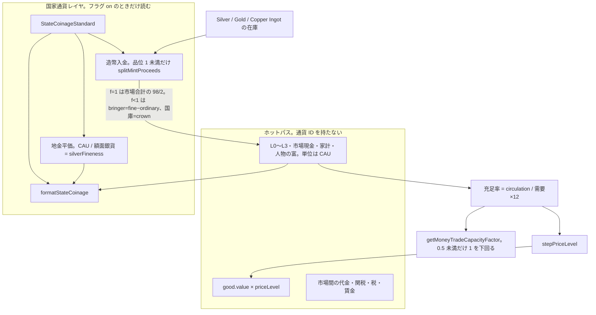

# 国家通貨・為替・改鋳

著者: （未定）
日付: 2026-11-16
状態: Draft
配置: `docs/plan/state-currency-and-exchange.md`

関連: [currency-denomination.md](./currency-denomination.md)、[money-supply-mint.md](./money-supply-mint.md)、[money-scale-calibration.md](./money-scale-calibration.md)、[multi-ledger-fiscal-architecture.md](./multi-ledger-fiscal-architecture.md)。

## 概要

現行の内部金額は、地図全体で一つの銀貨（SP）である。表示だけが世界共通の金貨・銀貨・銅貨に分かれ、造幣は地金をその SP で買って実際のお金を出す。国家ごとの通貨は無い。地金が尽きると通貨は増えず、物価 `priceLevel` が下がる。品位を落とす改鋳は史料としては書いてあるが、造幣式には入っていない。

本設計は、国家ごとに額面・品位・地金アンカーへの為替を持たせる。シミュレーションのホットパス（価格、税、賃金、市場間の代金、L0〜L3 の残高）は、今の SP を**共通会計単位（CAU）**として残す。CAU は「世界標準の純分を持つ銀貨 1 枚」であり、地金の貨幣価値（Silver Ingot の `good.value`）に錨を下ろしたまま動かさない。国家通貨は、その CAU の上の額面レイヤである。プレイヤーに見える硬貨と、明示的な両替だけが国家通貨になる。

品位の変更は表示だけでは終わらせない。効果は造幣の入金式一本に寄せる。同じ地金から国庫へ入る CAU が増え、その増分は既存の充足率の読み手に届く。読み手は `stepPriceLevel`（物価）と `getMoneyTradeCapacityFactor`（交易資本・調達。`tradePaymentTerms.ts`、`marketProcurementBudget.ts`、`merchantTradeCapital.ts`）である。新しい乗数は置かない。為替は額面の表示と見積もりであり、残高には掛けない。

信用手形・預金銀行・紙幣・金本位は [money-supply-mint.md](./money-supply-mint.md) §12（F1〜F5）のまま将来の別設計とし、ここには入れない。

## 背景と動機

### 今の仮定

[currency-denomination.md](./currency-denomination.md) はフェーズ 1 を実装済みである。内部値は変えず、`formatPrice()` が金貨・銀貨・銅貨に分ける。本文は「地図上の全ての国は同じ通貨を使うと仮定する（地域ごとの為替・通貨制度の違いは設計しない）」と書いており、これが本設計が置き換える非目標である。

既定レートは `src/utils/currency.ts` の `DEFAULT_GOLD_TO_SILVER_RATE = 12`、`DEFAULT_SILVER_TO_COPPER_RATE = 12`。Options の `goldToSilverRate` / `silverToCopperRate`（`src/state/optionsStore.ts`）は世界に一つで、`formatPrice()`（`src/utils/unitUtils.ts`）が毎回これを読む。`toCoinage()` のコメントは「表示専用。財政計算に使うな」である。

### 今の造幣

[money-supply-mint.md](./money-supply-mint.md) の M0〜M4 は実装済みである。世界設定 `fmg-money-supply` は新しい地図では既定 `on`（`NEW_WORLD_SETTING_DEFAULTS`、`src/simulation/worldSettings.ts`）。旧セーブはキーが無いので off のまま。

`on` の月次は `Minting.settleMoneySupplyMonthly`（`src/extensions/economy/generators/minting.ts`）である。

- 流通量 `MintLedger.circulation` は別帳簿ではなく、`getStateMoneyStocks()`（`stateMoneySupply.ts`）の実際のお金である。
- 造幣所は国の全部の市場から金・銀・銅の地金を買い、`Markets.consumeForMint` が在庫の 20% までしか渡さない（`markets-generator.ts`）。
- 買う価格は `good.value`。市場価格が `good.value` を超えるとその地金は買わない（地金の飢饉）。
- 代金の 98% を市場の現金へ、2%（`SEIGNIORAGE_RATE`、`currencySufficiency.ts`）を `state.treasury` へ入れる。
- 需要の 12 か月分は鋳造量の上限ではない。§11.3 で自由鋳造にした。12 か月は充足率と `priceLevel` の分母（`TARGET_MONTHS_OF_CURRENCY = 12`）として残っている。
- 金・銀（単位 kg）の相場の下限は `getMintPriceFloor` = `good.value * (1 - 0.02)`。銅（単位 wagon）には下限が無い。

`off` の月次 `settleMonthly` は別物である。`METAL_COIN_VALUES`（銀 10・金 100・銅 1）で**最大都市の市場だけ**を鋳つぶし、不足分（需要の 12 か月 − 帳簿上の circulation）までしか鋳造しない。国庫に入るのは手数料だけで、財布は増えない。

### 地金と硬貨は別物

`goods-generator.ts` の Coins は `tags: ["currency", "service"]` で、コメントは「通貨在庫は MintLedger が持ち、この Good は両替・造幣のサービスであって、金銀銅の価値を二重にしない」である。Gold / Silver / Copper Ingot と Ore は交易品である。§11 で金・銀の地金は貨幣価値に合わせ済みである（Silver Ingot `value: 5` / kg、Gold Ingot `value: 55` / kg、金銀比 11）。銅は意図的に変えていない（Copper Ingot `value: 8.5` / wagon）。本設計は §11 の価格改定をやり直さない。

### 痛いところ

地金が無い、または工芸・輸出の方が高い国は、通貨を増やせない。史料（同文書 §3、信頼度 ○）では、そのときの為政者の手段が小額貨を中心にした改鋳だった。今はその手段が無く、不足は `priceLevel` の低下（0.5〜1.5）と交易資本の縮小だけに出る。国家の硬貨の名前も、国境の両替も無い。

## 目標と非目標

### 目標

1. 生存している国家（`state.i` が真で `removed` でない）が、自分の額面単位を一つ持つ。
2. 額面どうし、および額面と CAU の間に、地金平価の為替がある。
3. 地金不足のとき、金・銀・銅の含有比（品位）を変えて鋳造できる。同じ地金から国庫に入る CAU（シニョリッジ）が増え、既存の充足率（`priceLevel` と `getMoneyTradeCapacityFactor`）に届く。開始 24 か月は改鋳も割増の鋳造もせず、`calibrateDemandScale` の分子は現行の `stock.money` のままである。割増による物価の変化は、倍率が凍結したあとだけ出す。
4. 国庫に残っている改鋳益の未使用分だけを、月次の式で消す。使い切って家計へ出た割増は注釈に残し、純分の CAU や造幣市場の現金は消さない。強化改鋳（品位を戻す）は同じ関数で行う。
5. 世界設定が off、またはセーブに記録が無いとき、今の造幣・表示・テストと一致する。

### 非目標

- 紙幣、預金、振替、為替手形の流通市場、国際公債、金本位、兌換停止。境界は [money-supply-mint.md](./money-supply-mint.md) §12。`commercialFinance` や `printing` には繋がない。
- 硬貨 1 枚ずつの重量・ポケット・盗難。フェーズ 2（内部単位を銅貨整数にする）は [currency-denomination.md](./currency-denomination.md) の対象外のまま。
- D&D の gp 経済への寄せ、魔法で地金を作る、City Editor の硬貨メッシュ。
- Coins Good の在庫を通貨量にすること。地金財の `value` の再改定（§11 のやり直し）。
- 市場間交易・輸入関税・貢納の現金化。交易の代金は CAU のまま。`importDuty` は CAU 建ての率のまま。
- 貢納を為替イベントにすること。`tributePaid` は `src/generators/vassalage.ts` が人口 × `populationRate` × `tributeRate` で書く穀物相当であり、国庫を動かしていない（多層会計の文書が「宗主 L2 への流れ」と書いている箇所は、コードより古い）。
- ホットパスの価格式（`markets-generator.ts` の `good.value * priceLevel`、`foodLedgerConsumption.ts` の主食、税・俸給の定額）に、品位や為替の乗数を直書きすること。
- 政体ごとの改鋳議会、戦争 footing による自動改鋳、為政者性格の新しい軸。性格は既存の `personality.greed` / `rationality` を読むだけにする。
- 金を溶かして銀にする、地金の新しい市場を作る、`getMintPriceFloor` を額面まで上げる。複本位で動かすのは、後述の金の造幣入札だけである。
- 品位の叫び上げ（cry-up）。持ち込み人への純分の支払いは、品位が 1 未満でも `fine - ordinary` のまま。額面の剰余は国庫に入る。法定比の入札上乗せを、その剰余に足して二重に払わない。
- `mergeStates`（`src/runtime/worldRuntime.ts`）に国庫・家政・部門残高の移転を足すこと。吸収国の L1/L2/L3a が流通から外れるのは現行のまま残す。割増の注釈を宗主へ足す処理も足さない。

## 現行実装と文書のずれ

矛盾したらコードを採る。実装時に直す文書の箇所は次のとおり。

| 文書 | 古くなっている点 | コード |
| :--- | :--- | :--- |
| currency-denomination.md の非目標「地域ごとの為替は設計しない」 | 本設計が置き換える。フェーズ 1 の表示関数はそのまま世界標準のフォールバック | `formatPrice()` は Options だけを見る |
| money-supply-mint.md §2 の表 | `fmg-money-supply` が off の旧式。on では最大都市限定でも 12 か月上限でも `METAL_COIN_VALUES` でもない | `settleMonthly` が on なら `settleMoneySupplyMonthly` へ分岐 |
| 同 §4.1「12 か月分に満たない分だけ鋳造」 | §11.3 で自由鋳造に変わった。12 か月は充足率の分母 | `mintMoneySupply` は在庫 20% を価格条件つきで全部買う |
| 同 §9「品位の切り下げは将来」 | 本設計の対象。§12 の F1 より前、という順序は維持する | メカニクスは未実装 |
| 同 §11.1「銅は変えない」 | 今も正しい。Copper Ingot は貨幣価値の錨ではない | `value: 8.5`、`unit: "wagon"`。`getMintPriceFloor` は kg だけ |
| multi-ledger-fiscal-architecture.md の貢納 | 現金移動としては未実装 | `vassalage.ts` の穀物相当のみ |
| money-scale-calibration.md | 本設計は K を掛け直さない。CAU は既に K 済みの SP | `getMoneySupplyDemand` は `getEconomyStartProfile()` 経由。旧式需要だけが `nominal()` |

`MintLedger.circulation` を「地金の通貨」と「額面の通貨」の二本に分けない。§4.1 の「実際のお金が流通量」は維持する。追加するのは、その内数としての改鋳割増（`debasedPremium`）だけである。

## 三つの比率を分ける

今は「12」が一つに見えるが、コードには既に別の 11 がある。三つを混ぜない。

| 数 | 何か | 今の値 | 本設計での役割 |
| :--- | :--- | :--- | :--- |
| 地金の市場比価 | `Gold Ingot.value / Silver Ingot.value` | 55 / 5 = **11** | 錨。Goods の価格。造幣が地金 1 kg を CAU に変えるときの `good.value`。再改定しない |
| 世界の法定額面比 | Options `goldToSilverRate` / `silverToCopperRate` | 既定 **12** と **12** | 世界標準の額面の分け方。フラグ off の `formatCoinage`。国家通貨を初めて作るときのコピー元。地金比ではない |
| 国家の法定額面比 | `StateCoinageStandard.legalGoldToSilver` など | 生成時に Options を写す | その国の硬貨表示。既存残高は掛け直さない。金を地金比より高く評価しているときだけ、次の造幣の金の買い値を上げる |
| 品位 | 額面 1 枚に入っている純分 ÷ 世界標準の純分 | 記録が無ければ **1** | 造幣の入金式だけを変える。銀・金は `fine / fineness`。銅は後述の上限つき |

1 CAU = 1 現行 SP = 品位 1 の額面銀貨 1 枚。Silver Ingot が 5 CAU/kg なので、世界標準の銀貨 1 枚は銀 0.2 kg という読みになる（§10.7.2 の 155〜215 g と同じ桁。式は `1 / good.value` で、定数を新しく置かない）。

金の額面 1 枚の地金価値は、法定の 12 ではなく地金比 11 である。`goldFineness = 1` のとき `cauPerFaceGold = goldFineness * (goldValue / silverValue)`。表示の `formatCoinage` は法定比で分割する。`bimetallicGap = legalGoldToSilver - goldValue / silverValue` は、このずれの観測であり、金の造幣入札の入力でもある。

## 代替案

### 案 A: 名前と紋章だけのフレーバー

国家名と `state.coa` を硬貨のラベルにし、数値は今のまま。

- 利点: 差分が小さい。テストが壊れない。
- 欠点: 地金不足でも何も起きない。為替が常に 1。ユーザーの「品位を変えると物価・為替・シニョリッジに効く」に反する。不採用。

### 案 B: 財布を通貨 ID 付き残高にする

L0 `Character.wealth`、L1 `householdPurse`、L2 `treasury`、L3a `departmentBalances`、L3b `burg.treasury`、市場現金、ギルド、人物の現金口座（`stateMoneySupply.ts` は残高を 100 で割っている）を、すべて `{ currencyId, amount }[]` に割る。国境で毎回両替する。

- 利点: 「この財布はどの国の硬貨か」が文字どおり保存できる。
- 欠点: 月次の価格・税・賃金・交易が通貨 ID を知らない。`getStateMoneyStocks` と money-flow 記録（`scripts/lib/observeViews.mts` の `MONEY_HOLDERS`）が全残高の走査になる。既存テストの期待値が広域に壊れる。ホットパスを最初の PR で変えない、という制約に反する。不採用。

### 案 C（採用）: CAU 台帳 + 国家の額面レイヤ

残高の数値型は `number` のまま。単位は CAU。国家通貨は `StateCoinageStandard`（額面比・品位・アンカー）として国家に一つ。為替は品位から導く地金平価で、残高には掛けない。品位の効果は造幣の入金だけが台帳に届く。品位 1 の金属は今の市場合計のまま、品位 1 未満だけ `splitMintProceeds` を使う。増えたお金は既存の充足率に入り、読み手は `stepPriceLevel` と `getMoneyTradeCapacityFactor` である。新しい物価の乗数は置かない。

- 利点: フラグ off で挙動不変。価格の二重計上が構造的に起きない。セーブは国家あたり一つの小さいレコード。
- 欠点: 財布の中の「良貨と悪貨の枚数」は持てない。グレシャムはマクロの割増消去で近似する。表示は「現行標準での額面」と「CAU」の二段にしないと、改鋳した瞬間に国庫が大きく見えて買えるものが増えたように誤解される。

案 C を採る。案 B は、硬貨の物理インベントリを本当にやる段（currency-denomination のフェーズ 2）まで採らない。

## 提案する設計



フラグは世界設定 `fmg-state-currency`（`"on"` のみ有効）。`src/simulation/worldSettings.ts` の `WORLD_SETTING_KEYS` に足す。`NEW_WORLD_SETTING_DEFAULTS` には入れない。無いキーは off。これは `fmg-money-supply` を新しい地図で on にした先例の逆で、未較正の増発を既定にしないためである。決定済み（決定事項 1）。覆さない。

改鋳とグレシャムと造幣式の分岐は、`fmg-state-currency` と `fmg-money-supply` の両方が on のときだけ動く。関数名は `isStateCoinageActive()`。通貨フラグだけ on で造幣フラグが off のときは、旧式 `settleMonthly`（帳簿 circulation と `METAL_COIN_VALUES`）に `/ fineness` を掛けない。額面レコードの表示と法定比の編集はできるが、品位を動かしても CAU は増えない。UI はその理由を一行で出す。

### 造幣の入金（効果の唯一の経路）

新モジュール `src/extensions/economy/generators/stateCoinage.ts`（今は無い）に純粋関数を置く。`mintMoneySupply` は、**品位が 1 未満の金属だけ** `splitMintProceeds` に渡す。品位が 1 の金属は今の市場合計のままである。`rn(..., 2)` は `src/extensions/hostUtils` 経由の 2 桁で、現行の造幣と同じである。

現行の on 経路は、市場ごとに金属を足してから一度だけ手数料を取る。

```text
fine_i = rn(units * good.value, 2)
minted = Σ fine_i
seigniorage = rn(minted * SEIGNIORAGE_RATE, 2)
市場現金 += minted - seigniorage
国庫 += seigniorage
```

`minting.test.ts` の例（鋳造 90、手数料 1.8、市場 88.2）はこの形である。金属ごとに `fine * 0.02` と `fine * 0.98` を別々に丸めると、和が `fine` から 0.01 ずれる。だから f = 1 では `splitMintProceeds` を呼ばない。

```ts
export type CoinMetal = "gold" | "silver" | "copper";

export interface MintProceeds {
  /** Already rounded. fineCau - ordinarySeigniorage. */
  bringerCau: number;
  /** Already rounded. bookedCau - bringerCau. Includes the ordinary fee. */
  crownCau: number;
  /** bringerCau + crownCau. The only addition to the money stock for this metal. */
  bookedCau: number;
  /** rn(fineCau * SEIGNIORAGE_RATE, 2). Stays inside crownCau. */
  ordinarySeigniorage: number;
  /** crownCau - ordinarySeigniorage. Equals bookedCau - fineCau. Zero when bookedCau == fineCau. */
  debasementGain: number;
}

/** Called only when fineness < 1. f = 1 metals never enter this function. */
export function splitMintProceeds(fineCau: number, fineness: number, metal: CoinMetal): MintProceeds;
```

品位が 1 未満のときの式。`fine` は呼び出し側が既に `rn(units * good.value, 2)` した純分である。

```text
f = clamp(fineness, floor(metal, period), 1)    // ここでは f < 1
raw = fine / f                                    // 銀・金
raw = fine * min(1 / f, COPPER_BOOK_CAP)          // 銅。COPPER_BOOK_CAP = 1.25（仮値）
booked = rn(raw, 2)
if booked < fine: booked = fine                   // 丸めと cap で純分を下回らない

ordinary = rn(fine * SEIGNIORAGE_RATE, 2)
bringer  = fine - ordinary                        // 2 桁同士の差。fine と一致する
crown    = booked - bringer                       // bringer + crown = booked
debasementGain = crown - ordinary                 // = booked - fine
```

数値例（銀、fine = 100。100 は 2 桁で割り切れる）:

| f | 市場の現金 | 国庫 | お金の増加 `booked` | うち通常 2% | うち改鋳益 |
| ---: | ---: | ---: | ---: | ---: | ---: |
| 1（この関数は呼ばない。市場合計） | 98 | 2 | 100 | 2 | 0 |
| 0.8 | 98 | 27 | 125 | 2 | 25 |

一市場の代入先は次だけである。`lastMintedValue` のコメントは metal-backed のままなので、割増は足さない。

| 行き先 | 品位 1 の金属（市場合計 `fullFine`） | 品位 1 未満の金属（金属ごと） |
| :--- | :--- | :--- |
| 売り手の `marketTreasury.balance` | `fullFine - rn(fullFine * 0.02, 2)` | `bringerCau` |
| `state.treasury` | `rn(fullFine * 0.02, 2)` | `crownCau` |
| `MintLedger.lastMintedValue` / `totalMintedValue` | `fullFine` | `fine`（`booked` ではない） |
| `MintLedger.lastSeigniorage` | 上の通常手数料 | `ordinarySeigniorage` だけ |
| `MintLedger.lastDebasementGain` | 0 | `debasementGain` |
| `MintLedger.debasedPremium` と `unspentPremium` | 足さない | `debasementGain` を足す |
| その月の `money`（月末に `circulation`） | `fullFine` | `bookedCau`（純分 + 割増） |

`lastDebasementGain` はその月の割増だけをゼロから足す。`money:mint` の標本は純分と通常 2%、`money:debasement` は割増、と分かれる。観測の `minted`（`lastMintedValue`）と `debasementGain` は同じ割増を二度数えない。

持ち込み人は純分から通常手数料を引いた CAU を受け取る。軽い硬貨の額面剰余は国庫に入る。国庫が後で俸給や事業に使うと、家計へ CAU として出る。出たあとも `debasedPremium` は減らない（下のグレシャム）。合計が `getStateMoneyStocks` に入り、同じ充足率を `stepPriceLevel` と `getMoneyTradeCapacityFactor` が読む。後者は充足率が `MONEY_NEUTRAL_MIN_SUFFICIENCY`（6/12）未満のときだけ 1 を下回る。割増で充足率がその線をまたぐと、物価だけでなく交易資本も戻る。`good.value` に品位を掛けない。`getMarketPriceLevel` に品位を掛けない。`getMintPriceFloor` も `good.value * (1 - SEIGNIORAGE_RATE)` のまま（下限を額面まで上げると、§11.11 で直した「地金が価値の 1/4 に張り付いて鉱山が止まる」が別の形で戻る）。

#### 開始 24 か月の需要較正

`calibrateDemandScale`（`minting.ts`）は `stock.money / (rawDemand * 12)` で、結果を `MIN_DEMAND_SCALE`（0.25）から `MAX_DEMAND_SCALE`（4）へ丸める。`calibrationMonthsLeft` が残っているあいだ、造幣ループの先頭で毎月これをやり直し、そのあと 1 減らす（`START_CALIBRATION_MONTHS = 24`、money-supply-mint §11.4）。0 を渡しても倍率は 0 にならず 0.25 になる。窓の最後の月にその床が固定されると、以後の需要が実在のお金に対して小さすぎる側へ寄る。

分子から `debasedPremium` を引かない。引き算が「倍率で割増を打ち消さない」になるのは、注釈がまだその国の現金の中にある月だけである。`debasedPremium` は国庫を使っても減らない注釈で、財布には付かない。`getStateMoneyStocks` が数えるのは、今その国の中にある現金（国庫、家政、部門、都市、市場、家計、人物）だけである。交易で他国へ出た分、摩耗で消えた分は `stock.money` から既に落ちている。そこへ注釈を再度引くと、純分まで分子から落ち、渡した 0 が床 0.25 として凍結する。注釈が `stock.money` を超えた月だけ引き算をやめる、でも足りない。残っている現金のどれが割増かは、財布を通貨で割らない限り観測できない。その観測は案 B であり、ここではやらない。

窓のあいだは割増を作らない。手順 2 の先頭で `calibrationMonthsLeft > 0` なら、保存された品位が 1 未満でも造幣は品位 1 の市場合計だけを使う。`splitMintProceeds` は呼ばない。金の造幣入札も上げない（買い値は `good.value` のまま）。上乗せがこの窓の `stock.money` に入ると、倍率がそれを需要に吸い込む。標準の品位フィールドは手順 2 では書き換えない。自動改鋳もプレイヤー改鋳も適用しない（手順 3）。ダイアログは品位も法定比も受け付けず、`queueCoinageReform` を呼ばない。この窓の gap は飢饉の信号ではなく、領土の数え方の揺れを需要に吸収するためのものだからである。

```text
demandScale = calibrateDemandScale(stock, rawDemand)   // 分子は stock.money。割増は引かない
```

手編集で窓のあいだ `debasedPremium > 0` でも、同じく引かない。窓が終わる月は、デクリメントの前がまだ `> 0` なので造幣は品位 1 のままである。デクリメントのあと手順 3 が見る値が 0 なら、そこから保留の適用が許される。その月の造幣は既に終わっている。翌月の造幣が新品位を読み、そのとき倍率はもう書き換えない。物価への効果は、凍結した倍率に対する流通量の増分だけである。

銅だけ cap がある理由: Copper Ingot の `value` は貨幣の錨ではなく、§11.1 が残した工業価格（wagon）である。銀・金と同じ `fine / f` を無制限に使うと、安い銅車が改鋳の印鑑になる。cap 1.25 は仮値（△。史料の含有比ではなく、誤用を止めるゲーム上の天井）。銅の額面枚数の表示は cap と無関係に `1 / copperFineness` で増える。台帳に届く銅の割増は最大 +25% である。お金を実際に増やす改鋳は銀と金である。自動改鋳が銅から手を付けるのは、小額貨を先にいじる史料（§3、○）に合わせるためで、銅だけで飢饉を埋められるとは扱わない。

銀と銅のブレーキは残す。市場価格が `good.value` を超える銀・銅は買わない（`minting.ts` の `marketPrice > price`、`price = good.value`）。金だけは次節の入札天井まで買う。改鋳は「量は足りないが、貨幣価値以下で売られている地金」を伸ばす。工芸・輸出の方が金の入札より高いときの飢饉を、造幣所が際限なく剥がすものではない。

### 金の造幣入札

決定事項 2。法定比が地金比より金を高く評価している国では、金地金が造幣に寄る。新しい地金市場は作らない。`consumeForMint` は変えない。呼び出しは今どおり `mintMoneySupply` の金属ループで、要求量は `Infinity`、関数が `stock * 0.2` で切る（`markets-generator.ts`）。`getMintPriceFloor`（kg の `good.value * (1 - SEIGNIORAGE_RATE)`）も変えない。床を入札まで上げると、§11.11 で直した鉱山の張り付きが戻る。

地金比は Goods の価格からその場で読む。定数 11 は置かない。`Gold Ingot.value` は 55、`Silver Ingot.value` は 5 なので、比は 11 になる。

```text
bullionRatio = gold.value / silver.value          // silver.value > 0 のとき。否则入札しない
bimetallicGap = legalGoldToSilver - bullionRatio  // 観測列。負でもよい
```

`goldMintBidPerKg` は `stateCoinage.ts` に置く。`mintMoneySupply` が金の行だけこれを買い値にする。銀の行と銅の行は今どおり `good.value`。

```text
active = isStateCoinageActive() かつ デクリメント前の calibrationMonthsLeft == 0
ratio = legalGoldToSilver / bullionRatio
bid = gold.value
if active かつ silver.value > 0 かつ ratio > 1:
  bid = rn(gold.value * min(ratio, GOLD_BID_RATIO_CAP), 2)
GOLD_BID_RATIO_CAP = 1.25   // 仮値 △。既定の 12/11 ≈ 1.0909 はキャップに掛からない
```

買う条件は `marketPrice <= bid`。法定 12、地金 11 なら `bid = rn(55 * 12/11, 2) = 60`。相場 58 の金は今は `58 > 55` で買わない。入札後は買う。相場 61 は買わない。

法定比が地金比以下（`ratio <= 1`、金を安く評価している）のときは `bid = gold.value`。買い値を地金価値より下げない。銀の買い値は上げない。銀が相対的に高く評価されていても、銀を追う対称の入札はしない。銅は `legalSilverToCopper` を見ない。ゲートも支払いも `copper.value` のまま。銅に `getMintPriceFloor` は無い、もそのまま。

支払いは一つの鋳造額にまとめる。品位の `booked` と入札を足さない。

```text
fine = rn(units * gold.value, 2)          // 金属の裏。lastMintedValue に入るのはこちら
bidValue = rn(units * bid, 2)
booked = 品位 1 なら fine、品位 1 未満なら splitMintProceeds の booked
topUp = max(0, bidValue - booked)         // booked が入札を超えていれば 0
```

`topUp` は売り手の `marketTreasury.balance` と、その月の `money`（月末の `circulation`）にだけ足す。国庫、`lastSeigniorage`、`lastMintedValue`、`totalMintedValue`、`lastDebasementGain`、`debasedPremium`、`unspentPremium` には足さない。通常手数料の母数は今どおり金属の `fine`（市場合計ならその和）で、`topUp` を母数に入れない。手数料を入札額と品位の `booked` の両方から取らない。

例: 金 1 kg、品位 1、法定 12。`fine = 55`、`bidValue = 60`、`booked = 55`、`topUp = 5`。この金だけなら手数料 `rn(55 * 0.02, 2) = 1.1`。市場現金は `55 - 1.1 + 5 = 58.9`。国庫は `1.1`。`lastMintedValue` は 55。改鋳益は 0。

品位を下げて `booked` が 60 を超えたキログラムには `topUp` は付かない。軽い硬貨の剰余と、法定比の上乗せは、同じ地金から一度しか出ない。

入札は手順 2 が、その月の初めの `legalGoldToSilver` を読む。`pendingReform` の法定比は見ない。ダイアログで法定比を変えても、その月の造幣は古い比のままである。

`lastBimetallicTopUp` はその月の `topUp` の合計。`generate()` は `lastMintedValue` と同じく 0 から書き、前月の値は写さない。

### 月次の位置

造幣は、その月の初めに標準の品位フィールドだけを読む。`pendingReform` は見ない。ダイアログが `applyCoinageReform` をその場で呼ぶと、次の手順 2 が新品位を読み、造幣が一月早い。新しいティックは増やさない。`settleMoneySupplyMonthly` の順は次の一つだけである。

1. `money:coinWear`。既存の `wearCoin`。市場現金と家計だけを減らす。国庫も `debasedPremium` も `unspentPremium` も触らない。品位では割らない。
2. `money:mint`。欠けた台帳があれば `generate()`（割増フィールドと、標準の `pendingReform` を写し、通貨標準も生存国だけに揃える）。需要較正の分子は `stock.money`。デクリメント前の `calibrationMonthsLeft > 0` なら全金属を品位 1 の市場合計にし、金の入札も `good.value` のまま。そうでなく品位 1 の金属は市場合計の `rn`。金で `goldMintBidPerKg` が `good.value` を超えるときだけ `topUp` を市場現金に足す。品位 1 未満の金属の国庫入金（通常手数料と割増の両方を含む `crownCau`）のうち、割増分の入金だけを内側の `measureTickStep("money:debasement", ...)` に置く。`topUp` は `money:debasement` に入れない。money-flow 記録は最内のステップに差額を付ける。月末の `circulation` は `booked` と、あれば `topUp` を含んだ `money`。続けて既存の `stepPriceLevel`。この手順は品位フィールドを書かない。
3. `money:reform`。造幣のあと。`calibrationMonthsLeft > 0` なら保留も自動も適用せず、`pendingReform` は残す。0 なら、先に保留を `applyCoinageReform` して消し、`playerReformedAtYear` をその年にする。保留が品位を含めていた金属は、続く自動の一歩の候補から外す。自動は `playerLocked` でなく、`autoReformedAtYear` が今年でなく、不足が閾値を超えているときだけ、残った金属から一つ動かし、そのときだけ `autoReformedAtYear` を書く。候補が残らなければ年は書かない。同じ金属を保留の値の上からさらに `DEBASE_STEP` しない。
4. この改鋳でどれかの品位が上がったときだけ `money:recoinage`。`retireDebasementPremium` を、次のグレシャムより前に、同じ月に実行する。
5. `money:gresham`。国庫に残る未使用分だけを消す（次節）。

```mermaid
sequenceDiagram
  participant M as settleMoneySupplyMonthly
  participant L as 台帳 CAU
  participant P as stepPriceLevel
  M->>L: 1. money:coinWear（premium は減らさない）
  M->>L: 2. money:mint は月初の品位。f=1 は市場合計、f&lt;1 は splitMintProceeds
  M->>L: 内側 money:debasement は割増の国庫入金だけ
  M->>P: circulation は booked を含む実際のお金
  M->>M: 3. money:reform は pending を先に適用。触った金属は自動が動かさない
  M->>L: 4. 品位が上がったときだけ money:recoinage
  M->>L: 5. money:gresham（国庫の未使用分だけ）
```

摩耗 `COIN_WEAR_ANNUAL_RATE = 0.0025` は品位で割らない。軽い硬貨の方が減りやすい、という式は史料がこのリポジトリに無く、第二の消滅経路になる。v1 ではやらない。

### 地金不足

不足は「12 か月の需要」と「在庫の 20%」の両方で定義する。鋳造量の上限を 12 か月に戻さない。

```text
target = currencyDemand * TARGET_MONTHS_OF_CURRENCY    // 12
gap = max(0, target - circulation)
reach(metal) = Σ 市場（その国）
    marketPrice <= その金属の造幣の買い値 のとき stock * 0.20 * good.value
    否则 0
    金の買い値は goldMintBidPerKg。銀と銅は good.value
reachable = reach(gold) + reach(silver) + reach(copper)
monthsToFill = reachable <= 0 ? +∞ : gap / reachable
```

`stock * 0.20` は `consumeForMint` と同じ割合である。一か月に買える純分 CAU で、12 か月分の穴を何か月で埋められるか、という読みである。`gap` と `circulation` は、その月の造幣が終わったあと（手順 3）の値を使う。自動改鋳は、次が全部真のときだけ、ゲーム年に一度（`getSimulationYear()`、`economyApi.ts`）動く。

- `isStateCoinageActive()`
- 空位でない。`getRulerId`（`nobilityContext.ts`）が生きている人物を返す。人物拡張が無く為政者を引けないときも空位として自動しない。在位で `greed` か `rationality` が欠ける軸だけ 50 を使う
- プレイヤーが為政者でも免除しない。止めるのは `playerLocked` だけである。国家ごとの「改鋳を許す」スイッチは置かない
- `playerLocked` でない
- `calibrationMonthsLeft` が 0（窓のあいだは走らない。プレイヤーの品位変更も受けない）
- `autoReformedAtYear` が今年でない
- `monthsToFill > threshold`
- その金属が、この手順 3 で適用した `pendingReform` の品位フィールドに含まれていない

プレイヤーの改鋳は `autoReformedAtYear` を見ない。ダイアログは `pendingReform` を置き換えるだけで、品位フィールドは書かない。同じ年に保留を適用したあとでも、保留が触っていない金属なら自動は走る。保留が触った金属は、その月の自動では動かない。自動が先に走ることはない。手順 3 は常に保留が先である。

`threshold` の基準は `DEBASE_MONTHS_TO_FILL = 18`（仮値、△）。為政者で前後する（UI の節）。

動かす金属は、不足が真のときに次の順で、まだ下限より上のもの一つだけである。

1. その金属の `reach(metal) < currencyDemand * 0.25`（0.25 は仮値。月次需要の四半分かどうか）なら銅 → 銀 → 金の順で最初に当たったもの。
2. どれも 0.25 か月分以上あるが、全体の `monthsToFill` が閾値を超えるなら、同じ順で下限に達していない最初の金属。

一歩は品位の絶対値 `DEBASE_STEP = 0.02`（仮値、△）。下限で止まる。中世の銀の下限 0.50 なら、自動だけだと 1.00 から 25 年かかる。速度の根拠は「改鋳は年単位」（○、フランドルの研究が年単位の政策であるという §3 の読み）までで、0.02 そのものは史料の刻みではない。

### グレシャム

良貨と悪貨を財布ごとに持たない（非目標）。消してよい CAU は、国庫にまだ残っている改鋳益だけである。造幣市場の現金（持ち込み人への支払いと、その都市の売上）にも、家計にも、税で戻った国庫にも手を出さない。造幣市場へのフォールバックは置かない。

台帳は二つに分ける。

| フィールド | 何か | 減るとき |
| :--- | :--- | :--- |
| `debasedPremium` | まだ「純分ではない」と扱う割増。流通量に残り、窓のあと充足率は見続ける。`calibrateDemandScale` の分子からは引かない | `drain` と `retire` だけ。国庫を使っても減らない |
| `unspentPremium` | そのうち国庫に残っている未使用分。`0 <= unspentPremium <= debasedPremium` かつ、国庫が非負なら `unspentPremium <= treasury` | 国庫が減った分（注釈だけ）、`drain`、`retire` |

`GRESHAM_MONTHLY = 0.01`（仮値、△）。月を通した不変条件は次である。`gain` はその月の `debasementGain`、`retire` は同じ月の強化、`drain` はグレシャムが消した CAU である。

```text
debasedPremium = max(0, debasedPremium + gain - drain - retire)
```

手順ごとの代入は次だけである。造幣（手順 2）が `gain` を国庫と両方のフィールドに足し、強化（手順 4）が `retire` を国庫と両方から引いたあと、グレシャムはそれを足し直さない。

```text
spent = max(0, unspentPremium - max(0, state.treasury))
unspentPremium = unspentPremium - spent          // 注釈だけ。CAU は動かさない
lastPremiumSpent = spent

drain = min(unspentPremium * GRESHAM_MONTHLY, unspentPremium)
state.treasury = rn(max(0, state.treasury) - drain, 2)
unspentPremium = unspentPremium - drain
debasedPremium = max(0, debasedPremium - drain)
```

`debasedPremium` は国庫を超えて残ってよい。その超過は市中に出た割増で、`unspentPremium` が 0 なので `drain` は 0 である。注釈を落とさない。較正の分子からは引かない。窓のあと倍率は凍結しているので、流通量に残った割増を充足率は見続ける。

摩耗は国庫を触らないので、この注釈を自動では減らさない。減るのは国庫が `unspentPremium` を下回ったときだけである。地金在庫には戻さない。戻すと自由鋳造（§11.3）が翌月に買い戻す。溶融して国内の板にする半分は、同じ理由で v1 に入れない。

月に一度の照合なので、同じ月のあいだに国庫を使い切ってから税で埋め戻すと、`spent` が 0 のまま最大で未使用分の 1% を新しい国庫から消すことがある。毎残高の書き込みにフックは付けない（非目標）。UI は、`unspentPremium` が 0 で `debasedPremium` が残っているとき「市中に出た割増は回収できない」と書く。

### 強化改鋳

品位を上げるのも `applyCoinageReform` 一つである。f は 1 を超えない（標準より重い硬貨は新しい通貨であり、v1 の外）。適用は月次の手順 3 で、造幣の後である。新しい品位は翌月の `splitMintProceeds` から効く。

同じ月の手順 4、グレシャムより前に、国庫の未使用分だけを消す。

```text
retire = min(unspentPremium, debasedPremium, state.treasury * RECOIN_TREASURY_SHARE)
RECOIN_TREASURY_SHARE = 0.5    // 仮値。一撃で国庫を 0 にしない
state.treasury -= retire
unspentPremium -= retire
debasedPremium -= retire
```

`unspentPremium` が 0 なら `retire` は 0。家計へ出た分は回収しない。残った `debasedPremium` はグレシャムが追わない。

### 為替

レートの主体は市場でも造幣所の注文帳でもなく、国家の標準から月次に導く値である。保持者は `StateCoinageStandard`。更新は改鋳のときと、`money:mint` の末尾（フラグ on のときのスナップショット）である。

```text
cauPerFaceSilver(S) = silverFineness(S)          // 1 面銀貨の CAU。表示と見積もりだけ
cauPerFaceGold(S)   = goldFineness(S) * goldIngot.value / silverIngot.value
faceSilverOfAPerFaceSilverOfB = silverFineness(B) / silverFineness(A)
```

この三つの比は表示と見積もり専用である。残高、市場間の代金、税、`importDuty`、`tributePaid`、`exchangeCau` の CAU には掛けない。掛けると `formatStateCoinage` の `cau / silverFineness` と二重になり、台帳を通貨 ID で割る案 B になる。

初期実装は固定の地金平価である。市場の需給でレートが動くのは後続にしない（v1 の非目標に含める）。平価が需給で動くと充足率と二重になる。

国境を越える既存の流れ（市場間の支払い、海外交易の国庫支出、人物の `wealth` が `character.state` で数えられること）は CAU のままなので、両替しない。同じ金属の会計単位どうしだからである。

明示的な両替だけ手数料を取る。

```ts
export interface ExchangeResult {
  /** CAU left in the payer's purse. Principal minus the spread. */
  cauOut: number;
  /** CAU credited to the destination mint market. Equals the spread. */
  spreadCau: number;
  /** Unsaved quote: cauOut / to.silverFineness. Not written to any balance. */
  faceSilverOut: number;
  /** Unsaved quote of the same cauOut in the source standard. `from` is used only here. */
  faceSilverFrom: number;
}

/**
 * Does not retag the purse. The payer keeps cauOut. Only spreadCau moves.
 * Returns a zero spread when from.stateId === to.stateId.
 */
export function exchangeCau(cau: number, from: StateCoinageStandard, to: StateCoinageStandard): ExchangeResult;
```

仕訳は一つである。元本は相手へ渡さない。

```text
EXCHANGE_SPREAD = 0.02    // 仮値 △。率の桁はシニョリッジと同じだが、受取人は別
from.stateId === to.stateId のとき spread = 0
否则 spread = cau * EXCHANGE_SPREAD
cauOut = cau - spread          // 支払者の手元に残る
faceSilverOut = cauOut / to.silverFineness      // 保存しない
faceSilverFrom = cauOut / from.silverFineness   // 保存しない。from の唯一の使い道
```

呼び元は、支払者の CAU を `spread` だけ減らし、その `spread` だけを着地側 `getMintMarketId` の `marketTreasury.balance` に足す。`cauOut` は受取人へ移さない。着地は人口最大の都市の市場であり、首都 `state.capital` ではない。国庫のシニョリッジには入れない。`from` と `to` のフィンネス比で残高を割ったり掛けたりしない。ホットパスの交易からは呼ばない。

プレイヤーの所持金が国境を越えても、自動ではスプレッドを取らない。`Character.wealth` は通貨 ID を持たず、表示は操作の前後とも `character.state` の標準である。操作は相手国を選ばせる。「この国の標準へ両替」とは書かない。`from.stateId === to.stateId` のボタンは出さない（同じ標準への 2% 課金にしない）。見積もりとして、同じ CAU が相手国の額面で何枚に見えるかだけを出す。

貢納・賠償を額面建てで新たに作らない。既存の穀物相当 `tributePaid` は換算しない。

### 表示

`formatPrice()` / `formatCoinage()` の既定引数は世界標準のまま残す。商品価格、Goods エディタ、世界共通の一覧はこれを使う。品位で割ると、`priceLevel` と二重に見える。

国家が分かる残高だけ新しい関数を使う。

```ts
export function formatStateCoinage(cau: number, standard: StateCoinageStandard | undefined): string;
```

`standard` が無い、またはフラグ off なら `formatCoinage(cau)` に落ちる。on のときは `formatCoinage(cau / silverFineness, { legalGoldToSilver, legalSilverToCopper })`。額面の枚数は増えるが、保存値は CAU のまま。

国庫・家政・個人の所持金の UI は二行にする。

- 額面: `formatStateCoinage`（「現行標準での額面」）
- 会計: 今の `formatPrice`（CAU。品位 1 の世界標準硬貨）

改鋳した瞬間、額面の行だけ増える。買える量が増えるのは、その後の造幣で CAU が増えてからである。

## API

既存の公開関数のシグネチャは、フラグ off で変えない。

| 関数 | 変更 |
| :--- | :--- |
| `formatPrice` / `toCoinage` / `formatCoinage` | 変えない。世界標準 |
| `normalizeCurrencyRate` | 法定比の検証に再利用する（整数、`MIN_CURRENCY_EXCHANGE_RATE` 以上） |
| `Minting.settleMonthly` | on かつ通貨フラグ on のときだけ入金式を差し替える |
| `getMintPriceFloor` / `getMarketPriceLevel` / `stepPriceLevel` | 変えない |
| `Markets.consumeForMint` | 変えない（20% のまま） |

新設（すべて `stateCoinage.ts` に集約。判定を `minting.ts` に散らさない）:

```ts
export const STATE_CURRENCY_SETTING = "fmg-state-currency";

export function isStateCurrencyEnabled(): boolean;
export function isStateCoinageActive(): boolean; // currency on AND money-supply on

export function worldLegalRates(): CurrencyRates; // options の現行値。地金比ではない

export function identityStandard(stateId: number, unitName: string, rates: CurrencyRates): StateCoinageStandard;

export function finenessFloor(metal: CoinMetal, period: string | undefined): number;

export function monthsToFillGap(gapCau: number, reachableCau: number): number;

export function debaseMonthsThreshold(greed: number, rationality: number): number;

/** Gold purchase ceiling in CAU per kg. Returns goldValue when the bid is off. */
export function goldMintBidPerKg(legalGoldToSilver: number, goldValue: number, silverValue: number, active: boolean): number;

export function splitMintProceeds(fineCau: number, fineness: number, metal: CoinMetal): MintProceeds;

export interface CoinagePatch {
  /** Omitted fineness is not a touched metal. */
  goldFineness?: number;
  silverFineness?: number;
  copperFineness?: number;
  legalGoldToSilver?: number;
  legalSilverToCopper?: number;
}

/** Replaces pendingReform. Does not write fineness, legal rates, or reform years. */
export function queueCoinageReform(
  standard: StateCoinageStandard,
  patch: CoinagePatch,
  calibrationMonthsLeft: number
): StateCoinageStandard;

export function applyCoinageReform(standard: StateCoinageStandard, patch: CoinagePatch, year: number, period: string | undefined): StateCoinageStandard;

export function exchangeCau(cau: number, from: StateCoinageStandard, to: StateCoinageStandard): ExchangeResult;

export function formatStateCoinage(cau: number, standard: StateCoinageStandard | undefined): string;
```

`CoinagePatch` は、書く金属の目標品位と、任意の法定比である。省略した金属は「触っていない」。`queueCoinageReform` は `pendingReform` をそのパッチで置き換えるだけである。品位、法定比、`playerReformedAtYear`、`autoReformedAtYear` は書かない。CAU も動かさない。`calibrationMonthsLeft > 0` のときは標準をそのまま返し、保留も更新しない。ダイアログはこの関数だけを呼ぶ。`applyCoinageReform` は手順 3 だけが呼ぶ。品位を `[floor, 1]` にクランプし、法定比は Options と同じ `normalizeCurrencyRate`（2 以上の整数。上限は無い）だけを通す。8〜16 や 4〜48 という別帯は置かない。生成、改鋳、ロードがこのクランプを使う。範囲外は既定の 12 ではなく、`normalizeCurrencyRate` のフォールバック（無効なら `DEFAULT_GOLD_TO_SILVER_RATE` / `DEFAULT_SILVER_TO_COPPER_RATE`）である。適用したら `pendingReform` を消し、`playerReformedAtYear` をその年にする。`autoReformedAtYear` は自動の一歩だけが書く。同じ月に保留が品位を含めた金属は、自動の候補から外す。割増の回収は `retireDebasementPremium(state, ledger)` を、品位が上がった月の手順 4 で呼ぶ。

## データモデル

新しい配列 `stateCoinageStandards` を、`mintLedgers` と同じ経済拡張のスライスに置く。`State` 本体には足さない（`types/models.ts` の国家は既に大きく、通貨は経済拡張の関心である）。

```ts
export interface MetalStandard {
  /** 1 = world-standard fine content. Never above 1. */
  fineness: number;
}

export interface StateCoinageStandard {
  stateId: number;
  /** Flavor label. Balances are not keyed by it. */
  unitName: string;
  gold: MetalStandard;
  silver: MetalStandard;
  copper: MetalStandard;
  legalGoldToSilver: number;
  legalSilverToCopper: number;
  /** Monthly snapshot. Equals silver.fineness. Derived again if missing. */
  anchorCauPerFaceSilver: number;
  /**
   * Year the automatic step last ran. Player reforms do not write this.
   * 0 if the automatic step has never run. getSimulationYear().
   */
  autoReformedAtYear: number;
  /** Year step 3 applied pendingReform. Not written by the dialog. Does not block auto. */
  playerReformedAtYear?: number;
  /**
   * Dialog queue. money:mint does not read it.
   * Step 3 applies it only after calibrationMonthsLeft is 0, then clears it.
   */
  pendingReform?: CoinagePatch;
  /**
   * When true, the yearly auto step does not change fineness.
   * Same idea as State.warFootingPlayerLocked. The player can still reform.
   */
  playerLocked?: boolean;
}
```

`unitName` の既定は `"${state.name} silver"`。紋章は `state.coa` を UI が参照する。複製しない。

`MintLedger`（`mintingTypes.ts`）に足す任意フィールド。旧セーブには無い。

```ts
/**
 * Face surplus still in circulation after the calibration window.
 * Not an input to calibrateDemandScale. Not reduced when the treasury spends it.
 * Absent means 0.
 */
debasedPremium?: number;
/**
 * Slice of debasedPremium still inside state.treasury.
 * The only CAU a Gresham drain or a recoinage retire may destroy.
 * Absent means 0.
 */
unspentPremium?: number;
/** Crown CAU above the ordinary 2% fee in the last mint month. Not part of lastMintedValue. */
lastDebasementGain?: number;
/** Premium CAU destroyed from treasury by the drain last month. */
lastGreshamDrain?: number;
/** Annotation only: unspentPremium reduced because treasury fell. No CAU moved. */
lastPremiumSpent?: number;
/** Premium CAU retired from treasury by a strengthening reform. */
lastRecoinageRetirement?: number;
```

`Minting.generate` は台帳をオブジェクトリテラルで作り直す。今写しているのは `priceLevel`、`demandScale`、`calibrationMonthsLeft`、`totalMintedValue` などで、リテラルに無いフィールドは落ちる。`mintMoneySupply` は台帳の無い国が一つでもあると、生存国すべてについて `generate()` を呼ぶ。上のフィールドをリテラルに写さないと、新国の誕生で生存国の割増が消える。

登録箇所（`mintLedgers` が既に並んでいる場所へ、同じ形で足す）:

- `EXTENSION_SLICE_DEFINITIONS`（`src/runtime/extensionStateSlices.ts`）に `legacyField: "stateCoinageStandards"`。同じファイルの `validateEconomySlice` の配列名
- `src/runtime/dataFieldOwnership.ts`（`simulation.extensions.economy.stateCoinageStandards`、所有者 economy、キー state.id）
- `src/io/save.ts` の `getLegacyEconomyPackFields` と、スロット [55] `mineralResources` のオブジェクトリテラル（`mintLedgers` が並んでいる箇所）
- `src/io/load.ts` の `restoreMineralResourceState`（空の初期値と `record` からの代入の両方）
- `src/controllers/export-json.ts` の `getMineralResourcesData`
- `src/extensions/economy/context/fiscal.ts` に `getStateCoinageStandards` / `setStateCoinageStandards`

`.fmg` の本体は `simulation.extensions.economy` のスライスである。helper だけに配列を足しても、[55] と JSON 書き出しからは落ちる。旧セーブの残高を配り直さない方針は、この経路を足しても変わらない。

### 名義と「どの国の通貨か」

台帳は割らない。表示と両替のときだけ、次の国家 ID で標準を引く。

| 名義 | 国家の決め方 | 残高の単位 |
| :--- | :--- | :--- |
| L2 `state.treasury`、L1 `householdPurse`、L3a `departmentBalances` | その `state.i` | CAU |
| L3b `burg.treasury`、都市家計、ギルド | `burg.state` | CAU |
| 市場現金・運転資金 | 中心都市の `burg.state`（`getStateMoneyStocks` と同じ） | CAU |
| L0 `Character.wealth`、個人現金口座 | `character.state`、口座は既存の `stateId`（市場の町があればそちらが優先、という現行の数え方は変えない） | CAU |
| 商品価格 | 国家を付けない。世界標準表示 | CAU |
| 中立・`state` が 0・標準が無い | 世界標準。標準レコードを作らない | CAU |

`getStateMoneyStocks` は `!state?.i || state.removed` を飛ばす。中立（index 0）に造幣所も通貨も作らない。無主の現金は `getUnassignedPersonalCash` のまま世界のお金で、改鋳の対象外。

### 国家の一生

- 生成: フラグ on のとき `identityStandard`（品位 1、法定比は**その瞬間の** Options を `normalizeCurrencyRate` に通したもの）。Options を後から変えても、既存国の法定比は追従しない。
- `generate()` と同じ関数が、通貨標準も生存国だけに揃える。死んだ国の標準は落とす。生きているのに標準が無い国には `identityStandard` を足す。生きている国の `pendingReform` は前の標準から写す。写さないと、新国の誕生で積んである改鋳が消える。`mintMoneySupply` が台帳の欠落で `generate()` を呼ぶ経路も、この関数を通る。手順 2 は写した保留を読まない。
- 台帳リテラルは前の台帳から `debasedPremium`、`unspentPremium`、`lastDebasementGain`、`lastGreshamDrain`、`lastPremiumSpent`、`lastRecoinageRetirement` を写す。写さないと新国の誕生で生存国の割増が消える。
- 消滅: 生存国フィルタで標準と台帳が落ちる。その国の `debasedPremium` は宗主へ足さない。
- 併合: `worldRuntime.ts` の `mergeStates` は吸収国を `removed` にし、`burg.state` とセルの所属を宗主へ付け替える。`state.treasury`、`householdPurse`、`departmentBalances` は移さない。`getStateMoneyStocks` は `removed` を飛ばすので、吸収国の国庫・家政・部門残高は流通量から外れる。都市の金庫、市場の現金、家計は `burg.state` とともに宗主の流通に残る。エディタの `states-editor.ts` の `mergeStates` は、このコマンドのあとに DOM を更新するだけで、残高は動かさない。本設計は移転を足さない。割増の注釈も宗主へ足さない。
- 首都の移動: 標準は `stateId` に付く。造幣市場は今どおり人口最大の都市（`getMintMarketId`）で、`state.capital` ではない。本設計でそこを直さない。
- 中立都市の編入: 残高は CAU のまま。編入先の額面で表示が変わるだけ。変換イベントは無い。中立（index 0）に標準を作らない、は `getStateMoneyStocks` と一致している。

### 時代の下限

下限は `finenessFloor(metal, period)` の一関数にまとめる。中身は `historicalPeriodIndex` の範囲でも、時代名から帯への明示マップでもよい。橋の斜角は指数ではなく `bridgeSkewPolicy.ts` の `TIER_BY_PERIOD` であり、未知の時代は `bridgeSkewTierForPeriod` が中世側（tier 0）に倒す。ここはその実装の写しではない。数値は史料の写しではなくゲーム上の天井である（△。古代・中世・近世で改鋳の自由度が違う、という定性は §3 の切り下げ史料に沿う。刻みの数字はリポジトリに無い）。

| 帯 | `historicalPeriodIndex` | 銀の下限 | 金の下限 | 銅の下限 |
| :--- | :--- | ---: | ---: | ---: |
| 古代 | `classicalAntiquity` 〜 `lateAntiquity` | 0.75 | 0.90 | 0.25 |
| 中世 | `earlyMedieval` 〜 `lateMedieval` | 0.50 | 0.85 | 0.25 |
| 近世 | `ageOfExploration` 〜 `preIndustrialEra` | 0.40 | 0.75 | 0.25 |
| 産業以降 | `steamEra` 以降 | 0.85 | 0.95 | 0.50 |

未知の時代文字列、および `historicalPeriodIndex` が -1 を返す値は、近世帯（銀の下限 0.40）にする。橋の未知が中世側に倒れるのより緩い。-1 を古代の手前（下限 0.75）と読まないことを、`finenessFloor` の単体テストで固定する。金の下限を銀より高くするのは、§3 が小額・銀の切り下げを主に話しているためで、金の法令の写しではない。産業以降を狭くするのは、紙幣と金本位を実装せずに「切り下げが主な手段ではなくなる」ことだけを天井で表すためである。

## UI

| 場所 | 出すもの |
| :--- | :--- |
| Options の Simulation Settings（`SimulationSettingsTab.tsx` の既存の金銀・銀銅） | 文言を「世界標準の法定額面比」に変える。地金比 11 とは別、と一行。世界設定 `fmg-state-currency` の on/off をここに置く（`optionsStore` のレート欄には品位を足さない） |
| 国家の財政（`StateFiscalReportTab.tsx`、国家一覧の treasury 列 `economy/index.tsx`） | 額面と CAU の二行。品位三金属、法定比、地金平価、自動とプレイヤーの改鋳年、`pendingReform` の有無、`debasedPremium` と `unspentPremium`。`calibrationMonthsLeft > 0` のあいだは「較正中は品位を変えない」 |
| プレイヤーパネル（`PlayerCharacterPanel.tsx` の `formatPrice(summary.wealth)` 付近） | 人物の `state` の額面と CAU。操作は相手国を選び、選んだ CAU の 2% だけをその国の造幣市場へ払う。同じ国は選べない。所持金の表示標準は操作後も `character.state` のまま |
| 造幣の操作（国家ダイアログ。新しいタブを増やさず、財政タブの一区画） | 目標品位。自動改鋳のロック `playerLocked`。較正窓のあいだ入力は出さない |

政策は両方である。

- 自動: 地金不足の節の条件（較正窓が終わっていること、`autoReformedAtYear`、ロック、閾値、保留が触っていない金属）をすべて満たす年に一歩。
- プレイヤー: ダイアログは `queueCoinageReform` だけ。`applyCoinageReform` はその場で呼ばない。下限〜1 の範囲で、一歩より大きく動かせる。ロック中でも保留は積める。適用は次の月次の手順 3、造幣のあとである。窓のあいだは受けない。

閾値は在位の為政者一人から取る。探し方は `getRulerBoldness`（`warFooting.ts`）と同じで、`getRulerId`（`nobilityContext.ts`）と `personality`。`getRulerId` が生きている人物を返さないときは自動しない（`getRulerBoldness` が空位を 50 に丸めるのとは違う）。在位で性格の軸が欠けるときだけ、その軸を 50 にする。プレイヤーが為政者の国も同じ閾値で自動する。

```text
g = (greed - 50) / 50          // -1..1
r = (rationality - 50) / 50
threshold = clamp(18 * (1 - 0.35 * g) * (1 + 0.25 * r), 6, 36)
```

係数 0.35 と 0.25 は仮値（△）。貪欲な為政者は早く、合理的な為政者は遅く切り下げる。`states-personality.md` の「強欲は搾取、合理性は損得」という既存の読みに合わせ、新しい性格ルールは足さない。政体（`state.form`）では閾値を変えない。議会の否決を新しく作らない。

## セーブと移行

- フラグが無い、または `"on"` でない: 標準配列がセーブにあっても読まない。造幣式は今のまま。表示は Options。
- フラグ on で配列が無い: 生きている国家に `identityStandard` を作る。品位 1 なので、改鋳が起きるまで入金は今と一致する。残高の掛け算はしない。
- 旧セーブの SP を国家通貨へ配り直さない。CAU = 旧 SP の読みを維持する。
- 読み込み時の正規化は、生成と改鋳と同じ関数である。品位は有限数で `[floor, 1]`。法定比は `normalizeCurrencyRate`（2 以上の整数、上限なし）。`pendingReform` も同じクランプを通す。空のパッチはフィールドごと落とす。ロードは保留を適用しない。`debasedPremium` と `unspentPremium` は有限かつ 0 以上で、`unspentPremium` は `debasedPremium` を超えない。それ以外は 0 に落とす。法定比を 8〜16 に切り詰めて 12 に戻す、ということはしない。0 や NaN の品位で無限の CAU を作れないようにする。
- 途中でフラグを off に戻しても、既に国庫へ入った CAU は回収しない。割増の割引も止まる。再び on にすると、保存されていた品位と残っている `debasedPremium` から再開する。
- `fmg-money-supply` が off のまま通貨フラグだけ on: 標準と表示だけ。`splitMintProceeds` は呼ばない。

## セキュリティとプライバシー

ローカルの地図セーブであり、認証も通信も無い。脅威は改ざんセーブと数値の崩壊である。

- 品位 0、負数、非数を読み、`fine / f` が無限になる。緩和: ロード（生きている標準と `pendingReform`）、`applyCoinageReform`、`splitMintProceeds` が同じクランプを通す。クランプは `stateCoinage.ts` だけ。ダイアログは適用しないので、ここにはクランプしない。
- 銅の wagon 価格を無制限に割って通貨を刷る。緩和: `COPPER_BOOK_CAP`。
- 通貨レコードに人物名や所持金の内訳を書かない。`unitName` は国家名からのラベルだけ。既存の人物データ以上の個人情報は増えない。

## 観測

`scripts/lib/observeViews.mts` の `wealth().states[]` に、造幣台帳と標準から次を足す。既存の `money`・`minted`・`priceLevel` は残す。

| 列 | 意味 |
| :--- | :--- |
| `silverFineness` / `goldFineness` / `copperFineness` | 品位。標準が無ければ 1 |
| `legalGoldToSilver` / `legalSilverToCopper` | 法定比 |
| `anchorCauPerFaceSilver` | 額面銀貨 1 の CAU |
| `debasedPremium` | 純分ではないと扱う割増。国庫を使っても減らない |
| `unspentPremium` | そのうち国庫に残っている分。0 なら割引は 0 |
| `premiumSpent` | その標本区間の `lastPremiumSpent`。注釈だけで、CAU は動いていない |
| `debasementGain` | その標本区間の `lastDebasementGain`。`minted` には含めない |
| `greshamDrain` | `lastGreshamDrain`。国庫の未使用分から消した CAU |
| `recoinageRetirement` | `lastRecoinageRetirement`。強化で国庫から消した CAU |
| `bimetallicGap` | `legalGoldToSilver - goldValue/silverValue`。正のとき金の入札を上げる。入札そのものは `goldMintBid` |
| `goldMintBid` | その月の `goldMintBidPerKg`。窓のあいだ、および金を安く評価しているときは `gold.value` |

`debasedPremium` が残って `unspentPremium` が 0 の行は、割増が市中に出て回収できない月である。お金の出入りは `money:mint`（持ち込みと通常の 2%。品位 1 未満では `booked` ではなく純分 `fine`）、`money:debasement`（割増の国庫入金だけ）、`money:gresham`（国庫の未使用分からの割引。造幣市場からは引かない）に分ける。全量の JSON を Git に置かない。Agents.md のとおり、再生成できる大きな出力は `docs/analytics/raw/` に出し、コミットするのは記録 md と SHA-256 の一覧だけにする。本設計の採用だけでは計測を回さない。

## リスク

| 深刻度 | リスク | 緩和 |
| :--- | :--- | :--- |
| 高 | 品位 1 の金属まで `splitMintProceeds` に通し、市場一括の `rn(minted * 0.02, 2)` と 0.01 ずれる | 品位 1 は今の市場合計のまま。関数は品位 1 未満だけ。回帰は既存の `minting.test.ts`（鋳造 90、手数料 1.8、市場 88.2）。品位 1 未満は `bringer + crown === booked` |
| 高 | 誰かが `good.value` や `priceLevel` を品位で割り、物価が二重に動く | 台帳の金額を変えるのは造幣入金だけ、とモジュールコメントに書く。フィンネス比は表示と見積もりにしか掛けない。価格ファイルは本設計の PR で触らない |
| 中 | 割増の割引が国庫を細らせ、軍事のテスト期待値が動く | 割引はフラグ on のときだけ。既定 off。消すのは `unspentPremium` の月 1% で、造幣市場の現金も税の埋め戻しを追わない。同じ月に使い切ってから税で戻すと、照合が月一回なので未使用分の最大 1% だけ新しい国庫に触りうる。25% の現金上限は置かない |
| 中 | 額面表示だけ見て、改鋳直後に豊かだと誤認する | 額面と CAU の二行。商品価格は世界標準のまま |
| 中 | 銅の cap が低く、小額貨の改鋳が遊びに見える | 受け入れる。お金が増えるのは銀と金、と UI に書く。cap は未決ではなく仮値 |
| 中 | 較正の分子から割増を引き、流出した注釈で需要倍率が 0.25 に固定される | 窓のあいだは改鋳も `splitMintProceeds` もせず、分子は `stock.money`。`MIN_DEMAND_SCALE` 0.25 と `MAX_DEMAND_SCALE` 4 は現行の `calibrateDemandScale` の床と天井であり、0 を渡す経路は作らない |
| 中 | ダイアログが同じ月の造幣より前に品位を書き、新品位が一月早い | ダイアログは `pendingReform` だけを更新する。手順 2 はそれを見ない。適用は手順 3。同じ金属はプレイヤーが勝ち、自動は重ねない |
| 中 | 金の入札と品位の `booked` を同じキログラムに足し、CAU を二度出す | `topUp = max(0, bidValue - booked)`。手数料の母数は `fine` だけ。`topUp` は `debasedPremium` に入れない |
| 中 | 金の入札が銀の造幣を止める | 銀と銅のゲートは `marketPrice <= good.value` のまま。`consumeForMint` の 20% も金属ごと。金の在庫だけが入札天井まで減る。天井を超えた金は今どおり買わない |
| 低 | 併合で吸収国の国庫が流通から外れる | 現行の `mergeStates`（`worldRuntime.ts`）が `removed` にするだけで `treasury`・`householdPurse`・`departmentBalances` を移さない。`getStateMoneyStocks` が `removed` を飛ばすので、その CAU は流通量から外れる。都市・市場・家計の現金は `burg.state` とともに残る。本設計は移転を足さない。死んだ国の割増注釈も宗主へ足さない。お金が残る、とは書かない |
| 低 | セーブの配列が国家数だけ増える | 国家あたり数十バイト。台帳の分割より小さい |

## ロールアウト

1. 世界設定は既定 off。新しい地図の `NEW_WORLD_SETTING_DEFAULTS` にも入れない（決定事項 1）。
2. PR は後ろの「PR Plan」の順。PR1 は挙動不変。商品の価格式はどの PR でも変えない。PR4 で金の造幣入札が初めて買い値を変える。PR5 で品位の入金が変わる。
3. 戻し方: 設定を off にする。以後の改鋳と割引は止まる。既に増えた CAU は残る。残高を旧セーブの比率へ割るマイグレーションは作らない。
4. 較正（シードを多数回すこと）は本設計の完了条件にしない。Agents.md のとおり、実装時は関係する単体テストだけを走らせる。長期の money-flow は、フラグを on にした計測を別作業にするときだけ `docs/analytics/raw/` へ出す。

## 決定事項

未決は残っていない。次の三つは決定済みであり、覆さない。

1. **新しい地図の `fmg-state-currency`。決定済み: (A)。** 既定 off。`NEW_WORLD_SETTING_DEFAULTS` に入れない。無いキーは off。
2. **法定比 12 と地金比 11 のずれ。決定済み: (B)。** 法定比が地金比より金を高く評価している国では、`goldMintBidPerKg` が金の買い値を上げ、`consumeForMint` の経路で金地金を造幣に寄せる。`bimetallicGap` はそのずれの観測である。金を安く評価しているときは買い値を下げず、銀も銅も変えない。初期法定比を地金比に丸めることはしない。
3. **自動改鋳を誰が許すか。決定済み: (A)。** フラグ on なら、空位でない国は性格つき閾値で自動する。プレイヤーが為政者でも免除しない。止めるのは `playerLocked` だけである。国家ごとの「改鋳を許す」は置かない。

## 参照

- [currency-denomination.md](./currency-denomination.md) — 表示デノミ。本設計が非目標の一文を置き換える。
- [money-supply-mint.md](./money-supply-mint.md) — 造幣・物価・§11 の地金価格・§12 の信用手段（非目標の境界）。
- [money-scale-calibration.md](./money-scale-calibration.md) — 名目スケール K。本設計は掛け直さない。
- [multi-ledger-fiscal-architecture.md](./multi-ledger-fiscal-architecture.md) — L0〜L3。名義は維持し、通貨 ID では割らない。
- [states-personality.md](./states-personality.md) — 強欲・合理性の読み。閾値の符号だけ使う。
- [bridge-skew-policy.md](./bridge-skew-policy.md) — 時代で上限を一関数に置く先例。実装（`TIER_BY_PERIOD`、未知は中世の tier 0）の写しではない。
- コード: `src/utils/currency.ts`、`src/utils/unitUtils.ts`、`src/extensions/economy/generators/minting.ts`、`mintingTypes.ts`、`currencySufficiency.ts`、`stateMoneySupply.ts`、`markets-generator.ts` の `consumeForMint`、`goods-generator.ts` の地金と Coins、`src/simulation/worldSettings.ts`、`src/types/historicalPeriod.ts`、`scripts/lib/observeViews.mts`。

## Key Decisions

1. **同一性は案 C。** 台帳は CAU（現行 SP）の `number` のまま。国家通貨は額面・品位・地金平価のレイヤ。案 A は効果が出ず、案 B は月次とテストを広域に壊す。
2. **効果の経路は造幣入金だけ。** 品位 1 の金属は今の市場合計（`rn(minted * 0.02, 2)` を一度）のまま。品位 1 未満だけ `splitMintProceeds`。充足率の読み手は `stepPriceLevel` と `getMoneyTradeCapacityFactor`（後者は充足率 0.5 未満のときだけ 1 を下回る）。`calibrationMonthsLeft > 0` の分子は現行の `stock.money` で、割増は引かない。その窓はプレイヤー改鋳も自動改鋳も `splitMintProceeds` も走らせない。物価への効果は、倍率が凍結したあとの流通量の増分だけである。為替も商品価格も品位で割らない。
3. **為替の初期実装は地金平価の見積もり。** 保持者は国家の標準。フィンネス比は表示と見積もりだけで、残高・交易・税・`importDuty`・`tributePaid` に掛けない。明示両替は支払者の CAU がスプレッド（2%、仮値）だけ減り、そのスプレッドだけが相手国の造幣市場へ入る。元本は支払者に残る。同じ国は選べない。市場の需給レートは置かない。
4. **Options の 12 は世界の法定額面比。地金比は Goods の 11 のまま。** 国家の法定比は生成時に `normalizeCurrencyRate`（2 以上の整数、上限なし）を通したコピーで、その後 Options に追従しない。8〜16 / 4〜48 の別帯は置かない。無効値は `DEFAULT_GOLD_TO_SILVER_RATE` / `DEFAULT_SILVER_TO_COPPER_RATE` に落ち、保存のたびに 12 へ戻す第二の identity は置かない。既存の CAU 残高は法定比で掛け直さない。法定比が地金比より金を高くする国だけ、較正窓のあと `goldMintBidPerKg` が金の買い値を上げる。上乗せは `max(0, bidValue - booked)` で、品位の割増と足さない。金を安く評価するときは買い値を下げない。銀と銅の買い値は変えない。キャップ `GOLD_BID_RATIO_CAP = 1.25`（仮値）は既定の 12/11 には掛からない。
5. **銅の台帳効果は +25% で頭打ち（仮値）。** Copper Ingot は §11 が貨幣の錨にしなかった。銀と金は cap しない。自動改鋳の手は銅→銀→金の順。
6. **グレシャムが消せるのは国庫に残る未使用の割増だけ。** `unspentPremium` の月 1%（仮値）。造幣市場へはフォールバックしない。現金 25% の上限は置かない。使い切った分は `debasedPremium` に注釈として残る。較正の分子からは引かない。窓のあと流通量に残るので充足率は割増を見続ける。地金在庫へは戻さない。家計からは取らない。
7. **強化も切り下げも、ダイアログはその場で品位を書かない。** `pendingReform` を手順 3 が造幣のあとで適用する。同じ月に保留が触った金属は自動が動かさない。プレイヤーが勝つ。品位は 1 が天井。消せるのは `unspentPremium` から国庫の 50%（仮値）まで。未使用分が 0 なら回収は 0。市中に出た `debasedPremium` は回収しない。新しい品位は翌月の造幣から効く。
8. **フラグは既定 off。決定済み。** `NEW_WORLD_SETTING_DEFAULTS` には入れない。`fmg-money-supply` が off の旧式造幣には品位も金の入札も掛けない。旧セーブの残高は配り直さない。
9. **時代の下限は `finenessFloor` の一関数。数値は仮値（△）。** 中身は `historicalPeriodIndex` の範囲でも時代名の明示マップでもよい。未知と指数 -1 は近世帯（銀の下限 0.40）で、橋の未知（中世の tier 0）より緩い。-1 を古代の手前にしない。産業以降は狭くする。紙幣は実装しない。
10. **自動改鋳は、フラグ on で空位でない国が性格つき閾値で行う。決定済み。** プレイヤーが為政者でも免除しない。止めるのは `playerLocked`（`warFootingPlayerLocked` と同じ形）だけである。国家ごとの許可スイッチは置かない。政体と戦争 footing は閾値を動かさない。`getRulerId` が生きている人物を返さないときは自動しない。

## PR Plan

### PR1 — 型・セーブ・フラグ（挙動不変）

- タイトル: `Add state coinage records without changing minting`
- ファイル: `src/extensions/economy/generators/stateCoinage.ts`（新規）、`mintingTypes.ts`（任意フィールドの型だけ。`debasedPremium`、`unspentPremium`、`lastDebasementGain`、`lastGreshamDrain`、`lastPremiumSpent`、`lastRecoinageRetirement`）、`src/extensions/economy/context/fiscal.ts` の `getStateCoinageStandards` / `setStateCoinageStandards`、`src/runtime/extensionStateSlices.ts` の `EXTENSION_SLICE_DEFINITIONS`（`legacyField: "stateCoinageStandards"`）と `validateEconomySlice` の配列名、`src/runtime/dataFieldOwnership.ts`、`src/io/save.ts` の `getLegacyEconomyPackFields` とスロット [55] `mineralResources` のオブジェクトリテラル、`src/io/load.ts` の `restoreMineralResourceState`（空オブジェクトと `record` からの代入の両方）、`src/controllers/export-json.ts` の `getMineralResourcesData`、`src/simulation/worldSettings.ts`（`WORLD_SETTING_KEYS` のみ。`NEW_WORLD_SETTING_DEFAULTS` には入れない）、`src/extensions/economy/generators/stateCoinage.test.ts`（新規）
- 依存: なし
- 内容: `StateCoinageStandard` と正規化。欠落時は identity（品位 1。法定比は Options を `normalizeCurrencyRate` に通す。2 以上の整数で上限は無く、無効なら `DEFAULT_*`）。`pendingReform` は任意フィールドとして保存し、ロードは適用しない。造幣は読まない。フラグ off では造幣も表示もこの配列を読まない。`.fmg` の本体はスライス、[55] と JSON 書き出しはレガシー往復、とテストまたは往復の確認で両方を見る。`splitMintProceeds(fine, 1)` が 98/2 になるテストは足さない。品位 1 の回帰は既存の `minting.test.ts` のままである。ホットパスの価格式は触らない。旧セーブの SP 残高は配り直さない。配置済みの本設計書への相互リンク（currency-denomination の非目標の一文と money-supply-mint §9 の「将来」）と、`docs/plan/CHANGELOG.md` へのファイル名追加は、本 md を `docs/plan/` に置いたコミットで行う。

### PR2 — 額面の定義と表示

- タイトル: `Show each state face value beside the accounting unit`
- ファイル: `stateCoinage.ts` の `formatStateCoinage`、`src/ui/components/tabs/options/SimulationSettingsTab.tsx`、`src/extensions/economy/ui/components/StateFiscalReportTab.tsx`、`src/extensions/economy/index.tsx` の国庫列、`src/extensions/nobility/ui/components/PlayerCharacterPanel.tsx`、対応する単体テスト
- 依存: PR1
- 内容: フラグ on の生成時に identity 標準を書く。残高 UI は額面と CAU の二行。商品価格は `formatPrice()` のまま。品位と法定比の編集ダイアログはまだ付けない（PR5 の `pendingReform` だけが書く）。造幣の買い値はまだ変えない。

### PR3 — 地金平価と明示両替

- タイトル: `Quote bullion-par exchange and charge a spread on explicit conversion`
- ファイル: `stateCoinage.ts` の `exchangeCau` とアンカー更新、`minting.ts`（フラグ on のときスナップショットを書くだけ。入金額は変えない）、国家財政タブの両替操作、`PlayerCharacterPanel.tsx`、`stateCoinage.test.ts`
- 依存: PR2
- 内容: `cauPerFaceSilver = silverFineness`。この比と金銀のフィンネス比は見積もりと表示だけで、残高・交易・税・`importDuty`・`tributePaid` に掛けない。`exchangeCau` は支払者の CAU を `spread` だけ減らし、その `spread` だけを着地側 `getMintMarketId` の `marketTreasury.balance` に入れる。`cauOut` は支払者に残る。`faceSilverOut` は保存しない。`from` は見積もりの表示元と、同一 `stateId` ならスプレッド 0、にしか使わない。ボタンは相手国を選んで選んだ CAU の 2% をその造幣市場へ払う。同じ国は出さない。`Character.wealth` の表示は操作後も `character.state` の標準のまま。フラグ off ではスナップショットも書かない。入金額は変えない。

### PR4 — 金を高く評価する法定比の造幣入札

- タイトル: `Bid gold bullion into the mint when the legal ratio overvalues it`
- ファイル: `stateCoinage.ts` の `goldMintBidPerKg`、`minting.ts` の `mintMoneySupply`（金の買い値と `topUp` だけ。品位の分岐はまだ入れない）、`mintingTypes.ts` の `lastBimetallicTopUp`、`stateCoinage.test.ts` と `minting.test.ts`
- 依存: PR3。PR5 はこの PR に依存する（同じ `mintMoneySupply` のループを、入札のあとで品位が触る）
- 内容: `isStateCoinageActive()` かつデクリメント前の `calibrationMonthsLeft === 0` かつ `legalGoldToSilver > gold.value / silver.value` のときだけ、金のゲートを `marketPrice <= goldMintBidPerKg` にする。`bid = rn(gold.value * min(legal / bullion, 1.25), 2)`。既定の 12 と 11 では 60 CAU/kg。法定比が地金比以下なら金も `gold.value`。銀と銅は `good.value` のまま。`consumeForMint` の 20% と `getMintPriceFloor` は変えない。`topUp = max(0, bidValue - fine)` を市場現金と流通量にだけ足す。手数料の母数と `lastMintedValue` は `fine`。`debasedPremium` には入れない。窓のあいだは入札を上げない。フラグ off の既存造幣（鋳造 90、手数料 1.8、市場 88.2）はそのまま通る。

### PR5 — 地金不足の品位変更とシニョリッジ

- タイトル: `Debase coinage when bullion cannot fill twelve months of demand`
- ファイル: `stateCoinage.ts`（不足、閾値、`finenessFloor`、`queueCoinageReform`、`applyCoinageReform`、`retireDebasementPremium`、グレシャム）、`minting.ts` の `mintMoneySupply` と `generate()`（台帳リテラルが割増フィールドを前の台帳から写す。通貨標準は生存国だけに揃え、`pendingReform` も写す。欠けていれば `identityStandard`）、財政タブの改鋳操作、`minting.test.ts` と `stateCoinage.test.ts`
- 依存: PR4
- 内容: `isStateCoinageActive()` かつ品位 1 未満、かつデクリメント前の `calibrationMonthsLeft === 0` の金属だけ `splitMintProceeds`。それ以外は市場合計の `rn`。既存の `minting.test.ts`（鋳造 90、手数料 1.8、市場 88.2）がそのまま通る。品位 1 未満は `bringer + crown === booked`。金の `topUp` は `max(0, bidValue - booked)` のままにし、`booked` に足し直さない。`calibrateDemandScale` の分子は `stock.money`。`debasedPremium` が残っていても引かない。窓のあいだ `queueCoinageReform` は標準を変えず、手順 3 は保留も自動も適用しない。窓のあとダイアログは `pendingReform` だけを置き、`applyCoinageReform` はその場で呼ばない。手順 2 は保留を見ない。手順 3 が造幣のあとで保留を適用し、そのパッチが品位を含めた金属は同じ月の自動が動かさない。空位（`getRulerId` が生きている人物を返さない）は自動しない。プレイヤーが為政者でも免除しない。`generate()` が生存国の割増と `pendingReform` を落とさない。グレシャムは国庫の `unspentPremium` からだけで、造幣市場の現金は触らない。月次の順は摩耗、造幣（月初の品位フィールドと金の入札、内側は `money:debasement`、続けて `stepPriceLevel`）、改鋳、品位が上がったときの回収、`money:gresham`。`finenessFloor` は未知の時代と `historicalPeriodIndex === -1` を近世帯（銀 0.40）にし、古代（0.75）にしない。`markets-generator.ts` の価格式、`getMintPriceFloor`、`consumeForMint` の 20% は変えない。併合の国庫移転は足さない。

### PR6 — 観測列

- タイトル: `Record fineness, par, debasement gain, and the gold bid`
- ファイル: `scripts/lib/observeViews.mts` の `wealth().states[]`、必要なら money-flow のラベルが内側ステップに付くことのコメント、観測の説明を本設計書の節へ追記するならその md のみ
- 依存: PR5
- 内容: 上の観測列を足す。`bimetallicGap` は入札を動かすずれ、`goldMintBid` はその月の買い値。全量 JSON は `docs/analytics/raw/` に出す運用だけ書き、この PR では長期シミュレートを回さない。
